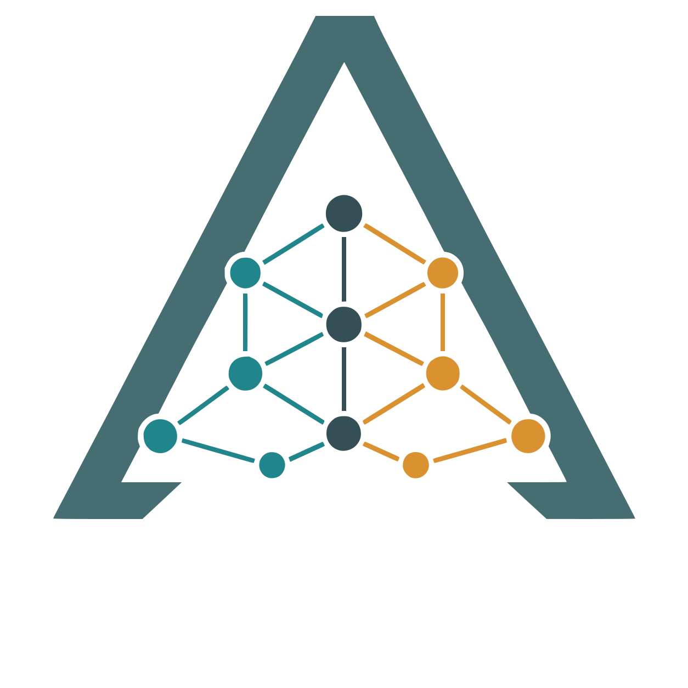

<p align="center">
  <picture>
    <source media="(prefers-color-scheme: dark)" srcset="images/logos/Ariadne_WhiteText.svg">
    <source media="(prefers-color-scheme: light)" srcset="images/logos/Ariadne_BlackText.svg">
    
  </picture>
</p>

<p align="center">
  <strong>Live, read-only federated querying across cybersecurity knowledge graphs that don't share a query language</strong><br>
  one layer plans, queries, and synthesizes analyst-facing answers across engines
  instead of forcing an offline merge into a single graph.
</p>

<p align="center">
  
  
  
  
</p>

Cybersecurity teams increasingly rely on knowledge graphs to represent adversary techniques, attack patterns, and mitigations — but those sources live on different engines with different schemas and query languages, so cross-source correlation today usually means manual lookups or an offline ETL into one graph. Most existing federation approaches assume a single engine or require that translation step up front.

Ariadne instead reads schema and metadata from each **live** source and routes queries natively per engine — Cypher against Neo4j, Gremlin against a Neptune-style server — reconciling results by shared identifiers (ATT&CK technique IDs, CAPEC IDs) rather than a shared index. Every claim in the answer cites a retrieved record and the query that produced it, and the system abstains rather than guesses when a request falls outside the declared schema. Grounding comes entirely from schema descriptions, source metadata, and executed queries; **no vector index or embedding store** is built from the graph data. Named after Ariadne — who guided Theseus through the labyrinth — it threads adversary-technique, attack-pattern, and mitigation graphs into one provenance-linked answer.

**Funded by:** ReliaQuest Innovation Challenge Fund — Challenge Three: Knowledge Graph Integration (award period June 8 – October 23, 2026)

## Research record

This is a research repository. All experiments, results, figures, and findings
live in [`docs/research/`](docs/research/). Nothing that will appear in a paper
is recorded anywhere else. Before running an experiment, read
[`docs/research/AGENT_INSTRUCTIONS.md`](docs/research/AGENT_INSTRUCTIONS.md).

<p align="center">
  
</p>

## What actually runs

Ariadne is **deterministic by default, with LLM seams that are opt-in and individually backstopped**. This is a design decision the project's own evaluation supports (see [Results](#results)), and it is worth stating plainly because the architecture diagram alone does not show it:

| Stage | Default behavior | LLM seam |
|---|---|---|
| **Planning** | Deterministic drafter: intent classified by a closed regex taxonomy, sources and entities matched against schema labels from the source cards, plan checked by a deterministic self-eval gate ([`utils/planner/`](utils/planner/)) | `PLANNER_LLM_ENABLED` (default `false`) swaps in an OpenAI-compatible drafter, always backstopped by the deterministic one; `--plan-llm` / `--query-llm` enable it per invocation |
| **Query construction** | **Always deterministic.** An if-cascade over **25 distinct read-only query templates, of which 19 are exercised by the 120-question bank** — 17 declared in the Cypher builder and 11 in the Gremlin builder, with `describe`, `describe_by_name` and `expand` declared in both — each validated against the source card before execution ([`utils/specialists/cypher/builder.py`](utils/specialists/cypher/builder.py), [`gremlin/builder.py`](utils/specialists/gremlin/builder.py)) | **None.** No LLM writes a query in this system |
| **Retrieval loop** | `assess → re-plan → specialists`, capped at `ORCH_MAX_HOPS` (default 5), with a deterministic sufficiency judge over join closure ([`utils/orchestration/`](utils/orchestration/)) | `ORCH_ASSESS_MODE=llm` swaps in a "what's missing" critic with clean fallback; `ORCH_CHASE_FACETS` (default off) extends the frontier to un-fetched facets |
| **Synthesis** | **Claims are always composed deterministically** and every one is checked against the retrieved evidence by an unconditional verifier — uncited or ungrounded claims are cut, honest empties become abstentions carrying the executed query as proof ([`utils/synthesis/`](utils/synthesis/)) | `SYNTHESIS_LLM_ENABLED` (default `false`) lets an LLM rewrite the **narrative prose** over the already-verified claims. It cannot add a claim |

Every LLM-off path is byte-reproducible, which is what makes the committed evaluation reports citable.

## Quick Start

One command takes a fresh clone all the way to a running workbench:

```bash
python3 setup.py              # interactive — inspect and confirm each step
python3 setup.py --yes        # non-interactive, accept every default
python3 setup.py --no-launch  # set everything up, then just print the commands
```

The wizard walks five steps, showing what each will run and skipping work already done, so re-running is cheap:

1. **Prerequisites** — checks for `uv`, Node.js, and Docker (CLI + Compose v2 + a running daemon).
2. **`.env`** — creates it from `.env.example`; optionally customize ports and the Neo4j login.
3. **Local inference server** — configures the OpenAI-compatible LLM endpoint (optional) and **probes it**, so you know it's reachable before you query.
4. **Data pipeline** — download MITRE ATT&CK + CAPEC → build canonical graphs → start the Docker stack → load both graphs → verify (the self-healing `--yolo-all` runner).
5. **Web dependencies** — `npm install` for the Next.js workbench.

It then prints the copy-paste commands below and launches the workbench at `http://localhost:16500`.

### Prerequisites

| Tool | Version | Role |
|------|---------|------|
| [uv](https://docs.astral.sh/uv/) | latest | Python env + dependency manager (the wizard offers to install it) |
| Docker | Engine + Compose v2 | Runs the pinned local Neo4j + Gremlin stack |
| Node.js | 18.18+ | Builds and serves the analyst web workbench |
| OpenAI-compatible LLM server | *optional* | e.g. vLLM / LM Studio / llama.cpp / Ollama at `http://localhost:9090/v1`. Without one, the pipeline runs fully deterministically — and, per the evaluation below, slightly more accurately. |

### Everyday commands

| Goal | Command |
|------|---------|
| One-shot setup | `python3 setup.py` &nbsp;(`--yes` non-interactive · `--no-launch` set up only) |
| Start the graph databases (Docker) | `uv run main.py --docker start` |
| Ask a federated question (CLI) | `uv run main.py --query "…"` &nbsp;(add `--query-llm` to plan through the LLM) |
| Launch the analyst web workbench | `uv run app.py` &nbsp;→ web `:16500`, api `:16501` |
| Run the whole data pipeline in one shot | `uv run main.py --yolo-all` |
| Component / end-to-end evaluation | `uv run main.py --component-eval` · `--e2e-eval` |

The complete, verified command reference — every flag on `setup.py`, `app.py`, and `main.py` — is [`docs/commands.md`](docs/commands.md).

<details>
<summary>Manual setup (step by step)</summary>

```bash
# Python setup & dataset download
uv sync
cp .env.example .env
uv run main.py --download

# Build canonical graph artifacts (ATT&CK + CAPEC)
uv run main.py --build all

# Local graph databases (Docker)
uv run main.py --docker start

# Load built artifacts into the live databases
uv run main.py --dataset attack --graph all
uv run main.py --dataset capec --graph gremlin

# Ask a federated question
uv run main.py --query "Which CAPEC patterns related to credential theft map to ATT&CK techniques, and what mitigations appear for those techniques?"

# Web workbench (FastAPI + Next.js)
cd web && npm install && npm run dev
```

</details>

All settings live in a single git-ignored `.env` (`cp .env.example .env` — every value defaults to current behavior). Repository navigation map and output-artifact tables: [`docs/structure.md`](docs/structure.md).

## Architecture

Four components, each independently testable:

| # | Component | Role |
|---|-----------|------|
| 1 | **Data & schema layer** | Per-source cards (connection details, schema, provenance fields, safety limits) plus reproducible ATT&CK and CAPEC fixtures, sha256-pinned against the raw source snapshot. |
| 2 | **Federated planning agent** | Reads the source cards, classifies analyst intent against a closed taxonomy, and emits a machine-readable plan (target sources, sub-questions, join keys, traversal limits) rather than routing by free-text guess. |
| 3 | **Source-specific query specialists** | A Cypher specialist (Neo4j) and a Gremlin specialist (bounded traversals). Each compiles a read-only template, validates it against the source card, enforces the card's safety limits, and returns normalized, evidence-linked records. |
| 4 | **Synthesis & reporting agent** | Reconciles partial evidence across sources by joining on shared IDs, flags conflicts, and assembles the answer as verified claims-with-citations — every claim checked against the evidence, unsupported claims cut, honest empties turned into abstentions with the executed query as proof. |

**Example flow** — *"Which CAPEC patterns related to credential theft map to ATT&CK techniques, and what mitigations appear for those techniques?"*
The planner emits a CAPEC sub-task and an ATT&CK sub-task → the **Gremlin** specialist finds CAPEC-560/565 mapping to T1555 → the **Cypher** specialist retrieves T1555's mitigations (M1026, M1027) → the synthesis agent joins on the ATT&CK ID and returns a provenance-linked answer.

Full component contracts: [`docs/planner_agent.md`](docs/planner_agent.md), [`docs/specialist_agents.md`](docs/specialist_agents.md), [`docs/agent-interfaces.md`](docs/agent-interfaces.md).

## Tech Stack

| Layer | Technology |
|-------|------------|
| Language / tooling | **Python 3.13**, `uv` for env + dependency management |
| Pipeline | **LangGraph** — the Q/A flow is a compiled `StateGraph` ([`utils/orchestration/`](utils/orchestration/)): planner, specialists, and synthesis as subgraphs streaming the workbench's SSE events; `langgraph dev` opens the visual debugger via `langgraph.json`. A second graph ([`utils/conversation/`](utils/conversation/)) wraps that pipeline behind an orchestration → router → {memory-grounded answer \| extraction → validation → answer} flow. |
| Graph backends | **Neo4j** (Cypher) + **Gremlin Server** (Neptune-style) — two engines with genuinely different query models, not two configs of one. |
| API | **FastAPI** — thin layer wrapping the Python packages for the web workbench. |
| Frontend | **Next.js / React** (`react-force-graph-2d`) — analyst-facing graph explorer UI. |
| Infrastructure | **Docker Compose** — pinned local Neo4j + Gremlin stack. |

## Key Features

- **Plan-first routing** — the planning agent emits a structured, machine-checkable plan before any specialist runs a query, and a deterministic gate rejects plans that don't validate against the source cards.
- **Bounded, validated queries** — every query is a read-only template gated against the card's declared labels, relationship types, row cap, and traversal depth before execution. A task naming an entity the card doesn't model returns an honest empty with a `boundary` trace instead of silently answering a different question.
- **Verified answers, not generated ones** — claims are composed from the evidence and checked by an unconditional verifier; unsupported claims are cut and kept visible, and abstentions carry the executed query as proof.
- **Reproducible graph artifacts** — a canonical (JSONL + schema + manifest) → export (Neo4j CSV/Cypher, Gremlin JSONL) → runtime layering, sha256-pinned to the raw source, with a fixture-QA harness that reconciles raw == manifest == live before agents ever query it.
- **Self-healing pipeline runner** (`--yolo-all`) — classifies failures as stale-state (auto-backup + rebuild), transient (retry with backoff), or needs-human (surfaced, not crashed on), instead of failing the whole run on the first error.
- **Memory-inclusive chat threads** — the workbench is a threaded chat: persisted conversations in a date-grouped sidebar (stdlib-SQLite, LLM auto-titled), cross-turn memory so a follow-up ("tell me more about T1598") resolves from prior turns, and a router that answers from memory when it can or re-queries the graphs when it must — with the grounded Answer Card kept as the trust surface beneath every reply.
- **Analyst web workbench** — a Next.js app with three surfaces: a **chat view** streaming the live plan → query → evidence → answer pipeline, an **interactive graph explorer** (switch between the ATT&CK/Neo4j and CAPEC/Gremlin graphs, render every node and edge on canvas, search, filter by node/relationship type, inspect any element's properties), and an **evaluation view** that renders the committed component + end-to-end reports and can re-run the end-to-end evaluation live.
- **A launcher that proves the stack** — `uv run app.py` preflights everything the pipeline needs (toolchain, ports, source cards, both graph backends, the LLM endpoint, and a compile of the LangGraph super-graph), gates on real readiness probes, prints a status board with per-subsystem verdicts and named remediations, and streams a startup smoke query over the same SSE contract the UI uses.

## Results

The standing record is [`docs/evaluation/2026-07-26/`](docs/evaluation/2026-07-26/README.md): seven full runs over the 120-question golden catalogue against the live graphs, each answer graded by an **independent Sonnet 5 agent** (one per question, 840 agents in total) against the question's gold assertions *and* its full retrieved evidence. Cross-model on purpose — the pipeline's own model does not grade its own output.

| Configuration | Plan | Synthesize | correctness | verdicts | hallucinations | wall clock |
|---|---|---|---|---|---|---|
| **A — deterministic** | authored | deterministic | **0.9972** | **120/0/0** | **0** | **1.6 s** |
| **F — determ. + loop + LLM writer** | authored | LLM over verified claims | 0.9957 | 119/1/0 | 3 | 533 s |
| E — LLM-planned + loop | **LLM** | LLM over verified claims | 0.8560 | 97/7/16 | 15 | 1,043 s |
| B — LLM-planned | **LLM** | LLM over verified claims | 0.8505 | 92/14/14 | 12 | 1,020 s |

*(verdicts = CORRECT / PARTIAL / INCORRECT)*

Three findings drove the current defaults:

1. **LLM planning is where the loss concentrates.** Holding extraction and synthesis constant, the LLM-planned arm loses **0.119 correctness** against its deterministic-planned counterpart (B 0.8505 vs C 0.9690), and **0.140** against the best deterministic-planned arm (E 0.8560 vs F 0.9957). A mechanical failure-localisation pass showed only 2 of Arm B's 36 failures were faithfulness — 26 of 36 were planning or retrieval, the opposite of the intuition that LLM answers fail by making things up.
2. **Retrieval volume is not the lever.** Arm B retrieves 2.6× more evidence than Arm F and surfaces 20% *less* of the gold.
3. **The accuracy-versus-readability trade is not real** — once the narrator is bound to the *verified claims* rather than left to re-read raw evidence, readable prose costs 0.0015 correctness with zero INCORRECT verdicts.

Component and end-to-end reports, deterministic and reproducible: source recall 1.0 / schema adherence 1.0 on the planner corpus, query validity at the ceiling **by construction** (the specialists fill templates rather than free-generating), 100% block rate on adversarial safety probes, cross-source join exact-set-match 30/30, CAPEC→ATT&CK mapping recall 113/113, provenance completeness 120/120. See [`docs/evaluation/`](docs/evaluation/README.md).

### What these numbers do and don't show

Recorded here so they are not over-read, and expanded in the standing record's limitations section:

- **All 120 questions are anchored** — every one names an entity or an id. Nothing here measures open-ended analyst questions, which is where a template router is weakest.
- **The catalogue was authored alongside the system** and is used for development, not held out. Each question carries an `expected_template` field.
- **No alternative system was implemented**, so the federation approach has not been contrasted against a text-to-query baseline or a merged-single-graph baseline.
- **The judge is a model.** Cross-model and evidence-grounded, but still an LLM, and its verdicts are not perfectly stable across runs.
- **One model, one day** (`skynet`, vLLM). Nothing here generalises to other models without re-running.

The portability question — what survives a dataset that isn't MITRE — is audited in [`docs/evaluation/2026-07-26/portability.md`](docs/evaluation/2026-07-26/portability.md): the harness, orchestration, and card-driven `describe`/`expand` primitives are schema-agnostic; 19 of the **25 distinct query templates** are MITRE-specific, as are the id regexes, the canonical join key, and the question catalogue, and all of those would need re-authoring.

## Challenges & Design Decisions

**One plan schema, two query languages.** Cypher and Gremlin don't share a traversal model, so the planner can't emit engine-specific queries itself without becoming two planners. It instead emits an engine-agnostic plan (sub-questions, entities, join keys, traversal limits) and pushes engine-specific query construction down into each specialist — keeping the planner swappable and the specialists independently testable. Adding a third query language is documented as four targeted changes in [`docs/migration-guide.md`](docs/migration-guide.md).

**Templates over free generation.** The specialists compile hand-written, card-validated templates instead of letting a model write Cypher or Gremlin. The cost is coverage: a question shape nobody wrote a template for falls back to a schema-driven `describe`. The benefit is that query validity and safety adherence hold by construction, and the evaluation above says the accuracy trade runs in the same direction.

**Reproducibility against a live, external data source.** MITRE ATT&CK and CAPEC change over time, but behavior needs to be reproducible for evaluation. The build pipeline pins a sha256 snapshot of the raw source at download time and gates every rebuild on that pin, with a fixture-QA harness that checks raw == manifest == live before anything is loaded — catching schema drift before it reaches an agent instead of after.

## Status

The data layer, the federated planning agent, both query specialists, the verifying synthesis agent, and the end-to-end pipeline integration are complete: one LangGraph `StateGraph` orchestrator ([`utils/orchestration/`](utils/orchestration/), shared by the CLI and the API through `run_pipeline`/`iter_pipeline`) runs plan → dependency-sequenced specialists → assess → verified synthesis with per-stage latency. An analyst web workbench sits on top — chat, graph explorer, and evaluation dashboard.

Component-level evaluation (`--component-eval`) and end-to-end evaluation (`--e2e-eval`) are complete and committed, as is the controlled seven-arm study that produced the results above. The Wk 14–15 technical documentation set is delivered: source card format ([`docs/source_cards.md`](docs/source_cards.md)), agent interface contracts ([`docs/agent-interfaces.md`](docs/agent-interfaces.md)), the query safety model ([`docs/query-safety.md`](docs/query-safety.md)), and the openCypher/GQL migration guide ([`docs/migration-guide.md`](docs/migration-guide.md), proposal Deliverable #6).

**In progress (Wk 14–15):** bug-fix iteration and documentation hardening. **Next:** pitch prep and the final demo (Wk 15–16). Known open work, in priority order, is listed in the standing evaluation record: LLM planning quality, pipeline timeouts on the LLM arms, narrator count discipline, and the unmeasured open-ended-question case.

## Documentation

| Document | Description |
|----------|--------------|
| [`docs/purpose.md`](docs/purpose.md) | Problem, architecture, data sources, team |
| [`docs/goals.md`](docs/goals.md) | Full roadmap, evaluation criteria, deliverables |
| [`docs/structure.md`](docs/structure.md) | Repository navigation map and output-artifact reference |
| [`docs/commands.md`](docs/commands.md) | Every CLI command, verified against the parsers |
| [`docs/planner_agent.md`](docs/planner_agent.md) | Planning agent contract: discovery, gate, plan schema |
| [`docs/specialist_agents.md`](docs/specialist_agents.md) | Query specialists: loop, validation, evidence schema, federation |
| [`docs/query-safety.md`](docs/query-safety.md) | The safety model by enforcement point |
| [`docs/migration-guide.md`](docs/migration-guide.md) | Adding a new query-language specialist |
| [`docs/evaluation/README.md`](docs/evaluation/README.md) | Which evaluation report is current, and what each measures |
| [`docs/research/`](docs/research/README.md) | **The research record.** Every experiment, claim, decision, figure, and open question |
| [`docs/research/INDEX.md`](docs/research/INDEX.md) | Auto-generated table of every recorded experiment |
| [`docs/research/CLAIMS.md`](docs/research/CLAIMS.md) | Claim → experiment → artifact ledger, with what is and is not supported |
| [`docs/research/audit-2026-08-03.md`](docs/research/audit-2026-08-03.md) | External research audit: novelty, positioning, blocking gaps |
| [`docs/skills/global-project-rules/SKILL.md`](docs/skills/global-project-rules/SKILL.md) | Agent workflow rules (read first) |
| [`NOTICE`](NOTICE) | MITRE ATT&CK® and CAPEC™ attribution, licence text, and the pinned dataset versions |

## Data attribution

Ariadne is built on MITRE ATT&CK® and MITRE CAPEC™, used under their respective
terms of use. The required attribution, the licence and disclaimer text, and the
exact snapshots in use (ATT&CK 19.0, CAPEC 3.9, with SHA256 pins) are in
[`NOTICE`](NOTICE). Ariadne is not affiliated with or endorsed by The MITRE
Corporation.

## Team

| Role | Person |
|------|--------|
| Principal Investigator | Olmo S. Zavala Romero — Assistant Professor, FSU Department of Scientific Computing |
| Graduate RA / technical lead | Brendon DGR — prototype implementation, evaluation, documentation |

## Repository Layout

```text
main.py   CLI: download, build, docker, load/verify, plan, query, evaluate
app.py    Workbench launcher: preflight → FastAPI + Next.js → status board → smoke query
setup.py  One-command setup wizard
api/      FastAPI service wrapping utils/ for the web UI
docker/   Neo4j and Gremlin Compose stack (pinned image versions)
docs/     Purpose, goals, structure, commands, skills, evaluation, research, changelog
utils/    download · kg_builder · graph_loader · infrastructure · planner ·
          specialists · synthesis · orchestration · conversation · evaluation · launcher
web/      Analyst-facing workbench (Next.js App Router)
```

Agent pointer folders (`.claude/`, `.agents/`, `.cursor/`) route to canonical instructions under [`docs/skills/`](docs/skills/) and contain no instructions of their own.

## Roadmap — Week by Week

Full task rationale in [`docs/goals.md`](docs/goals.md); change history in [`docs/changelog.jsonl`](docs/changelog.jsonl).

| Status | Weeks | Phase | Task | Difficulty |
| :---: |-------|-------|------|------------|
| ✅ | Wk 1–2 | Setup | Environment and tooling setup | Low |
| ✅ | Wk 2–3 | Setup | Download and validate public data sources | Low |
| ✅ | Wk 3–4 | Data layer | Build portable ATT&CK graph artifacts (JSONL, schema, Neo4j CSV/Cypher) | Medium |
| ✅ | Wk 4 | Data layer | Runtime ATT&CK graph loader (Neo4j/Gremlin load, verify, health) | Medium |
| ✅ | Wk 4–5 | Data layer | Build Gremlin CAPEC fixture | Medium |
| ✅ | Wk 4–5 | Data layer | Fixture-QA harness (raw==manifest==live) + sha256-pinned data snapshot | Medium |
| ✅ | Wk 5 | Data layer | Author source cards (auto-generated base + hand-authored overlays: connection, provenance, safety limits) | Low |

**ITS check-in** — Both graph fixtures live and QA-reconciled against the pinned ATT&CK v19.0 / CAPEC v3.9 snapshot, source cards complete, environment reproducible.

| Status | Weeks | Phase | Task | Difficulty |
| :---: |-------|-------|------|------------|
| ✅ | Wk 6–7 | Agents | Federated planning agent | High |
| ✅ | Wk 7–8 | Agents | Cypher specialist agent | High |
| ✅ | Wk 8–9 | Agents | Gremlin specialist agent | High |

**Midpoint review** — All three agents (planner + Cypher + Gremlin) functional and running end-to-end against the live Neo4j + Gremlin stack.

| Status | Weeks | Phase | Task | Difficulty |
| :---: |-------|-------|------|------------|
| ✅ | Wk 10 | Agents | Synthesis and reporting agent | High |
| ✅ | Wk 10–11 | Agents | End-to-end integration and pipeline wiring | Medium |
| ✅ | Wk 11–13 | Evaluation | Component-level evaluation (planner + specialist scorers, `--component-eval` report) | Medium |
| ✅ | Wk 12–13 | Evaluation | End-to-end evaluation and LLM evaluator (`--e2e-eval` report, opt-in LLM judge, web Evaluation view) | Medium |

**Pitch workshop** — Evaluation results compiled, demo stable, narrative prepared.

| Status | Weeks | Phase | Task | Difficulty |
| :---: |-------|-------|------|------------|
| 🔄 | Wk 14–15 | Evaluation | Bug fixes, iteration, and documentation — technical documentation set delivered; bug-fix and hardening half in progress | Low |
| ⬜ | Wk 15–16 | Pitch prep | Pitch preparation and final demo | Low |

**October ReliaQuest pitch** — Live demo, evaluation results, and future development roadmap presented.
