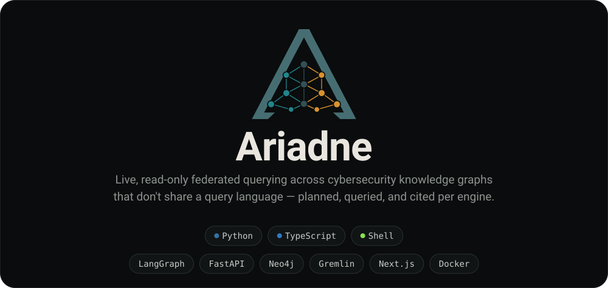
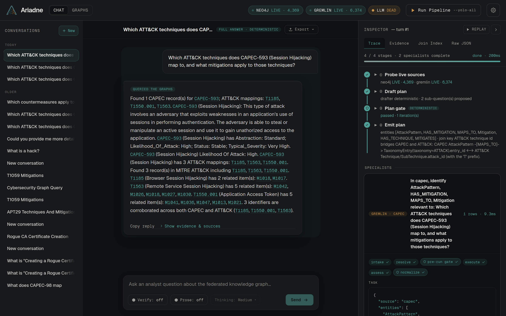

<!-- Banner generated by scripts/make_header.py from images/logos/Ariadne_LogoONLY.svg.
     Edit TITLE/TAGLINE/chips there and re-run; do not hand-edit images/header.svg. -->
<p align="center">
  
</p>

<!-- The banner carries a tagline that says the same thing as the sentence below.
     If you change what Ariadne is, change both: the tagline lives in TAGLINE in
     scripts/make_header.py, which regenerates images/header.svg and its alt text. -->
Ariadne answers a security analyst's question across live cybersecurity knowledge graphs that do not share a query language, and every claim it returns cites the record and the query behind it. It queries each graph in its own language — Cypher for Neo4j, Gremlin for a TinkerPop server — and joins the results on identifiers the graphs already share, such as ATT&CK technique and CAPEC IDs, without merging them into one store.

<p align="center">
  
</p>

## How It Works

1. **Plan** — the question becomes a plan: which graphs to ask, what to ask each one, and which shared IDs join the answers.
2. **Query** — each graph is queried in its own language with a read-only, bounded query checked against that graph's schema.
3. **Join** — the results are combined on the IDs the graphs share.
4. **Verify** — every claim in the answer is checked against the retrieved records and cites its source. If nothing holds up, Ariadne says so and shows the query it ran.

## Prerequisites

| Tool | Version | Used for |
|------|---------|----------|
| [uv](https://docs.astral.sh/uv/) | latest | Python environment and dependencies (setup offers to install it) |
| [Docker](https://docs.docker.com/get-docker/) | Engine + Compose v2 | The local Neo4j and Gremlin databases |
| [Node.js](https://nodejs.org/) | 18.18+ | The web workbench |
| OpenAI-compatible LLM server | optional | Not required — everything runs without a model |

## Getting Started

```bash
git clone https://github.com/brendondgr/Ariadne.git
cd Ariadne
python3 setup.py
```

The setup wizard checks the prerequisites, creates `.env`, downloads MITRE ATT&CK and CAPEC, builds and loads both graphs into Docker, installs the web dependencies, and opens the workbench at `http://localhost:16500`. Add `--yes` to accept every default.

After setup:

| To | Run |
|----|-----|
| Start the graph databases | `uv run main.py --docker start` |
| Open the web workbench | `uv run app.py` → `http://localhost:16500` |
| Ask a question from the terminal | `uv run main.py --query "Which ATT&CK techniques does CAPEC-593 map to, and what mitigations apply to them?"` |

Every command and flag is in [`docs/commands.md`](docs/commands.md).

## More

- How each stage works: [`docs/ARCHITECTURE.md`](docs/ARCHITECTURE.md)
- Research results and how to reproduce them: [`docs/RESULTS.md`](docs/RESULTS.md)
- Code is licensed under [Apache 2.0](LICENSE). MITRE ATT&CK® and CAPEC™ data carry their own terms of use, given in [`NOTICE`](NOTICE); Ariadne is not affiliated with or endorsed by The MITRE Corporation.
- Developed at Florida State University (PI: Olmo S. Zavala Romero) with funding from the ReliaQuest Innovation Challenge Fund.
