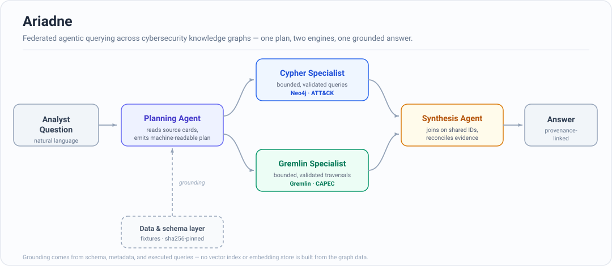

# Ariadne

Live, read-only federated querying across cybersecurity knowledge graphs that don't share a query language — one agentic layer plans, queries, and synthesizes analyst-facing answers across engines instead of forcing an offline merge into a single graph.

Named after Ariadne, who guided Theseus through a maze — this system threads together adversary technique, attack-pattern, and mitigation knowledge graphs to guide analysts through the same kind of labyrinth.

**Funded by:** ReliaQuest Innovation Challenge Fund — Challenge Three: Knowledge Graph Integration (award period June 8 – October 23, 2026)

<p align="center">
  
</p>

## Overview

Cybersecurity teams increasingly rely on knowledge graphs to represent adversary techniques, attack patterns, and mitigations, but those sources live on different engines with different schemas and query languages — cross-source correlation today usually means manual lookups or an offline ETL into one graph. Most existing federation approaches assume a single engine or require that translation step up front.

Ariadne instead reads schema and metadata from each live source and routes queries natively per engine — Cypher against Neo4j, Gremlin against a Neptune-style server — reconciling the results by shared identifiers (ATT&CK technique IDs, CAPEC IDs) rather than a shared index. Grounding comes entirely from schema descriptions, source metadata, and executed queries; **no vector index or embedding store** is built from the graph data.

## Architecture

The diagram above shows the runtime flow end to end. Four components, each independently testable:

1. **Data & schema layer** — per-source cards (connection details, schema, provenance fields, safety limits) plus reproducible ATT&CK and CAPEC fixtures, sha256-pinned against the raw source snapshot.
2. **Federated planning agent** — reads the source cards, classifies analyst intent, and emits a machine-readable plan (target sources, sub-questions, join keys, traversal limits) rather than routing by free-text guess.
3. **Source-specific query agents** — a Cypher specialist (Neo4j) and a Gremlin specialist (bounded traversals), each validating its own queries, enforcing safety constraints, and returning normalized, evidence-linked summaries.
4. **Synthesis & reporting agent** *(in progress)* — reconciles partial evidence across sources by joining on shared IDs, flags conflicts, and assembles a provenance-linked answer.

**Example flow** — *"Which CAPEC patterns related to credential theft map to ATT&CK techniques, and what mitigations appear for those techniques?"*
Planner emits a CAPEC sub-task and an ATT&CK sub-task → Gremlin specialist finds CAPEC-560/565 mapping to T1555 → Cypher specialist retrieves T1555's mitigations (M1026, M1027) → synthesis agent joins on the ATT&CK ID and returns a provenance-linked answer.

Full component contracts: [`docs/planner_agent.md`](docs/planner_agent.md), [`docs/specialist_agents.md`](docs/specialist_agents.md).

## Tech Stack

- **Python 3.13**, `uv` for env/dependency management
- **Neo4j** (Cypher) + **Gremlin Server**, Neptune-style — two backends with genuinely different query models, not two configs of the same one
- **FastAPI** — thin API layer wrapping the Python agents for the web workbench
- **Next.js / React** (`react-force-graph-2d`) — analyst-facing graph explorer UI
- **Docker Compose** — pinned local Neo4j + Gremlin stack

## Key Features

- **Plan-first routing** — the planning agent emits a structured, machine-checkable plan (not a free-text guess) before any specialist runs a query.
- **Bounded, validated queries** — each specialist enforces its own safety limits and validates queries before execution; no unbounded traversals reach the live graph.
- **Reproducible graph artifacts** — a canonical (JSONL + schema + manifest) → export (Neo4j CSV/Cypher, Gremlin JSONL) → runtime layering, sha256-pinned to the raw source, with a fixture-QA harness that reconciles raw == manifest == live before agents ever query it.
- **Self-healing pipeline runner** (`--yolo-all`) — classifies failures as stale-state (auto-backup + rebuild), transient (retry with backoff), or needs-human (surfaced, not crashed on), instead of failing the whole run on the first error.
- **Analyst web workbench** — a Next.js app with two surfaces: a **chat view** that streams the live plan → query → evidence → answer pipeline, and an **interactive graph explorer** — switch between the ATT&CK/Neo4j and CAPEC/Gremlin graphs, render every node and edge on canvas, search by node title/description or edge type, filter by node/relationship type, and click any element to inspect its properties.

## Setup

```bash
# Python setup & dataset download
uv sync
cp .env.example .env
uv run main.py --download
uv run read-skills

# Build canonical graph artifacts (ATT&CK + CAPEC)
uv run main.py --build all

# Local graph databases (Docker)
uv run main.py --docker start

# Load built artifacts into the live databases
uv run main.py --dataset attack --graph all
uv run main.py --dataset capec --graph gremlin

# Ask a federated question
uv run main.py --query "Which CAPEC patterns related to credential theft map to ATT&CK techniques, and what mitigations appear for those techniques?"

# Web workbench (FastAPI + Next.js)
cd web && npm install && npm run dev
```

Or the whole download → build → docker → load → verify pipeline in one shot:

```bash
uv run main.py --yolo-all
```

All settings live in a single git-ignored `.env` (`cp .env.example .env` — every value defaults to current behavior). Full CLI reference, output artifact tables, and Docker endpoint details: [`docs/structure.md`](docs/structure.md).

## Challenges & Design Decisions

**One plan schema, two query languages.** Cypher and Gremlin don't share a traversal model, so the planner can't emit engine-specific queries itself without becoming two planners. It instead emits an engine-agnostic plan (sub-questions, entities, join keys, traversal limits) and pushes engine-specific query construction down into each specialist — keeping the planner swappable and the specialists independently testable.

**Reproducibility against a live, external data source.** MITRE ATT&CK and CAPEC change over time, but agent behavior needs to be reproducible for evaluation. The build pipeline pins a sha256 snapshot of the raw source at download time and gates every rebuild on that pin, with a fixture-QA harness that checks raw == manifest == live before anything is loaded — catching schema drift before it reaches an agent instead of after.

## Status

The data layer, the federated planning agent, both query specialists (Cypher over Neo4j, Gremlin over a Neptune-style server), the verifying synthesis agent, and the end-to-end pipeline integration are complete: one `run_pipeline` orchestrator (shared by the CLI and the API) runs plan → dependency-sequenced specialists → verified synthesis with per-stage latency, and the proposal's flagship credential-theft flow matches its snapshot-derived gold live (18/18 cross-source correlations, 64/64 technique→mitigation pairs, unsupported-claim rate 0%). An analyst web workbench sits on top — a chat view over the live pipeline plus an interactive graph explorer. Next up: formal component + end-to-end evaluation. See the [week-by-week roadmap](#roadmap--week-by-week) at the bottom for the full milestone checklist.

## Documentation

| Document | Description |
|----------|--------------|
| [`docs/purpose.md`](docs/purpose.md) | Problem, architecture, data sources, team |
| [`docs/goals.md`](docs/goals.md) | Full roadmap, evaluation criteria, deliverables |
| [`docs/structure.md`](docs/structure.md) | Repository navigation map, full CLI/output reference |
| [`docs/planner_agent.md`](docs/planner_agent.md) | Planning agent contract, discovery, gate, plan schema |
| [`docs/specialist_agents.md`](docs/specialist_agents.md) | Query specialists: loop, validation, evidence schema, federation |
| [`docs/skills/global-project-rules/SKILL.md`](docs/skills/global-project-rules/SKILL.md) | Agent workflow rules (read first) |

## Team

| Role | Person |
|------|--------|
| Principal Investigator | Olmo S. Zavala Romero — Assistant Professor, FSU Department of Scientific Computing |
| Graduate RA / technical lead | Brendon DGR — prototype implementation, evaluation, documentation |

## Repository Layout

```text
docker/   Neo4j and Gremlin Compose stack (pinned image versions)
docs/     purpose, goals, skills, changelog, plans, structure.md
utils/    Python utilities (download, kg_builder, graph_loader, infrastructure, planner, specialists)
api/      FastAPI service wrapping utils/ for the web UI
web/      Analyst-facing graph explorer (Next.js)
```

Agent pointer folders (`.claude/`, `.agents/`, `.cursor/`) route to canonical instructions under `docs/skills/`.

## Roadmap — Week by Week

Full task rationale in [`docs/goals.md`](docs/goals.md); change history in [`docs/changelog.jsonl`](docs/changelog.jsonl).

| Status | Weeks | Phase | Task | Difficulty |
| :---: |-------|-------|------|------------|
| ✅ | Wk 1–2 | Setup | Environment and tooling setup | Low |
| ✅ | Wk 2–3 | Setup | Download and validate public data sources | Low |
| ✅ | Wk 3–4 | Data layer | Build portable ATT&CK graph artifacts (JSONL, schema, Neo4j CSV/Cypher) | Medium |
| ✅ | Wk 4 | Data layer | Runtime ATT&CK graph loader (Neo4j/Gremlin load, verify, health) | Medium |
| ✅ | Wk 4–5 | Data layer | Build Gremlin CAPEC fixture | Medium |
| ✅ | Wk 4–5 | Data layer | Fixture-QA harness (raw==manifest==live) + sha256-pinned data snapshot | Medium |
| ⬜ | Wk 5 | Data layer | Author source cards (ATT&CK card auto-generated; endpoints & safety limits pending) | Low |

**ITS check-in** — Both graph fixtures live and QA-reconciled against the pinned ATT&CK v19.0 / CAPEC v3.9 snapshot, source cards complete, environment reproducible.

| Status | Weeks | Phase | Task | Difficulty |
| :---: |-------|-------|------|------------|
| ✅ | Wk 6–7 | Agents | Federated planning agent | High |
| ✅ | Wk 7–8 | Agents | Cypher specialist agent | High |
| ✅ | Wk 8–9 | Agents | Gremlin specialist agent | High |

**Midpoint review** — All three agents (planner + Cypher + Gremlin) functional and running end-to-end against the live Neo4j + Gremlin stack.

| Status | Weeks | Phase | Task | Difficulty |
| :---: |-------|-------|------|------------|
| ✅ | Wk 10 | Agents | Synthesis and reporting agent | High |
| ✅ | Wk 10–11 | Agents | End-to-end integration and pipeline wiring | Medium |
| ⬜ | Wk 11–13 | Evaluation | Component-level evaluation | Medium |
| ⬜ | Wk 12–13 | Evaluation | End-to-end evaluation and LLM evaluator | Medium |

**Pitch workshop** — Evaluation results compiled, demo stable, narrative prepared.

| Status | Weeks | Phase | Task | Difficulty |
| :---: |-------|-------|------|------------|
| ⬜ | Wk 14–15 | Evaluation | Bug fixes, iteration, and documentation | Low |
| ⬜ | Wk 15–16 | Pitch prep | Pitch preparation and final demo | Low |

**October ReliaQuest pitch** — Live demo, evaluation results, and future development roadmap presented.
