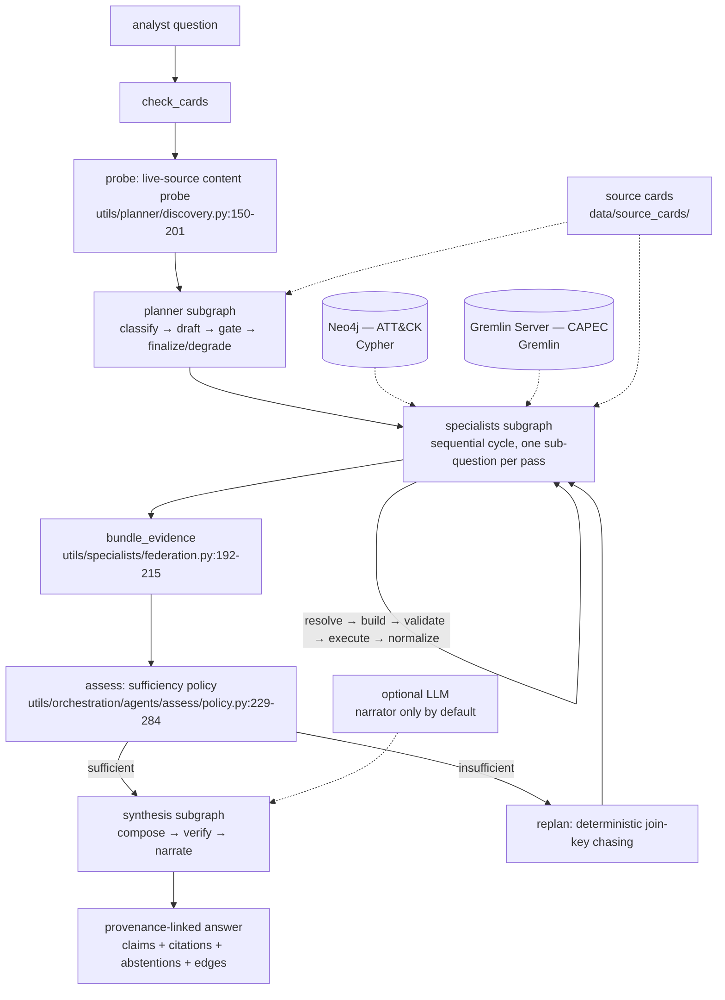

# Ariadne — Research Audit

> **Archived snapshot.** This is a dated analysis of the repository as it stood
> on 3 August 2026, kept verbatim as the record of how the project looked to an
> outside reviewer at that moment. Several documentation defects it identifies
> — the README's agentic framing, the inverted specialist roles in
> `docs/purpose.md`, and the unreproducible −0.196 arm delta — were fixed on
> 4 August 2026 (see `docs/plans/documentation-accuracy-purge-plan.md`); its
> findings about the *system* and about research positioning stand. Do not
> update this file in place; write a new dated audit instead.

**Prepared:** 3 August 2026
**Repository:** `/home/bdgr/Agents/Ariadne` @ `main` (455 commits, 11 June – 27 July 2026)
**Method:** every architectural statement traces to a file and line in the repository; every cited paper was retrieved during this session. See §10 for what could not be verified.

---

## 0. Executive Summary

**What it is.** Ariadne is a question-answering system that lets a security analyst ask a question in English and answers it by querying two *separate, live* graph databases in their own native query languages — MITRE ATT&CK in Neo4j via Cypher, MITRE CAPEC in a TinkerPop Gremlin Server via Gremlin — then joining the results on shared ATT&CK technique identifiers and returning an answer in which every claim carries a citation to a retrieved record and the executed query that produced it. It refuses rather than guesses when a request falls outside the declared schema.

**What it actually is, mechanically.** Despite the "agentic" framing, the running system is almost entirely deterministic. Query construction is a flat if-cascade selecting among **17 hand-written Cypher templates and 11 hand-written Gremlin templates** (`utils/specialists/cypher/builder.py:139-254`, `utils/specialists/gremlin/builder.py:137-208`); no LLM touches the specialists at all, and the `SPECIALIST_LLM_*` configuration block has zero read sites. Planning is token-index matching against schema labels (`utils/planner/drafter.py:87-118`) plus a seven-label regex intent cascade (`utils/planner/intent.py:122-158`), with the LLM drafter opt-in and always backstopped by the deterministic one. Claim synthesis is hardcoded to `DeterministicComposer` (`utils/synthesis/factory.py:90`) — the 380-line LLM claims composer is dead at runtime. The documented "plan → retrieve → assess → re-plan" loop **has never executed**: the live `.env` pins `ORCH_MAX_HOPS=1`, and the repository's own evaluation record says so in those words. ⚠️ The README describes an agentic federated system; the source tree is a well-engineered deterministic query router with an optional LLM prose narrator.

**Novelty verdict.** Federated querying across cybersecurity knowledge graphs held in *separate engines* is genuinely unclaimed territory — a seven-formulation search found no paper whose contribution is that, and the one survey that names the idea (Sikos 2023, §7) cites nothing for it. But the *mechanism* is not novel: mediator-wrapper federation is twenty-five years old, "use templates rather than let the parser free-generate" is a named family in the KBQA literature since Bast & Haussmann (CIKM 2015) and Zheng et al. (PVLDB 2018), and **AgCyRAG** (Kurniawan et al., RAGE-KG @ ISWC 2025) already runs Cypher *and* SPARQL agents over two stores in one security-domain agentic loop and states in its own limitations section that it deliberately restricts agents to predefined queries. AgCyRAG partially scoops the architecture. It does not scoop the result, because it reports no quantitative evaluation whatsoever.

The publishable asset in this repository is **not the system**. It is the controlled seven-arm experiment recorded in `docs/evaluation/2026-07-26/README.md`, which isolates deterministic versus LLM query planning with extraction and synthesis held constant and finds a **−0.196 correctness penalty attributable to LLM planning alone**,† with 120 independent cross-model grader verdicts per arm and a mechanically computed failure-localisation taxonomy.

> † ⚠️ **Fix this before the number reaches a reviewer.** The −0.1960 figure is quoted exactly from `docs/evaluation/experiments/untruncated/root-cause.md:33`, but it is **not reproducible from the arm table the same repository prints**: that table gives Arm B 0.8505 and Arm C 0.9690, whose difference is **−0.1185**. The −0.196 was computed against an earlier judge run in which Arm C scored 0.9620 (109/9/2, per `docs/changelog.jsonl:374`), before the eight defect fixes; the final table reports the post-fix Arm C (110/8/2). Both numbers are faithfully recorded in the repository and neither is wrong, but they are from different runs and the repository does not say so. Every downstream use of −0.196 in this audit inherits the inconsistency. **Recompute the delta within a single judge run before publishing it, and expect the honest figure to be nearer −0.12 than −0.20.** The qualitative finding — that LLM planning is where the loss concentrates — survives either way, since −0.12 with extraction and synthesis held constant is still the dominant single effect in the matrix. The literature contains no controlled head-to-head ablation of a query-template library against free-form LLM query generation — that null result was verified explicitly this session. Ariadne has run most of that experiment already and does not appear to know it is the paper.

**The blocking problems.** There is no baseline of any kind — not one alternative system was ever implemented or run, so the federation claim has never been contrasted with a counterfactual. There is no holdout: all 120 evaluation questions were used during development, and they were co-authored commit-for-commit with the templates that answer them (each question ships an `expected_template` field). The planner corpus is filtered on the planner's own success, making two of its reported metrics 1.0 by construction. Three of the four end-to-end metrics are self-consistency checks, and the repository's own analysis says so. There is no related-work engagement anywhere in the project — the proposal cites vendor documentation and the PI's ocean-modelling papers, and nothing else. There is no LICENSE file and no MITRE attribution.

**Readiness verdict line.**

> **Readiness: L3 — near from workshop/demo; blocked by positioning; critical path 2–3 weeks; cheapest next action: run the frozen deterministic pipeline on 30 blind-authored held-out questions.**

Distance to the other tiers: **far from applied conference** (blocked by baseline coverage, evaluation rigour, novelty defensibility, positioning, narrative; 10–13 weeks); **far from top-tier archival** (26–40 weeks, and not recommended).

**Recommended action, in order.**

1. **This week (≈4 days):** freeze the templates and the planner; have someone other than the author write 30 anchored questions using the existing category scheme but sampling anchors uniformly rather than by mapping richness; run Arm A and Arm F blind. This single experiment determines whether the 0.997 correctness figure is a real capability or a coverage artifact, and it gates the value of every other item on the list.
2. **Immediately (½ day):** add a LICENSE and a MITRE ATT&CK/CAPEC attribution notice. The artifact cannot legally be released without them.
3. **By 22 September:** submit to **EACL 2027 System Demonstrations** (6 pages, single-blind, live demo URL and screencast both mandatory — you have both). This is the correct first move and should be treated as such, not as a consolation. Consider **ARTMAN 2026 @ ACSAC** (31 August, 4-page short, anonymous) in parallel; its chair leads one of the three groups closest to this work.
4. **Over the next quarter:** build the free-form text-to-Cypher/Gremlin baseline and the merged-single-graph baseline, and reframe the paper as the empirical study described in §7 Path 1. Do not submit a system-description paper to an archival venue.

---

## 1. Project Characterization

### 1.1 Identity

**Name.** Ariadne. No internal codenames found; the only alternate identifier in the tree is `skynet`, which is the name of the internal LLM endpoint, not of the project (`.env:118`, `.env:124`, `.env:134`).

**One sentence, non-specialist.** Ariadne answers a cybersecurity analyst's plain-English question by looking things up in two different attack-knowledge databases that speak different query languages, then stitching the two answers together and showing exactly which database record and which query supports every sentence it produces.

**One paragraph, technical peer in an adjacent field.** Ariadne is a read-only *federated query mediator* for property-graph databases with an LLM-optional natural-language front end. (*Federated* here means the classical data-integration sense: the sources stay where they are in their own engines and the system ships sub-queries to them and joins the partial results locally, as opposed to ETL-ing everything into one store first.) Two public MITRE corpora are loaded as separate sources — ATT&CK Enterprise STIX 2.1 into Neo4j, the CAPEC XML catalogue into a TinkerPop Gremlin Server chosen to approximate an Amazon Neptune-style traversal endpoint. A *source card* per database (a machine-readable JSON document holding connection details, the introspected schema, provenance fields and safety limits) is the only thing the planner sees. The planner classifies intent, selects sources by matching request tokens against schema-derived vocabulary, emits a machine-readable plan of sub-questions with declared join keys and traversal bounds, and passes each sub-question to a per-engine *specialist* that selects a parameterised read-only query template, validates it against the card (labels, edge directions, disallowed clauses, depth and row caps), executes it, and normalises the rows into a shared evidence record carrying six provenance fields. A synthesis stage joins on shared ATT&CK technique IDs, emits claims with citations, runs a deterministic verifier that cuts any claim whose cited records do not contain its asserted identifiers, and enforces abstentions carrying the executed query as proof. An LLM may optionally rewrite the prose narrative — but only from the *verified claims*, never from raw evidence, and it cannot alter claims, citations, verdicts or abstentions. **No vector index or embedding store is built over the graph content at any point.** Orchestration is LangGraph; the analyst-facing surface is a FastAPI backend and a Next.js workbench.

**Funding and personnel.** ReliaQuest Innovation Challenge Fund, Challenge Three (Knowledge Graph Integration); award period 8 June – 23 October 2026; $29,298 requested. PI: Olmo S. Zavala Romero, Assistant Professor, FSU Department of Scientific Computing. Graduate RA and technical lead: Brendon DGR, FSU Computational Science PhD student (`docs/proposal/proposal.md`, `docs/purpose.md`). The deliverable is a 5–7 minute pitch at the ReliaQuest Innovation Challenge on 19 October 2026. Per your instruction this is treated as context, not as a constraint on the research assessment.

### 1.2 The problem

**Stated as a problem.** Security analysts routinely need to correlate facts that live in different curated catalogues — "which attack patterns relevant to credential theft map to ATT&CK techniques, and what mitigations exist for those techniques?" — but the catalogues sit in different systems with different schemas and different query languages. Answering such a question today means either manual cross-lookup or an offline ETL that merges everything into one graph, which is expensive to build, immediately stale, and destructive of source-level provenance.

**Who has it.** Threat-intelligence analysts, detection engineers, and vulnerability-management teams. The workflows that fail them are: manual pivoting between MITRE web properties; single-source graph tools that cannot answer a cross-catalogue question at all; and merged security knowledge graphs (BRON [B1], SEPSES [B2], ATT&CK-to-CVE [B3]) which answer the question but require you to own and maintain the merge.

**Why it is hard — and this is where the audit finds the first substantive problem.** The proposal frames the difficulty as heterogeneity of schema and query language. That is a real engineering difficulty but it is not the *research* difficulty. The research difficulties in this space, established by the literature, are:

| Difficulty | Status in the literature | Does Ariadne engage it? |
|---|---|---|
| **Source selection** — deciding which sources can contribute to which part of a query | Twenty-five years of federated SPARQL work [F1–F7]; the modern LLM version is at ~45% accuracy on the only federated agentic benchmark [F21] | Partially. Two sources, selected by token matching. |
| **Cost estimation and join planning across engines you do not control** | The core of cost-based federation [F4, F5] | No. Execution order is a fixed producer-then-consumer hoist. |
| **Cross-source entity reconciliation** | Large, contested field; benchmarks shown to measure name overlap [E33] and to assume bijections that do not exist [E32] | **Sidestepped by construction.** One hand-declared join key. |
| **Query correctness from natural language** | Text-to-Cypher at ~30–60% execution accuracy on public benchmarks; 0.189 on an unseen production graph [T-PIPE]; ISO-GQL at ≤4% zero-shot [T-GQL] | **Sidestepped by construction.** Templates, not generation. |
| **Whether the cross-catalogue mappings are fit for automated use at all** | Actively disputed: only 25% of ATT&CK techniques reference CAPEC and 20% of CAPECs reference ATT&CK [C-BRAZ]; transitive CWE→CAPEC→ATT&CK derivation produces a median of 8 and mean of 13.3 techniques per CVE with one technique attached to 53% of all CVEs [C-BONH] | Not engaged. The mapping is treated as ground truth. |

**Is the problem well-posed?** Mostly, but with a caveat the project has not confronted. The federation-versus-merge framing presumes that merging is the costly alternative. For *two static, small, public catalogues that MITRE republishes on a schedule*, merging is trivially cheap — the repository itself builds a canonical backend-neutral graph before loading it into two engines, which is most of a merge already. The federation argument only becomes forceful when at least one of the following holds: sources are private or licence-restricted; sources are large enough that duplication is costly; sources update at incompatible cadences; or provenance must survive to the answer. Ariadne's answer is the last one, and it is defensible — but it is not the argument the README makes, and it is not tested.

Second caveat, and it is sharper. **The join surface is thin.** Of 558 live CAPEC attack patterns, only **177 (31.7%)** carry any ATT&CK taxonomy mapping at all; there are **271** CAPEC→technique mapping edges in total, of which 256 resolve to a live ATT&CK object. The 40 federated evaluation questions are drawn from anchors explicitly hand-picked for having rich, stable mappings — `utils/specialists/evalset/federated_questions.py:58-60` says so: *"CWEs whose bridged patterns carry ATTACK-taxonomy mappings — many famous web CWEs bridge only to unmapped patterns and would be empty chains."* Two thirds of CAPEC cannot participate in the federation at all. That is a property of MITRE's data, not of Ariadne, and the literature already documents it [C-BRAZ]. But it caps what the system can claim.

### 1.3 The solution

#### Core mechanism

Reimplementable description: *Publish a machine-readable card per graph database containing its introspected schema, its provenance field names, and its safety limits. Match request tokens against schema-derived vocabulary to select sources. Emit a plan of per-source sub-questions with declared join keys drawn from a hand-curated registry of canonical cross-source identifiers. For each sub-question, select a parameterised read-only query template by a decision cascade over the resolved entity labels and the regex shape of any seed identifiers found in the text; validate the rendered query against the card's declared labels, relationship types, allowed edge directions, disallowed clauses and depth caps; inject or clamp a row limit; execute; normalise rows into records carrying (source, dataset, backend, query, record_id, timestamp) plus a canonical primary identifier and any join values. Sequence dependent sub-questions so a producer's join values seed its consumer. Index all records by normalised join value; a value seen under more than one source is a cross-source correlation. Emit one claim per result summarised by the normaliser, plus attribute claims, enumeration claims and one correlation claim per cross-source join value; verify each claim by requiring that its cited records exist, resolve, and contain every identifier the claim asserts; render only verified claims and expose the cut ones. For any sub-question that executed and returned zero rows, emit an abstention carrying the executed query as proof.*

#### Architecture

Component responsibilities, with files:

| Component | Files | Responsibility | State |
|---|---|---|---|
| Data & schema layer | `utils/kg_builder/`, `utils/graph_loader/`, `data/source_cards/` | Download pinned MITRE snapshots; build a backend-neutral canonical graph; project to Neo4j CSV and Gremlin JSONL; load idempotently with semantic validation; publish source cards | In-process, request-scoped |
| Planner | `utils/planner/`, `utils/orchestration/agents/planner/` | Intent classification, source selection, sub-question and join emission, deterministic gate, degradation to partial | Stateless per request |
| Specialists | `utils/specialists/{cypher,gremlin}/`, `base.py`, `federation.py` | Entity resolution, template selection, validation, bounded execution, evidence normalisation, dependency sequencing | Stateless per sub-question |
| Assess | `utils/orchestration/agents/assess/` | Sufficiency verdict, facet frontier, hop cap | Inert in all default configurations |
| Synthesis | `utils/synthesis/` | Claim composition, verification, abstention enforcement, conflict detection, edge pruning, optional LLM narration | Stateless |
| API + UI | `api/` (14 route decorators over 10 paths, 7 test files), `web/` (95 TS/TSX modules, 14 vitest files) | Streaming query, conversations, infra control, evaluation runs; analyst workbench with claim table, network plot, join-index inspector, per-specialist lane traces | Conversations persist to `data/conversations.sqlite3` |

Control flow is a LangGraph super-graph (`utils/orchestration/main.py:299-313`). State lives in `PipelineState`; note `utils/orchestration/state.py:49-66`, where `operator.add` was replaced by an identity-keyed `append_new` reducer after a five-hop question returned **90 results built from 14 distinct sub-questions** because the specialists subgraph shares state with its parent and re-returns the inherited list.

#### One complete execution path, traced

A numbered sequence of transformations from question string to answer object, for `uv run main.py --query "…"`. This is the CLI path; the HTTP/SSE path (`api/services/query.py:236`) and the conversational path (`utils/conversation/agents/graph_extraction.py:37`) converge on the same super-graph.

1. `main.py:17` — `load_env()` reads `.env` into the process environment *before* any config-resolving import.
2. `main.py:501` — `run_query_command(args.query, use_llm=args.query_llm)`.
3. `utils/specialists/cli.py:21-57` — creates a `PipelineRun` and drains `iter_pipeline(...)`, printing boundary events. Pure presentation; no composition logic.
4. `utils/orchestration/main.py:317-386` — `iter_pipeline()` computes a deadline from `PIPELINE_TIMEOUT_S` (default 120 s), builds collaborators, compiles the super-graph, seeds `PipelineState`, and streams events. ⚠️ **Line 353 is the single most consequential line in the system:** `dataclasses.replace(PlannerConfig.from_env(), llm_enabled=use_llm)` — the per-request flag overrides whatever `.env` says, which is why `PLANNER_LLM_ENABLED=true` in the live `.env` is inert.
5. `check_cards` (`main.py:103-116`) — if no source cards loaded, emit `done` with `status="no_sources"`, exit 2.
6. `probe` (`main.py:118-124` → `utils/planner/discovery.py:150-218`) — each source gets a **content** probe in a daemon thread with its own timeout: connect, `count_nodes()`, `count_by_label()` on the card's first two labels. **Up-but-empty counts as DOWN** (`discovery.py:188-192`). Cached 5 s.
7. `plan` (`main.py:126-139`) → `PlanningAgent.plan()` (`utils/planner/agent.py:92-107`) → planner subgraph `START → classify → draft → gate → {finalize | draft | degrade} → END` (`agents/planner/graph.py:41-50`), max 3 iterations. Gate failures are fed verbatim into the next draft. The finalised plan then runs `reconcile_join_keys()` (`planner/schema.py:180-183`) — the fix for defect #4, where a declared plan-level join never reached its sub-questions and silently downgraded the bridge hop from `capec_maps_to` to `describe`.
8. Specialists subgraph (`agents/specialists/graph.py:23-40`) — a **sequential conditional-edge cycle**, deliberately not a `Send` fan-out. One `run_specialist` invocation per sub-question, cursor advances.
9. `run_specialist` (`agents/specialists/nodes.py:66-142`) — computes `execution_order(plan)` (producers hoisted before consumers) and `dependency_map(plan)`, checks the deadline, harvests seed IDs from the producer's join values (`federation.py:146-158`, capped at the consumer's `max_result_rows`, with a `truncated` flag recorded in the sequencing audit trail), then calls `specialist.run(...)`.
10. `QuerySpecialist.run()` (`utils/specialists/base.py:141-215`) — intake → `resolve(task, card)` → **schema-boundary refusal if any requested entity is not in the card** (`base.py:188-212`) → `_loop()`.
11. `QuerySpecialist._loop()` (`base.py:236-352`) — up to `max_retries+1` attempts of: `builder.build()` → `validator.validate()` → on reject, feed reasons back and redraft → `connector.connect()` → `connector.run()` → `assess_rows()` → `normalizer.normalize()` → `check_contract()` (every record must carry `primary_id` or `name`, `id_scheme`, `label`, and all six provenance fields) → `join_integrity_problems()` (join values must match `^T\d{4}(\.\d{3})?$`) → `normalizer.summarize()`.
12. `bundle` (`main.py:163-179`) — `bundle_evidence(plan, results, skipped, sequencing)`, emit `evidence`, compute status and exit code.
13. `assess` (`agents/assess/node.py:33-73` → `policy.py:229-284`) — folds the evidence delta into the frontier and writes an `Assessment`. ⚠️ With `ORCH_MAX_HOPS=1` this immediately forces `sufficient=True` via the hop-cap short-circuit at `policy.py:274-283`, collapsing the graph to `bundle → synthesize`.
14. `synthesize_node` (`main.py:181-196`) → `synthesize()` (`utils/synthesis/factory.py:72-97`) → synthesis subgraph `START → compose → verify → narrate → END`.
15. `DeterministicComposer.compose()` (`composer.py:488-548`) — per result: one **fact claim** from the normaliser's summary cited against up to 8 records; **attribute claims** when the result has ≤10 records; **enumeration claims** in two shapes; **abstention** with executed-query proof if the query ran and returned zero rows; a **note** (never a claim) if the query failed. Then one **correlation claim** per cross-source join value, exact-text de-duplication across hops, and a headline.
16. `verify_answer()` (`verifier.py:293-323`) — four gates per claim, in order: **cited** (has citations at all) → **resolvable** (the cited source returned records and the normalised `primary_id` matches a retrieved record) → **grounded** (every asserted entity ID is in the cited records' ID pool = primary IDs ∪ join values ∪ related IDs) → **correlated** (a correlation claim's IDs must additionally appear in `cross_source_join_values()`). Then abstention enforcement, edge pruning, and contested-flagging.
17. `apply_llm_narrative()` (`factory.py:100-129`) — runs **only** if the LLM is enabled *and* there is at least one claim; POSTs the verified claims plus an execution context and asks for 2–5 sentences of prose. On any failure the deterministic narrative survives. **The narrator can never alter claims, citations, verdicts or abstentions — only `answer.narrative`.**
18. `main.py:191-194` — emit `answer`, then `done`. The CLI prints evidence, claims, abstentions, **cut claims with their rejection reasons**, verification statistics, per-stage timings, and the JSON bundle.

The two properties worth extracting from this trace: **the answer is a pure function of executed queries over a pinned snapshot in the default configuration** (steps 7–16 contain no LLM call), and **step 17 is the only place a language model touches the output, and it is structurally prevented from changing any factual content.**

#### Key design decisions, and the alternatives at each

| Decision | Alternative available | Why this one (where the code or history says) |
|---|---|---|
| **Deterministic query templates, no LLM generation** | Free-form or constrained LLM text-to-Cypher/Gremlin | Not stated in code; the component-eval report frames it as a design strength: *"Ariadne's specialists do not free-generate queries — a deterministic builder fills read-only templates — so query validity sits at the ceiling by construction."* Independently vindicated by the arm experiment (Arm A 0.9972 vs Arm B 0.8505). |
| **One hand-curated canonical join key** | Learned or LLM-proposed joins | `utils/planner/join_keys.py:50-51`: adding a bridge is *"a deliberate, reviewed edit here — never something the planner fabricates."* |
| **Deterministic composer hardcoded; LLM narrates verified claims only** | LLM composes claims from evidence | Arm C (LLM reads evidence) scored 0.9690; Arm F (LLM reads verified claims) scored 0.9957. The `_CLAIM_RENDER_RULES` block (`utils/synthesis/narrator.py:77-93`) exists because without it the narrator re-derived the answer and under-enumerated. |
| **Sequential specialist execution, not `Send` fan-out** | Parallel fan-out | `docs/plans/langgraph-orchestration-migration-plan.md:22`: parallel was deliberately not enabled because it would break byte-reproducibility of the committed baselines. Also, parallel failed the snapshot gold; sequenced reproduces it. |
| **No vector index over graph content** | GraphRAG-style embedding retrieval | Committed to in the proposal. The literature supports this: KG-based GraphRAG underperforms plain RAG on factual lookup [G-XIANG, G-HAN], and its reported gains rest on an LLM-judge protocol shown to be biased [G-ZENG]. |
| **Cut unsupported claims at render, do not delete them** | Silent suppression, or no verification | `utils/synthesis/verifier.py:20-21`: an unsupported claim must be auditable, never silently shown as fact. |

#### What makes this different from the obvious baseline

The obvious baseline is: merge ATT&CK and CAPEC into one Neo4j instance and let an LLM write Cypher against it. Ariadne differs in three specific, checkable ways.

1. **The sources are never merged.** Each engine is queried in its own language and the join happens in the mediator on normalised identifiers (`utils/specialists/federation.py:49-75`). Identifier normalisation is backend-aware: `utils/synthesis/grounding.py:21-30` canonicalises Gremlin URI forms (`capec:attack-pattern:555` → `CAPEC-555`).
2. **No query is generated.** Query construction is template selection plus parameter binding, and validation is set membership against the card, including a positional parse of Gremlin edge anchors to check traversal *direction* (`utils/specialists/gremlin/validator.py:33-59, 131-147`) — a check that does not exist in schema-free property graphs and that caught a single-quote bypass under adversarial probing.
3. **Every claim is verified against its own citations before rendering, and absence is proved.** A sub-question that executed and returned nothing yields an abstention carrying the executed query; the abstention set is *rebuilt* from the evidence rather than trusted (`utils/synthesis/verifier.py:142-171`), so an answer cannot hide evidence behind a false "the sources don't establish this."

### 1.4 How the mechanism addresses each difficulty

| Difficulty from §1.2 | Component | Does repository evidence support that it works? |
|---|---|---|
| Heterogeneous query languages | Per-engine specialist with swappable builder/validator/connector/normaliser | **Yes, demonstrably.** Both engines are queried live; 34 CAPEC and 46 ATT&CK questions execute. |
| Query validity / hallucinated schema | Template library + card-membership validator | **Yes, but trivially.** Validity is 1.000 (44/44 and 34/34) *by construction*, and the report says so. This is a design property, not a measurement. |
| Unsafe queries | Read-only clause blocklist, depth caps, row caps, adversarial probes | **Yes.** 17 adversarial probes, 0 leaks; one real bypass found and fixed. |
| Cross-source correlation | Join-key registry + normalised join index + correlation claims | **Yes on the 30 positives, but the anchors were selected for mappability.** |
| Fabricated correlation | `expect_no_correlation` negatives + dependency-skip results | **Yes.** 10/10 negatives surfaced no join. |
| Unsupported claims | Deterministic verifier, four gates | **Partially.** Arm A: zero hallucinations across 120. Arm F: 3. The pre-fix committed baseline had 11. |
| Provenance and auditability | Six provenance fields per record + claim→record→query chain + workbench inspectors | **Yes structurally; unmeasured behaviourally.** The `analyst_inspectability` metric is a structural property of the answer object (`utils/evaluation/score_e2e.py:248-294`). **There is no user study and no analyst has been observed using the tool.** The metric named "analyst inspectability" involves no analyst. |
| Source selection | Token-index matching against card vocabulary | **Weakly.** Source precision 0.919 with 7 unnecessary source calls; the planner cannot route bare ID lookups, and those questions were *excluded from the corpus as unroutable*. |
| Deciding when retrieval is sufficient | Assess policy + facet chasing | **No. The loop has never run.** |

### 1.5 Current state

#### Maturity table

| Component | File(s) | Status | Evidence |
|---|---|---|---|
| Canonical graph build (ATT&CK, CAPEC) | `utils/kg_builder/` | **Implemented and exercised** | 4,369 + 4,769 nodes in committed manifests; 52 test files |
| Runtime graph loader, preflight, verify | `utils/graph_loader/` | **Implemented and exercised** | Docker integration tests, fixture QA harness |
| Source cards + overlays | `data/source_cards/`, `utils/planner/cards.py` | **Implemented and exercised** | Overlay limits pinned == specialist env defaults by test |
| Deterministic planner (drafter, intent, gate, degrade) | `utils/planner/` | **Implemented and exercised** | Default path. ⚠️ Corpus size differs between artifacts: the committed report states *"43 cases (curated 7, generated 36)"*; the directory now holds 7 curated + 43 generated = 50. The report predates the expansion |
| LLM planner drafter | `utils/planner/llm_drafter.py` | **Implemented and exercised, but not default and not recommended** | Arm B/E; repo says "do not demo the LLM-planned path" |
| LLM intent classifier | `utils/planner/intent_llm.py` | **Implemented, unexercised** | `PLANNER_INTENT_LLM_ENABLED` default false; no arm tests it |
| Cypher specialist (17 templates) | `utils/specialists/cypher/` | **Implemented and exercised** | 15 of 17 reachable; `_node_lookup` (`builder.py:395-409`) never called |
| Gremlin specialist (11 templates) | `utils/specialists/gremlin/` | **Implemented and exercised** | 9 of 11 reachable; `_capec_lookup` (`builder.py:243-257`) never called |
| `expand` primitive (describe-then-expand) | `utils/specialists/primitives/expand.py` + both builders/normalisers | **Implemented, unexercised** | Every caller is a test; `QuerySpecialist` never constructs an `ExpandRequest` |
| Rich anchor resolver (seed→id→alias→fuzzy, ambiguity) | `utils/specialists/resolve/resolver.py:134-193` | **Implemented, unexercised** | Called only from its own test; `alias_index` has no producer |
| Runtime entity resolution | `utils/specialists/resolve/__init__.py:229-284` | **Implemented and exercised** | Regex ID lifting + case-insensitive substring on `name`; `concept_terms` has exactly **one** entry (`concepts.py:19-21`) |
| Federation sequencing + seed harvest | `utils/specialists/federation.py:104-189` | **Implemented and exercised** | Reproduces 18/18 correlations, 64/64 technique→mitigation pairs |
| Legacy `SpecialistRouter`/`run_plan` | `utils/specialists/federation.py:239-346` | **Implemented and exercised, but duplicated** | Superseded at runtime by the LangGraph node; still used by the eval harness — a live drift risk |
| Deterministic composer | `utils/synthesis/composer.py` | **Implemented and exercised** | Hardcoded at `factory.py:90` |
| LLM claims composer + hybrid | `utils/synthesis/llm_composer.py` (380 ln) | **Implemented, unexercised** | `select_composer` is never called by `synthesize()`; only `build_evidence_context` survives, used by the narrator |
| Claim verifier + abstention enforcement | `utils/synthesis/verifier.py` | **Implemented and exercised** | Four gates; abstentions rebuilt from evidence |
| Conflict detection | `utils/synthesis/reconcile.py` | **Implemented, effectively unexercised** | Two conservative conflict classes; **0 conflicts across 0 answers** in the e2e report |
| LLM narrator | `utils/synthesis/narrator.py` | **Implemented and exercised** | The only live LLM role by default |
| Assess / sufficiency policy | `utils/orchestration/agents/assess/` | **Implemented, unexercised** | `ORCH_MAX_HOPS=1` in `.env`; `facets.py:6-10`: *"the retrieval loop was live but inert"* |
| LLM sufficiency critic | `assess/policy.py:40`, `assess/node.py:29` | **Aspirational** | `ORCH_ASSESS_MODE=llm` exists and `LLMCritic` exists — but only as a *type alias* (`Callable[[str, FederatedEvidence, Assessment], Assessment]`) with an injectable seam. **No concrete production critic is implemented anywhere; only test doubles supply one, and `build_assess_node(orch)` is called without a critic, so the mode permanently degrades to `"deterministic (llm fallback)"`** |
| Specialist LLM seam | `utils/specialists/config.py:58-62`, `.env:122-126` | **Aspirational** | Config parsed, **zero read sites** |
| `SPECIALIST_GENERIC_ONLY` template-free mode | both builders | **Implemented, unexercised** | Off by default; built for an experiment |
| Component + e2e evaluation harness | `utils/evaluation/`, `utils/specialists/evalset/` | **Implemented and exercised** | Two committed reports, 7 experiment arms, 2,656 artifact files |
| Failure-terminus classifier | `utils/evaluation/failure_terminus.py` | **Implemented and exercised** | 10-class ordered ladder |
| LLM-as-judge + deterministic proxy | `utils/evaluation/llm_judge/` | **Implemented and exercised** | 120 verdicts, opt-in |
| Independent cross-model grading | `scratchpad/judge_untruncated.mjs` | **Implemented and exercised, but out-of-tree** | Run via an external "Workflow tool"; **not reproducible from the repository** |
| FastAPI backend | `api/` | **Implemented and exercised** | 14 route decorators over 10 paths, 7 test files |
| Next.js analyst workbench | `web/` | **Implemented and exercised** | 95 modules, 14 vitest files |
| Conversational multi-turn layer | `utils/conversation/` | **Implemented and exercised** | 29 MB `conversations.sqlite3` in active use |
| Migration guide to a new query language | `docs/migration-guide.md` | **Implemented (documentation)** | The "replace only four things" claim; not demonstrated on a third language |
| Third source / managed cloud backends | — | **Aspirational** | Named as future work in the proposal |
| **Baselines of any kind** | — | **Absent** | See §1.5.3 |
| **Related-work engagement** | — | **Absent** | See §6.2 |
| **LICENSE / MITRE attribution** | — | **Absent** | No `LICENSE`, `COPYING`, or attribution notice anywhere |

#### Data, evaluation infrastructure, and the circularity question

This subsection is separated out because everything in §5 and §6 depends on it, and because a reader who has never seen the repository cannot otherwise judge what the reported numbers mean.

**Data provenance.** `data/versions.json` pins ATT&CK 19.0 (52,680,865 bytes) and CAPEC 3.9 (3,849,998 bytes) with SHA256 checksums, downloaded from `raw.githubusercontent.com/mitre-attack/attack-stix-data` and `capec.mitre.org/data/xml`. The canonical build filters 251 deprecated and 157 revoked ATT&CK objects and quarantines 4,098 CAPEC objects. Both graphs are backend-neutral before projection, which is worth noting: **a merged-graph baseline is mostly a loader change, not a rebuild.**

**Graph contents.** ATT&CK: Analytic 1,758 · Software 821 · DetectionStrategy 697 · SubTechnique 475 · Technique 222 · Group 174 · DataComponent 106 · Campaign 56 · Mitigation 44 · Tactic 15 · Matrix 1. Relationships: USES 18,221 · MONITORS 4,170 · HAS_ANALYTIC 1,745 · MITIGATES 1,448 · HAS_TECHNIQUE 872 · DETECTS 697 · HAS_SUBTECHNIQUE 475 · ATTRIBUTED_TO 26 · HAS_TACTIC 15. CAPEC: Mitigation 1,170 · Consequence 812 · ExecutionStep 794 · AttackPattern 558 · ExternalReference 441 · Skill 402 · Weakness 336 · TaxonomyEntry 222 · Category 21 · View 13. **MAPS_TO 308, of which 271 carry `Taxonomy_Name="ATTACK"`** (the remaining 37 are WASC and others); 177 distinct patterns are sources of an ATTACK mapping; 256 of the 271 resolve to a live ATT&CK object.

**The question catalogue.** 120 questions across 31 category prefixes: 46 ATT&CK, 34 CAPEC, 40 federated. Tiers: easy 22, medium 52, hard 24, adversarial 22 — asserted in a test, so the composition cannot drift. The federated set includes 10 F-CTM (pattern → techniques → mitigations, two-hop), 6 F-CTT, 6 F-REV, 5 F-CWE (CWE → CAPEC → ATT&CK, three-hop), 6 F-NEG (verified no-mapping negatives), 4 F-PART (source-degradation scenarios) and 3 F-FAN (multi-pattern fan-in). The adversarial set includes non-existent identifiers, retired and revoked identifiers, and ICS-only concepts that must trigger a schema-boundary refusal.

**How the gold is derived — and the honest answer on circularity.** The gold is **computed, not hand-written**. `utils/specialists/evalset/gold_bank.py:2-8` states the design: *"This module parses the raw ATT&CK STIX bundle and CAPEC XML directly — deliberately NOT through utils.kg_builder — so the gold answers are an independent derivation. The specialists answer from the loaded graph; the gold comes from the raw files. The two agree only if the KG build was faithful, which makes the golden suite double as an ingestion check."* That is the right instinct and it is well executed — the gold bank independently derives 4,369 ATT&CK objects and 558 CAPEC patterns, exactly matching the build manifests. In the narrow sense the evaluation is **not** circular: gold is not produced by running the system's own Cypher or Gremlin.

⚠️ **But three softer circularities are real and must be disclosed in any paper.**

1. **The gold parser is a deliberate reimplementation of the ingest's own modelling policy, by the same author.** `gold_bank.py:39`, `:56-58` and `:65-67` each carry a `# Mirrors …(policy contract)` comment. If a modelling decision is wrong — for instance `HAS_TECHNIQUE` derived from kill-chain shortname matching — the gold is wrong in the same way as the graph. This measures **ingest fidelity**, not **ground-truth correctness**.
2. **The gold was in at least one place bent to match builder behaviour.** `questions.py:591-594`: *"The technique-fanout templates return top-level Techniques only (the builder rolls sub-technique USES up to their parent…), so the EX gold is the top-level slice — comparing against the raw STIX set… would penalise a correct roll-up."* That is a defensible modelling argument and also a redefinition of gold to agree with an implementation choice.
3. **The question set is defined by what the system can do.** `questions.py:4-10` restricts entries to *"intents the deterministic builders can express today,"* followed by a literal list of template names; every question ships an `expected_template`; and `questions.py:44-46` notes that group and tactic name-lookups are *"unroutable today — Known builder limitation"* and excludes them. Git confirms the coupling: `07c3bb8` (nine new deterministic templates) and `7c334c9` (27 new questions) land the same day, 7 July 2026; likewise `b977a30`/`44e30ff` on 4 July.

**The planner corpus is circular in the strict sense, and this one cannot be defended.** `utils/planner/evaluation/build_corpus.py:125-144` constructs the generated cases by **running the planner under test and discarding every case it gets wrong** — `if score.source_recall < 1.0: continue` and `if not score.schema_adherent: continue`, with the agent built at `:114-119` using the same `DeterministicDrafter` that `run_eval.py` then scores. Consequences: `source_recall` and `schema_adherence_rate` are **1.0 by construction** and must not be reported; two of `CaseScore.passed`'s six conjuncts are pre-satisfied; the every-fourth-case holdout is a holdout of *survivors*, not of the question population; and all adversarial questions are excluded. The file's docstring frames the filter as a virtue — *"so the corpus-wide hard guarantees hold"* — which is a description of selection on the dependent variable. Two planner metrics survive as genuine measurements: `intent_accuracy_rate` and `mean_entity_recall`, because expected intent is derived from the template taxonomy rather than from the planner's own classifier (`build_corpus.py:53-57` is explicit about this and deserves credit for it).

**What the four headline metrics actually measure.** `cross_source_answer_accuracy` compares `cross_source_join_values()` against the `must_correlate` set — the only one of the four with real discriminative content, and only on the 30 federated positives. `capec_attack_mapping_recall` scores gold IDs into the *retrieved record pool*, not into the answer, against gold derived from the same XML field the template queries — it cannot fall below 1.0 if the CAPEC template returns the pattern's `MAPS_TO` neighbours, which is the query the question was written for. `provenance_correctness` and `analyst_inspectability` check that the system's own bookkeeping is internally consistent with its own execution log, with ceiling-friendly defaults (both return 1.0 when there is nothing to score). **These last three are build-verification metrics, not correctness metrics.**

The repository says so itself, and this is the most credible sentence in the whole evaluation record — `docs/evaluation/independent-eval-analysis.md:173-179`: *"**Meta-finding: the deterministic metrics are blind to mitigations.** Several agents noted it independently… the pipeline's own `deterministic_scores` — correlation, mapping_recall, provenance, inspectability — were **all 1.0**, yet the answer missed **70% of the required mitigation ids**. Those four metrics never score mitigation coverage, which is why the skynet self-judged run looked flawless."* `score_answer_coverage` was added afterwards specifically to catch this, and it is the one deterministic metric with teeth.

**Statistical treatment.** Wilson score intervals (correctly chosen for ceiling behaviour) on accuracy; percentile bootstrap with 2,000 resamples and `seed=1729` on latency only. **No multiple seeds, no repeated runs, no variance, no significance tests, no multiple-comparison correction.** Determinism is treated as a substitute for replication — defensible for the deterministic arm, not for the LLM arms, where temperature-0 sampling on a served vLLM endpoint is not determinism.

**Judging.** Three layers. (a) A deterministic proxy computing faithfulness as supported/total claims — note it returns 1.0 when there are zero claims. (b) An opt-in LLM judge scoring faithfulness, groundedness and evidence sufficiency; it is explicitly *not* a correctness judge and **never sees the gold**. (c) A separate gold-aware correctness judge, and the independent cross-model pass: 120 answers, one Sonnet 5 agent each, graded against gold assertions *and* full retrieved evidence. The self-preference gap is documented and real — faithfulness 0.9733 self-judged versus 0.9558 independently judged, with the independent grader catching more unsupported claims. **The independent pass is the most credible evidence in the repository and should be the headline number, not the 1.0s.**

**Failure localisation.** `utils/evaluation/failure_terminus.py` classifies each graded case by the last stage at which the gold was still recoverable, computed from artifacts rather than from judge prose, using an ordered ten-class ladder: `gold_cap_collision` → `pipeline_timeout` → `retrieval_empty` → `seed_lost` → `wrong_query` → `incomplete_retrieval` → `property_gap` → `projection_gap` → `unfaithful` → `other`. It computes `recoverable = gold ∩ evidence_ids`, `lost_in_synthesis = recoverable − answer_ids`, `never_retrieved = gold − evidence_ids`. This is what converted "the judge says this is wrong" into "*this stage* lost the information," and it is what made all eight defects findable. **It is the most methodologically interesting artifact in the repository.**

#### Known limitations, from code and documentation

The repository is unusually honest with itself. `docs/evaluation/2026-07-26/README.md` §7 records, verbatim:

- *"All 120 questions are anchored. Every one names an entity or an id. Nothing here measures open-ended analyst questions, which is precisely where the template router is weakest."*
- *"The gold set is small and fixed. 120 questions, hand-authored alongside the system. Categories have 1–10 members."*
- *"The judge is a model … its verdicts are not perfectly stable across runs."*
- *"Arm A's 120/120 splices two judge runs."*
- *"One model, one day. `skynet` (vLLM) … Nothing here generalises to other models without re-running."*
- *"Two questions overflow the context"* (558 and 1,470 records exceed the ~64k window).

Additional limitations found by this audit and not recorded there:

- ⚠️ **The identity of the model that produced every LLM-path number is unknown to its own authors.** `docs/plans/answer-truncation-fix-plan.md:51`: *"Real context-window size of `skynet`. Unknown from the client side."* No parameter count, no quantisation, no serving config. Worse, the repository records **three mutually inconsistent context figures**: "unknown" in the plan document, "~64k window" in `docs/evaluation/2026-07-26/README.md:290-291`, and `skynet = 48000` max total tokens in `.env:159`. Two evaluation questions are reported as overflowing the window; which window is not determinable.
- ⚠️ **`.env` sets `PLANNER_LLM_ENABLED=true` and `SYNTHESIS_LLM_ENABLED=true`, and both are inert.** `utils/orchestration/main.py:352-366` rebuilds all three configs with `llm_enabled=use_llm` from the per-request flag. A reader of `.env` will form a false model of the running system.
- ⚠️ **The evaluation harness runs a different code path than the API.** `SpecialistRouter.run_plan` and the LangGraph specialists node duplicate dependency and seeding logic; the harness uses the former, production uses the latter.

#### Scale characteristics

**What it has been run on: 9,138 nodes and 34,641 edges across two backends.** ATT&CK 19.0 → 4,369 nodes / 27,669 relationships; CAPEC 3.9 → 4,769 nodes / 6,972 relationships (committed canonical manifests). This is a small graph. Neither engine is under any load; measured specialist latency is **1–3 ms p50**, execute-dominated.

What breaks first at 100× (≈900k nodes / 3.5M edges), in order:

1. **The row cap, immediately.** `max_result_rows` is 300 in the eval limits and 1,000 at runtime. Two evaluation questions are *defined by* the cap (`min_records: 250, max_records: 300`), and `failure_terminus.py:200` has a dedicated `gold_cap_collision` class for when lifting it moves past the gold window. At 100× every fan-out template truncates and the gold becomes unexpressible.
2. **LLM context, next.** Already at 1× two questions exceed the ~64k window under the un-truncation profile. Synthesis, not the databases, is the bottleneck.
3. **Serial federation.** Parallel fan-out was deliberately disabled to preserve byte-reproducibility.
4. **The gold bank build**, which does a full in-memory parse of the 52.7 MB STIX bundle and materialises every relation map eagerly.

The databases themselves would be comfortable to ~10⁷ edges. Nothing in the repository tests that, and no scaling experiment exists.

#### Reproducibility

**Strong:** `setup.py` is a two-stage bootstrap that takes a fresh clone to a running workbench in one command; `uv.lock` is committed; Python ≥3.13 and both container images are pinned; `data/versions.json` records **SHA256 checksums and byte sizes** for both raw MITRE downloads. That snapshot discipline is better than most published work in this area. 142 test files and 1,176 test functions, of which roughly 92% are hermetic — no Docker, no LLM.

**Broken:** the LLM path. Every LLM consumer points at `http://localhost:4000/v1` with model `skynet`, an internal relay-fronted vLLM deployment of an unidentified model. **No third party can reproduce any LLM-path number, including the headline Arm F result.** The independent cross-model grading ran through `scratchpad/judge_untruncated.mjs` invoked by an external workflow tool, which is not in the repository's dependency graph. And there is no LICENSE, so the artifact cannot be released as-is regardless.

Seeds: only `bootstrap_ci(seed=1729)` and a deterministic every-4th holdout slice. Temperature is 0 at every LLM call site, but temperature-0 sampling on a served vLLM endpoint is not determinism, and no run-to-run variance was ever measured.

### 1.6 Implicit research claims

These are the falsifiable statements the code makes. They are derived from what the system does and what the arm experiment measured, not from the README. Each is the unit against which the literature was searched in §2–§4.

---

**C1 — Deterministic template routing beats LLM query planning for federated graph QA.**
*Formally:* For anchored analyst questions over two heterogeneous property-graph engines, routing sub-questions to a validated parameterised template library yields higher answer correctness than having an LLM plan the query decomposition, holding extraction and synthesis constant.
*Evidence in the repository:* Strong internal evidence. Arm A (deterministic) 0.9972 correctness, 120/120 CORRECT, zero hallucinations, **2.6 s** for the whole 120-question catalogue. Arm B (LLM-planned) 0.8505, 92/14/14, 12 hallucinations, **1,020 s**. Arm B − Arm C = **−0.196** with identical extraction and identical synthesis — ⚠️ **but see the footnote in §0: that delta spans two judge runs; within the final table the same contrast is −0.1185.** 120 independent Sonnet 5 verdicts per arm.
*What would establish it:* The same comparison against an *external* free-form text-to-Cypher/Gremlin system rather than against Ariadne's own untuned drafter; on a question set the templates were not co-designed with; across ≥3 seeds; with an explicit measurement of the coverage that templates give up.

**C2 — Live federation across separate engines answers cross-source analyst questions without an offline merge.**
*Formally:* Cross-source questions answerable from a merged ATT&CK+CAPEC graph are answerable at comparable correctness by routing native queries to the two live engines and joining on shared identifiers, while additionally preserving per-source provenance.
*Evidence:* **None comparative.** The system works; no merged-graph condition was ever built or run. This is the project's headline claim and it is the least supported.
*What would establish it:* A merged single-Neo4j condition answering the same questions with equivalent templates, compared on correctness, latency, and staleness/provenance properties.

**C3 — Binding an LLM narrator to verified claims rather than to raw evidence removes the accuracy cost of readable prose.**
*Formally:* An LLM that rewrites prose from a set of already-verified claims produces answers statistically indistinguishable in correctness from a deterministic composer, whereas an LLM given the raw evidence does not.
*Evidence:* The cleanest result in the repository. Arm F (LLM reads verified claims) **0.9957**, 119/120, zero INCORRECT, answer coverage 1.0000. Arm C (LLM reads evidence) **0.9690**, 110/8/2. Deterministic ceiling 0.9972. Gap between Arm F and the ceiling: 0.0015.
*What would establish it:* Seeds and a paired significance test; replication on a second model; a human readability judgement to confirm the prose is actually preferred.

**C4 — Deterministic claim verification with enforced abstention eliminates unsupported claims in KG-grounded answers.**
*Formally:* Requiring every rendered claim's asserted identifiers to appear in its own cited records, and rebuilding the abstention set from execution state, drives the unsupported-claim rate to zero without reducing gold coverage.
*Evidence:* Committed baseline had hallucinations in 11 of 120 answers under independent grading. After the eight fixes: Arm A zero, Arm F three, with answer coverage 1.0000 in both. Defect #1 is instructive: the narrator was *blind to execution state*, so a timed-out sub-question reached the prompt as an unexplained absence and the model invented "None of the live graph sources cover this request."
*What would establish it:* An ablation with the verifier disabled, on the same questions, same model, same seeds. This does not currently exist and is cheap.

**C5 — Failure in LLM-based KG-QA pipelines is predominantly a retrieval and planning failure, not a faithfulness failure.**
*Formally:* When an LLM-planned graph-QA pipeline produces a wrong answer, the stage at which the gold answer was last recoverable is more often planning or retrieval than generation.
*Evidence:* `failure_terminus.py` classified Arm B's 36 failures: **26 of 36 were planning/retrieval; only 2 were faithfulness.** This directly contradicts the field's default assumption.
*What would establish it:* Applying the classifier to two or three *other* systems, and validating its labels against human annotation.

**C6 — Facet-chasing iterative retrieval compensates for weak planning but does not substitute for it.**
*Formally:* Adding an assess-and-re-retrieve loop improves answers built on a weak plan by a small margin and adds nothing on top of an accurate plan.
*Evidence:* Arm E (LLM plan + loop) 0.8560 vs Arm B (LLM plan) 0.8505 — **+0.0055**, buying completeness and costing faithfulness. Arm F (accurate plan + loop) 0.9957 vs Arm D (accurate plan) 0.9917.
*What would establish it:* More seeds; the deltas are within plausible judge noise.

**C7 — Schema and metadata descriptions suffice for routing; no vector index over graph content is needed.**
*Formally:* A planner reading only introspected schema, entity descriptions and source metadata can select sources and bound queries at accuracy sufficient for correct answers, without any embedding retrieval over the graph's contents.
*Evidence:* Weak. Source precision 0.919 with 7 unnecessary calls; recall 1.0 *but on a corpus filtered for routability*. Bare-ID lookups were excluded as unroutable. No comparison against an embedding-based router exists.
*What would establish it:* An ablation with an embedding-based source selector, and questions that are not pre-filtered for routability.

---

**Note on which claims the arm matrix already supports.** C1, C3, C4 and C5 have real, isolated internal evidence produced by a properly designed experiment. C2, C6 and C7 do not. The paper this repository can currently write is about C1, C3, C4 and C5. The paper the README describes is about C2, and C2 has never been tested.

---

## 2. Research Landscape

### 2.1 Decomposition into research areas

Ariadne sits at a four-way intersection. Maturity ratings below reflect what the retrieved literature shows, and they matter for strategy: contributing to a **mature** area means beating strong baselines; contributing to an **emerging** area means first justifying that the problem matters.

**Core methodological areas**

| Area | Maturity | Why it matters here |
|---|---|---|
| Federated query processing / virtual data integration | **Mature, largely settled by ~2018** | The mechanism Ariadne implements. Beating this lineage requires engaging cost models, source selection recall, and scale. |
| Cross-model / cross-language graph interoperability (Cypher / Gremlin / SPARQL / ISO-GQL) | **Active, recently disrupted by the GQL standard** | Ariadne's "two languages, one mediator" framing lives here. |
| Text-to-graph-query (semantic parsing to Cypher/Gremlin/GQL) | **Cypher adolescent; Gremlin empty; ISO-GQL newborn** | Ariadne's decision *not* to generate queries is a position within this area. |
| Template / constrained / grammar-guided query construction | **Classical lineage mature; the modern LLM-era form is near-folklore** | This is Ariadne's actual methodological position, and the audit's key finding is that it is under-evaluated. |
| Agentic / multi-hop iterative retrieval over KGs | **Active and openly contested** | Ariadne's assess loop belongs here; the literature is currently arguing that iteration is not what does the work. |
| Cross-source entity reconciliation | **Mature, benchmarks under attack** | Ariadne sidesteps this with one declared key — defensible, but it forgoes a hard problem. |
| Provenance / attribution / abstention over structured data | **Thin, and thinnest over graph data specifically** | Ariadne's strongest engineering asset lands in the least-crowded area. |

**Application domain areas**

| Area | Maturity | Note |
|---|---|---|
| Cybersecurity knowledge graph construction | **Mature and crowded** (BRON 2020, SEPSES 2019, and a 2024–2026 LLM-extraction wave) | Ariadne does not contribute here; it consumes catalogues. |
| Natural-language QA over security KGs | **Emerging and fragmented** | Roughly five substantive entries, most without quantitative evaluation. |
| LLM evaluation on ATT&CK tasks | **Active, and the results are bad** | Best model on CTIBench's ATT&CK technique extraction: **0.6388 macro-F1** [CTIBench]. On harder multi-label data the best of seven open LLMs reaches **0.22 micro-F1** [Ryan]. |
| SOC copilots / agentic security operations | **Very active, 2024–2026** | Where an industrial reviewer will place this work. |

**Intersection area — where the novelty claim must live**

> *Federated, provenance-verified question answering across cybersecurity knowledge graphs held in separate engines with different query languages.*

**Status: emerging to empty.** This is the finding that most shapes the verdict, and §3 treats it in detail.

### 2.2 Search plan executed

Queries were written per area and per claim before execution. Coverage: canonical/seminal work; state of the art in the last 18–24 months; surveys and position papers; benchmarks and datasets; **negative results and critique papers**; and adjacent-field work solving the same structural problem under different terminology. Roughly 120 distinct sources were retrieved and verified; approximately 75 are cited below. Explicit null results are reported in §2.7 and §10 — they are load-bearing for the verdict and were searched for deliberately, not assumed.

### 2.3 Area synthesis — federated query processing over heterogeneous graph sources

**What the area is.** The data needed to answer one question is rarely in one place. You can move the data (ETL into one store), move the query (federation: leave data where it is, decompose the query, ship sub-queries, join locally), or move the reasoning (let an agent decide step by step which source to consult). Ariadne is the second, with a thin layer of the third.

**Taxonomy and tradeoffs.**

| Approach | Exemplars | Tradeoff |
|---|---|---|
| Mediator-wrapper / polystore | BigDAWG [F8] | Preserves each engine's specialisation; the cross-model optimiser is the hard part and generalises poorly |
| Ontology-based data access (virtual knowledge graphs) | Xiao et al. survey [F9] | Strong theory; high modelling cost; rewriting blowup |
| Statistics-free SPARQL federation | FedX [F1] | No setup cost, robust to unknown sources; pays in probe round-trips and blind join ordering |
| Statistics-driven federation | SPLENDID [F2], CostFed [F4] | Better plans when statistics exist and are honest; degrades when they do not |
| Structural source pruning | HiBISCuS [F3] | Orthogonal and recall-preserving; pluggable |
| Scale-out federation | FedUP [F7] | Rethinks plan shape for hundreds of members rather than a dozen |
| Cross-language transpilation | Gremlinator [F16] | Cheap and immediately useful; always partial |
| Standardisation | GQL / SQL-PGQ [F13] (ISO/IEC 39075:2024) | Structurally correct; but LLMs cannot yet write ISO-GQL [T-GQL] |
| Model-shifting (property-graph views over RDF) | CypherBench [T-CB] | Empirically the strongest current answer to RDF/PG heterogeneity |
| Declarative graph-to-graph transformation | Bonifati et al. [F14, F15] | Principled schema mapping for property graphs; PSpace-complete conflict checking |
| LLM/agentic federation | Emonet et al. [F19], SPARQL-LLM [F20], **Agentic SPARQL [F21]**, AgenticData [F22], R1-Router [F24] | Zero setup cost is the promise; ~45% accuracy is the current reality |

**The current frontier.** The single most on-topic paper for this audit is **Agentic SPARQL** [F21] (Dobriy, Bauer, Azzam, Banerjee & Polleres, arXiv:2603.06582, Jan 2026). It cross-partitions Spider4SPARQL into **118 endpoints** to create a genuinely federated agentic KGQA benchmark, then evaluates LLM agents doing endpoint discovery, source selection, schema exploration and query formulation via a SPARQL MCP server. Across **5,814 agent runs** and 82.5M tokens: syntactic validity 75.7% overall; **accuracy 42.1% baseline / 45.4% with high-level endpoint descriptions / 43.5% with a VoID metadata tool** for GPT-5.2. Two findings matter enormously for Ariadne:

1. **Agents perform "trivial federation" — routing everything to a single endpoint — 90.2% of the time, dropping to 11.0% only once given high-level natural-language endpoint descriptions.** LLM agents do not federate unless you make them.
2. **High-level natural-language endpoint descriptions outperform detailed VoID metadata for source selection.** This inverts twenty years of federation orthodoxy that richer formal statistics are strictly better — and it is direct, favourable evidence for Ariadne's *source card* design, which is exactly a high-level, human-authored description of what each source contains.

**How the area evaluates itself.** FedBench (14 queries), LargeRDFBench, **FedShop** [F6] (which exists precisely because prior benchmarks fixed federations at ~a dozen members), and now the 118-endpoint FKGQA benchmark [F21]. Metrics: execution time, number of sources selected, source-selection recall, remote request count; in the agentic era, answer accuracy, syntactic validity, **trivial-federation rate**, route F1, latency and token cost.

**Is evaluation contested?** Yes. FedShop exists as an implicit critique of FedBench's scale. A 2025 debugging-tool paper documents federation's real-world failure modes — *"uninformative error responses, performance bottlenecks and unintended semantic changes introduced by SPARQL endpoints"* [F12]. And **WorkSurface-Bench** [F28] separates route F1 (98.7–99.8) from answer accuracy (56.1–75.3%), which reframes what "federation works" means: correct routing was demonstrably *not* the binding constraint in that setting. Ariadne should note this — it optimises routing hard, and the one benchmark that separates the two says routing is not where the loss is.

**Open problems as asserted by the field's own surveys.**

- Query-translation paths between data models remain weakly addressed or unexplored, and no consensus universal query language exists — asserted by Mami et al. [F11], which also calls full physical transformation for interoperability *"an ideal that is hard, if not impossible, to achieve."*
- Graph data integration and graph data cleaning lack a unified declarative paradigm; scalability of property-graph transformation over heterogeneous workloads is open — the explicit agenda of Bonifati, PVLDB 2025 [F15].
- Heterogeneous entity matching needs multimodal matching, human-in-the-loop workflows, deeper LLM/KG integration and fairness-aware evaluation — the future-work agenda of Moslemi et al. [E34].
- **LLM routers are limited by a predictability bottleneck, not by architecture.** Across 21 routing methods and 5 benchmarks, wildly different methods including plain k-NN converge to a narrow band far below the oracle, because routers *"mainly learn global averaged model-performance trends rather than fine-grained query-specific routing signals"* [R-PLAT]. A companion result identifies "routing collapse," where routers default to the most expensive model as budget rises [R-COLL]. This is the strongest available statement that better routing architectures will not by themselves fix source selection — and it is why Ariadne's *non*-learned, deterministic router is a more defensible position than it might first appear.
- OBDA has open challenges in techniques and applications — asserted by Xiao et al. [F9]. (The survey's abstract names them without enumerating; not reconstructed here.)

### 2.4 Area synthesis — text-to-graph-query and template-versus-generation

**What the area is.** Two routes to making an LLM answer from a graph. **Route A, semantic parsing:** translate the question into an executable query, run it, return the result. Promise: exactness and an auditable artifact. Failure mode: the query is wrong. **Route B, retrieve-and-generate (GraphRAG):** retrieve a subgraph or summary, stuff it in context, let the model write prose. Promise: robustness. Failure mode: grounding is soft. A third route, **agentic traversal**, splits the difference and inherits both problems. Ariadne is Route A taken to its limit: it does not generate the query at all.

**The frontier, with numbers — and note the spread, which is the single most important fact in this section.**

| Task | Best verified number | Source |
|---|---|---|
| WebQSP (peer-reviewed) | Hit **92.2** / F1 74.1 | GCR, ICML 2025 [T-GCR] |
| CWQ (peer-reviewed) | Hit **75.8** / F1 61.7 | GCR [T-GCR] |
| GrailQA | F1 **86.1** | KG-Agent, ACL 2025 [T-KGA] |
| LC-QuAD 2.0 | F1 **95.00** (fine-tuned); 89.10 best prompted LLM | D'Abramo et al. [T-DAB] |
| CypherBench | **88.79%** exec. acc. (GPT-5.5); 85.38% for a 4B open model | CYQUARK [T-CYQ] |
| Neo4j Text2Cypher (execution) | ~**30%** match ratio | Neo4j benchmarking [T-N4J] |
| **Enterprise Cypher on an unseen production graph** | **0.189** exec. acc. for a strong local baseline; zero-shot mean **0.036** across 11 models | PIPE-Cypher [T-PIPE] |
| ISO-GQL zero-shot | **≤4%** EX; ~50% with 3-shot but validity <70%; 45.1% fine-tuned 8B | Text2GQL-Bench [T-GQL] |
| ISO-GQL + Cypher combined | **35.40%** avg EX (gemini-3-flash) | GQLBench, ACL 2026 [T-GQLB] |
| **Gremlin** | **82.14%** execution correctness, one system, one domain | EICopilot [T-EIC] |

Peer-reviewed KGQA on WebQSP looks nearly solved at 92.2. Text-to-Cypher on an *unseen production graph* is at **0.189**. That gap is the whole argument for not generating queries — and Ariadne is one of the very few systems that acts on it.

**Text-to-Gremlin is empty.** Searches for `text-to-Gremlin`, `NL2Gremlin`, `text2gremlin`, and domain-restricted variants against arXiv, ACL Anthology, ACM DL and OpenReview returned **no dedicated paper, dataset or benchmark**. The only system that generates Gremlin at all is EICopilot [T-EIC], framed as an enterprise KG search agent, not as a text-to-Gremlin contribution. Gremlin appears in 2026 papers only as a name in a list of the graph-language Tower of Babel; **Text2GQL-Bench explicitly excludes it from its own experiments.** This emptiness is real and asymmetric: SPARQL has a decade of benchmarks, Cypher four years, ISO-GQL six months, Gremlin none. *For Ariadne this cuts both ways.* It means nobody has built what Ariadne's Gremlin specialist does — and it means nobody has asked for it, so the "why does this matter" question will be asked hard.

**Is "use templates instead of letting the LLM write queries" already published?** This was the audit's most important literature question and it was searched exhaustively. The answer has three parts.

*The idea is thoroughly published, with a clear classical pedigree.* Bast & Haussmann [T-AQQU] (CIKM 2015) used **three** templates covering almost all of Free917 and WebQuestions. Zheng et al. [T-TQA] (PVLDB 2018) makes the argument most explicitly of anyone: *"Once the input question is parsed incorrectly, a false structured query will be generated… we propose a novel systematic method to understand natural language questions **by using a large number of binary templates rather than semantic parsers**."* Abujabal et al. [T-QUINT] mined templates automatically. Dong & Lapata [T-C2F] (ACL 2018) generate a sketch then fill slots — and on WikiSQL, with only 35 distinct sketches, they modelled sketch generation as **classification over a fixed template set**, i.e. literally "pick a template, then fill slots," and it beat free generation. Gu et al.'s KBQA survey [T-SURV] catalogues this as one of three top-level families, stating: *"Traditional methods pre-specify a set of query templates and then fill the templates with concrete arguments."*

*The modern constrained-decoding lineage makes the same argument and wins.* PICARD [T-PIC] (EMNLP 2021) states the motivation verbatim — *"Many enterprise applications are out of reach because they require a degree of rigour and exactitude that language models are not able to deliver yet… the most widespread solution to constrained decoding is to make invalid SQL unrepresentable"* — and cuts T5-3B's unusable Spider queries from 12% to 2%. GCR/KG-Trie [T-GCR] reaches WebQSP Hit 92.2 with **2 LLM calls and 231 tokens**, against Think-on-Graph's 11.6 calls and 7,069 tokens. Grammar-constrained decoding roughly doubles closed-IE F1 [T-GCD].

*But the strongest form of the claim — restrict a production LLM to a vetted library of parameterised queries rather than generating them — is near-folklore.* Exactly one paper makes it a headline contribution: **FinAI Data Assistant** [T-FIN], whose abstract reads *"Rather than synthesizing complete SQL via text-to-SQL, our system routes user requests to a small library of vetted, parameterized queries, trading generative flexibility for reliability, low latency, and cost efficiency."* Two further system papers assert it in architecture sections without ablation [T-AGF, T-SPQ]. Six distinct search formulations were run; beyond those three papers, only vendor and blog material exists.

⚠️ **The null result is narrower than it first appears, and this correction matters.** FinAI's abstract also states that the system *"achieves lower latency and cost and higher reliability than a text-to-SQL baseline on our task suite"* — so it **does** run a controlled comparison, on one relational task suite in one domain, with figures that could not be retrieved this session. The defensible form of the gap is therefore: **no paper benchmarks a query-template library against free-form LLM query generation across multiple datasets, and none does so for graph query languages at all.** That is still an opening, but it is one paper narrower than "nobody has measured this." **Retrieve FinAI's results section before writing Path 1's related-work section** — if its comparison is strong, the framing must shift from "first measurement" to "first measurement over graph languages and across heterogeneous engines."

*Record the counter-evidence.* Constraining has costs. Ozsoy [T-OZS] shows that stricter Cypher filtering monotonically raises empty predictions (0 → 24 → 36) and *lowers* execution success from 86.7% to 84.0% when schema checks are added on top of grammar checks, stating: *"stronger filtering also increases the number of empty predictions and reduces execution coverage."* Tam et al. [T-FREE] report a *"significant decline in LLMs reasoning abilities under format restrictions."* And Gu et al.'s survey [T-SURV] names the structural limit of templates: they *"typically impose a maximum length limit of 2 for relation paths."* **Any template-first paper must answer that sentence.** Ariadne's caps are `max_traversal_depth: 3`, so it is one hop past the stated limit and no further.

### 2.5 Area synthesis — GraphRAG, agentic retrieval, and why Ariadne's abstentions are well-placed

Ariadne explicitly declines the GraphRAG route, and the 2025–2026 literature has turned sharply in its favour on that point.

**GraphRAG's reported gains are under sustained attack.** Zeng et al. [G-ZENG] audit the LLM-as-judge protocol that both Microsoft GraphRAG [G-MS] and LightRAG [G-LR] use, and find: comparing LightRAG *against itself* produces win-rate swings **over 30%** from position alone; a 25-token length gap out of ~200 can move win rate by **over 50%**; and LightRAG's reported **66.70%** win rate over NaiveRAG becomes **39.06%** after debiasing, with the headline 72-vs-28 result **fully reversing**. GraphRAG-Bench [G-XIANG] finds basic RAG matches or beats GraphRAG on simple fact retrieval (medical: **RAG 64.73 vs MS-GraphRAG 38.63**), with 5 of 12 graph methods ranking below plain RAG. Han et al. [G-HAN] find KG-GraphRAG at NQ F1 **28.50 vs RAG 68.18** at 70B, and diagnose the cause: *"only about 65.8% of answer entities appear in the constructed KG."* HippoRAG 2's own abstract concedes structure-augmented RAG's *"performance on more basic factual memory tasks drops considerably below standard RAG."*

**Agentic traversal is under the same pressure.** SubgraphRAG [T-SUB] (ICLR 2025) shows a lightweight *non-iterative* MLP triple-scorer beating Think-on-Graph on ToG's own benchmarks (WebQSP Hit 90.91 vs 82.6). A component ablation [T-DISS] finds fixed hybrid retrieval **without** adaptive routing scores better than the full agent (55.0 vs 53.2 EM) at one tenth the latency, and that two retrieval iterations capture **95% of the gains of five**. Ariadne's own finding that the loop is nearly neutral (C6) is consistent with this literature and would be received as corroboration rather than as a defect.

**Benchmark integrity is the field's live crisis.** Zhang et al. [G-KGQAGEN] manually audited 16 KGQA datasets: **average factual correctness 57%**, WebQSP 52%, CWQ 49.3%, MetaQA 20%. When RoG/GCR/ToG/PoG are moved to a clean benchmark their Hit@1 falls from 85.7–92.2 to **21.3–54.0**. Ariadne's insistence on computing gold from the raw source files rather than hand-annotating is *exactly the right instinct* given this, and should be argued as such.

**Provenance and abstention are thin, and that is Ariadne's opening.** Attribution research is overwhelmingly text-RAG. Attribution over structured data is a small cluster and it is all *tables* — MATSA [A-MATSA], TraceBack [A-TB], ViTaB-A [A-VIT], the last finding that *"attribution accuracy is much lower, near random for JSON inputs."* Attribution over *graph* data is thinner still: EXPLAIGNN [A-EXP] (SIGIR 2023) and LinkQ [A-LQ] (IEEE VIS 2024) are the substantive entries, and LinkQ makes precisely Ariadne's argument — it *"guards against the LLM hallucinating outputs by ensuring users' questions are only ever answered from ground truth KG data."* On abstention: AbstentionBench [A-AB] reports abstention is *"an unsolved problem, and one where scaling models is of little use"* with **reasoning fine-tuning degrading it by 24%**. In KGQA specifically the niche is roughly four to five papers, anchored by Patidar et al. [A-GQA] (ACL 2023), who state that answerability *"has not been studied for QA over knowledge bases"* and that models which do detect unanswerability *"often detect [it] for wrong reasons."* **There is no dedicated KGQA abstention benchmark.**

### 2.6 Area synthesis — cybersecurity knowledge graphs

**What the area is.** Security knowledge is scattered across incompatible public catalogues — ATT&CK (what attackers do), CAPEC (generic attack patterns), CWE (flaw classes), CVE (specific vulnerabilities), D3FEND (defences) — designed by different people for different purposes, with sparse and inconsistent cross-references. The field's response has been to build knowledge graphs; since 2024 a second layer asks questions of them in English; the newest layer is agentic.

**Taxonomy.** *(A) Catalogue integration:* BRON [B1], SEPSES [B2], ATT&CK-to-CVE [B3], Sanchez's UCKG thesis [C-UCKG], D3FEND [C-D3F]. *(B) Text→graph extraction:* Open-CyKG, AttacKG [C-ATTKG], ThreatKG [C-TKG] pre-LLM; CTINexus [C-CTIN], CTIKG, ANCHOR [C-ANCH], TRACE, CTI-Thinker, KGAgent4CTI in the LLM era. *(C) Querying and QA:* CyKG-RAG [C-CYKG], **AgCyRAG** [C-AGCY], ICSThreatQA [C-ICS], AttackQA [C-AQA], CyberRAG [C-CRAG]. *(D) Evaluation:* CTIBench [CTIBench], CyberMetric [C-CMET], SEvenLLM, CyberSOCEval [C-SOCE]. *(E) Critique:* Brazhuk [C-BRAZ], Bonhomme & Dulaunoy [C-BONH], Saha et al. [C-SAHA], Haque et al. [C-HAQ], Ryan et al. [Ryan], Roy et al.'s SoK [C-SOK].

**Every catalogue-integration system takes the merge path, explicitly.** BRON, SEPSES, ATT&CK-to-CVE, the UCKG thesis, TRACE, CTINexus, ThreatKG — **all of them ETL heterogeneous sources into a single engine.** Not one keeps sources in separate engines and queries across them at runtime. That is the gap Ariadne occupies, and it is real.

**What is *not* moving in this field: ATT&CK technique extraction from realistic text.** Best model on CTIBench's CTI-ATE: **0.6388 macro-F1** [CTIBench]. Best of seven open LLMs on genuinely hard multi-label sentences: **0.22 micro-F1** [Ryan]. Encoder classifiers *degrade 30%* under a realistic multi-report protocol [C-HAQ]. Five years of work has not moved this on hard data. **This is a strong argument for Ariadne's design choice to query the curated catalogues rather than extract from prose — and it should be made explicitly in any paper.**

**The most damaging finding for Ariadne's domain, and it must be confronted.** The cross-enumeration mappings that Ariadne treats as ground truth are quantitatively poor.

- Brazhuk [C-BRAZ]: ATT&CK techniques referencing CAPEC: **171 (25%)**. CAPECs referring to ATT&CK: **120 (20%)**. CWEs linking to CAPEC: **325 (34%)**. Directional inconsistency: ATT&CK→CAPEC 157 vs CAPEC→ATT&CK 148, reconciled to 204 only after reasoning over inverse properties. Killer line: *"from top 5 CWEs (787, 79, 125, 20, 78), only one (20) can be traced to the techniques."* Verdict: *"Existing security enumerations have weak links both quantitatively and qualitatively."*
- Bonhomme & Dulaunoy [C-BONH]: transitively deriving ATT&CK labels through CWE→CAPEC→ATT&CK gives 88.3% CVE coverage but a **median of 8 and mean of 13.3 techniques per CVE**, with **T1574.007 attached to 53% of all labelled CVEs**. Worked example: CVE-2024-21732, an XSS bug, maps through 48 CAPECs to techniques *"none of which has any relationship to cross-site scripting."* Their conclusion: *"We therefore exclude the derived labels from training entirely."*
- Ryan et al. [Ryan] supply the field's only proper agreement statistic: **κ = 0.68 overall, with 43% of techniques below κ ≥ 0.7** — meaning a substantial slice of ATT&CK is a task humans cannot reliably agree on.
- Saha et al. [C-SAHA]: *"a majority of groups (64%) have no group-specific behaviors"*; ATT&CK and Malpedia agree on only 17.7% of groups and 3.2% of report URLs.

Ariadne's own numbers corroborate this independently: **177 of 558 CAPEC patterns (31.7%) carry any ATT&CK mapping; 271 mapping edges in total.** This is simultaneously a *threat* (the join surface is thin and the questions were anchored on the rich part) and an *opportunity* (it is a strong published argument for *not* eagerly materialising the cross-enumeration join into a merged graph — which is precisely Ariadne's architectural position, and it has never been made in print).

**Open problems the field asserts.** (1) The cross-enumeration mappings are not fit for automated use [C-BRAZ, C-BONH]. (2) ATT&CK mapping may be partly ill-posed [Ryan, C-HAQ, C-SOK]. (3) Threat-group profiles are not discriminative [C-SAHA]. (4) Coverage and blind spots of the sources themselves — BRON's original 2020 finding, restated unchanged in 2025. (5) Hallucination and staleness in LLM-based CTI. (6) Agentic cost and trustworthiness — CORTEX [C-CTX] quantifies the tax at **5.68× tokens and 3.42–5.44× latency for +0.12 F1**. (7) **"No standard multi-KG QA benchmark for security exists."** (8) **Federation — named once, uncited, in Sikos's 2023 survey; prototyped without evaluation in AgCyRAG; otherwise absent.**

### 2.7 Deliberate null results

Reported explicitly, because they are load-bearing:

- **No dedicated 2023–2026 survey of federated SPARQL / decentralised RDF query processing** exists in the searched venues. The nearest is Masmoudi et al.'s broader ACM CSUR 2024 semantic-data-integration survey [F10].
- **No dedicated Text-to-Gremlin paper, dataset, or benchmark exists.**
- **No paper benchmarks a query-template library against free-form LLM query generation with a controlled ablation across multiple datasets.**
- **No peer-reviewed paper whose primary contribution is measuring analyst disagreement on CTI→ATT&CK mapping.** All existing agreement statistics appear incidentally inside dataset-construction sections of preprints.
- **No standard multi-KG QA benchmark for cybersecurity.**
- **No reproducibility-failure or replication study of Think-on-Graph**, and no KGQA-specific agent cost/latency critique paper.
- **No dedicated KGQA abstention benchmark** comparable to AbstentionBench.
- **No paper whose contribution is federated query answering across multiple security knowledge graphs held in separate engines.** Seven distinct search formulations were run; see §3.

⚠️ **Terminology trap, recorded so it is not repeated.** In the security-AI literature "federated" almost always means *federated learning* (privacy-preserving distributed training), not federated *querying*. Any literature search on that word will return false positives. Ariadne's own vocabulary should anticipate this — a reviewer skimming the title will assume federated learning.

---

## 3. Closest Prior Work

The table below ranks by threat. **Scoop** = this paper already demonstrates the claimed result. **Partial overlap** = shares the architecture or the claim but not both, or shares it without evidence. **Complement** = supports or motivates the work without competing.

| # | Citation | What they do | Overlap | Difference | Threat |
|---|---|---|---|---|---|
| 1 | **Kurniawan, Ardian, Kiesling, Ekelhart. "AgCyRAG: an Agentic Knowledge Graph based RAG Framework for Automated Security Analysis." RAGE-KG 2025 @ ISWC 2025, CEUR Vol-4079 paper 11.** [C-AGCY] | Six named agents (Guardrail, Vector, Cypher, SPARQL, Reflection, Synthesis) orchestrated in LangGraph over a Neo4j property graph of logs *and* the SEPSES CSKG RDF store queried by SPARQL via MCP, with a reflection loop that triggers follow-up retrieval. ⚠️ The paper enumerates six but its own prose says *"orchestrates five specialized agents"* — it is internally inconsistent; hedge if quoting a count. | Very high. Two stores, two query languages, one agentic loop, security domain, LangGraph, ATT&CK grounding, **and predefined rather than generated queries.** Its limitations section states: *"Analytic capabilities are constrained by the reliance on predefined Cypher and SPARQL queries exposed via MCP, which currently prevent LLM agents from executing arbitrary queries… While this restriction helps manage complexity and guide the analytic process—significantly improving the quality of answers, it also limits the ability to freely explore available knowledge."* That is Ariadne's design thesis, in print, from a peer group. | Ariadne adds: a *declared* cross-source join key with normalised identifier reconciliation; a plan-level gate with schema-boundary refusal; a deterministic claim verifier with enforced abstention carrying executed-query proof; a 120-question evaluation catalogue with computed gold; and a controlled seven-arm experiment. AgCyRAG has **zero quantitative evaluation** — three qualitative use cases, and it defers "comprehensive evaluations" to future work. It also does not address query decomposition, source selection, cross-KG entity resolution, or join planning. | **Partial overlap, bordering on architectural scoop.** It cannot scoop the *result* because it has none. But it establishes prior art for the architecture and for the design argument, from a well-known group (SEPSES, ICS-SEC KG, ATT&CK-KG). **This paper must be cited, engaged, and distinguished on evaluation. Failing to cite it would be the single most damaging omission possible.** |
| 2 | **Dobriy, Bauer, Azzam, Banerjee, Polleres. "Agentic SPARQL: Evaluating SPARQL-MCP-powered Intelligent Agents on the Federated KGQA Benchmark." arXiv:2603.06582, Jan 2026 (v2 Apr 2026).** [F21] | Extends Spider4SPARQL into a 118-endpoint federated agentic KGQA benchmark; evaluates agents doing endpoint discovery, source selection, schema exploration and query formulation via MCP. 5,814 runs. | The problem statement is nearly identical: can an LLM agent answer a question that requires federating across separate endpoints, and does source metadata help? | RDF/SPARQL only — one query language, one engine family. Queries are **LLM-generated**, not templated. No provenance verification, no abstention, no domain. Ariadne is heterogeneous-language, deterministic, provenance-verified, and domain-specific. | **Complement, and the most useful single paper for positioning.** Its 42–45% accuracy is the number against which Ariadne's approach can be argued; its "trivial federation 90.2%" finding motivates deliberate routing; its "high-level descriptions beat VoID" finding directly validates source cards. |
| 3 | **Hemberg, Kelly, Shlapentokh-Rothman, Reinstadler, Xu, Rutar, O'Reilly. "Linking Threat Tactics, Techniques, and Patterns with Defensive Weaknesses, Vulnerabilities and Affected Platform Configurations for Cyber Hunting" (BRON). arXiv:2010.00533, 2020.** [B1] | Links ATT&CK, CAPEC, CWE, CVE and platform configurations into a single bi-directional aggregate graph, then inventories the coverage and blind spots of the sources themselves. | Same catalogues, same cross-enumeration correlation goal. | **BRON merges. Ariadne federates.** BRON is the canonical instance of the alternative Ariadne implicitly argues against — and Ariadne has never compared against it. BRON also reports no QA capability. | **Complement, but it is the missing baseline in disguise.** A reviewer will ask "why not just build BRON?" and the answer must be measured, not asserted. |
| 4 | **Kiesling, Ekelhart, Kurniawan, Ekaputra. "The SEPSES Knowledge Graph: An Integrated Resource for Cybersecurity." ISWC 2019, pp. 198–214.** [B2] | Continuously updated RDF KG integrating CVE, CWE, CAPEC and CVSS, served via Linked Data, a SPARQL endpoint, TPF and dumps. >500k instances, 36M triples. | Same catalogues; also serves a *live queryable endpoint* rather than a dump. | Single store, single language; no NL front end (that came later as CyKG-RAG); no federation. | **Complement.** SEPSES is the obvious third source for a federation experiment and would materially strengthen the claim. |
| 5 | **Kurniawan, Kiesling, Ekelhart. "CyKG-RAG: Towards knowledge-graph enhanced retrieval augmented generation for cybersecurity." RAGE-KG 2024 @ ISWC 2024, CEUR Vol-3950 paper 1.** [C-CYKG] | LLM-generated SPARQL *and* Cypher combined with vector similarity over KG node embeddings, over SEPSES in GraphDB plus a Neo4j vector store; Streamlit analyst chatbot. | Two query languages, security domain, analyst chat interface. | Uses vector retrieval (Ariadne explicitly does not); generates queries (Ariadne does not); **no metrics at all** — three qualitative use cases and a self-described "preliminary evaluation." | **Partial overlap.** AgCyRAG's predecessor. Cite both; the pair establishes the group's trajectory and the fact that neither has evaluated. |
| 6 | **Zheng, Yu, Zou, Cheng. "Question Answering Over Knowledge Graphs: Question Understanding Via Template Decomposition." PVLDB 11(11):1373–1386, 2018.** [T-TQA] | Answers KG questions using a large set of binary templates rather than a semantic parser, arguing explicitly that parse errors are fatal. QALD-5 P 0.68; WebQuestions F1 0.62. | The core methodological argument, stated twenty years-worth more explicitly than Ariadne states it. | Single KG, no federation, no LLM, no provenance verification. | **Complement, but it removes the novelty of the template argument.** Ariadne must position its templates as an *engineering commitment being evaluated in the LLM era*, not as an idea. |
| 7 | **Bast, Haussmann. "More Accurate Question Answering on Freebase" (Aqqu). CIKM 2015.** [T-AQQU] | Three query templates covering almost all of Free917 and WebQuestions; Free917 76.4%, WebQuestions avg F1 49.4%. | Templates as the dominant paradigm. | Pre-LLM, single KB. | **Complement.** The seminal template citation. |
| 8 | **FinAI Data Assistant. arXiv:2510.14162, 2025.** [T-FIN] | *"Rather than synthesizing complete SQL via text-to-SQL, our system routes user requests to a small library of vetted, parameterized queries, trading generative flexibility for reliability, low latency, and cost efficiency."* Its RQ3 asks directly whether function calling beats text-to-SQL. | **This is Ariadne's C1 as a headline abstract sentence, and it is measured.** The abstract states the system *"achieves lower latency and cost and higher reliability than a text-to-SQL baseline on our task suite."* | Relational SQL, single database, single domain (finance), one task suite, no federation, no graph, no cross-engine join, no provenance verification. ⚠️ The results section was not retrieved this session, so the strength of its comparison is unknown. | **Partial overlap on both claim and evidence — the nearest competitor for C1.** Ariadne's remaining delta is: graph query languages, two heterogeneous engines, multiple datasets, and a per-stage ablation. **Retrieve and read this paper's results before writing Path 1.** |
| 9 | **Luo, Zhao, Haffari, Li, Gong, Pan. "Graph-constrained Reasoning: Faithful Reasoning on Knowledge Graphs with LLMs" (GCR/KG-Trie). ICML 2025.** [T-GCR] | Encodes KG reasoning paths in a trie and constrains decoding against it; WebQSP Hit 92.2, CWQ 75.8, at 2 LLM calls and 231 tokens vs ToG's 11.6 and 7,069. | The strongest demonstration that constraining the query space beats free generation. | Constrains *generation*; Ariadne eliminates generation. Single KG, no federation, no provenance chain. | **Complement, and the strongest supporting citation for C1** — but also the paper a reviewer will use to say "constraining is already solved; what does eliminating add?" The answer is coverage-versus-reliability, and it must be measured. |
| 10 | **Li, Miao, Li. "Simple Is Effective: The Roles of Graphs and LLMs in Knowledge-Graph-Based Retrieval-Augmented Generation" (SubgraphRAG). ICLR 2025.** [T-SUB] | A lightweight non-iterative MLP triple-scorer beats Think-on-Graph on ToG's own benchmarks. | Refutes the necessity of agentic iteration — corroborating Ariadne's C6. | Not federated, not multi-engine, no provenance. | **Complement.** Cite in support of the "the loop compensates but does not replace" finding. |
| 11 | **Zeng, Yan, Luo, Lin, Wang, Fu, Du, Xu, Jiang. "How Significant Are the Real Performance Gains? An Unbiased Evaluation Framework for GraphRAG." arXiv:2506.06331, 2025.** [G-ZENG] | Shows the LLM-as-judge protocol used by GraphRAG and LightRAG has position, length and trial biases; LightRAG's 66.70% win rate becomes 39.06% after debiasing, and a 72-vs-28 result fully reverses. | Directly threatens Ariadne's own LLM-judge numbers. | Not about federation or graph query. | **Threat to method, not to novelty.** Ariadne's use of a *separate-model* judge against *gold assertions and full evidence* is materially better than the protocol Zeng et al. destroy, and that should be argued explicitly. But the absence of any judge-versus-human agreement statistic is a live vulnerability. |
| 12 | **Zhang, Jiang, Chi, Chen, Elkoumy, Wang, Wu, Zhou, Pan, Wang, Ma. "Diagnosing and Addressing Pitfalls in KG-RAG Datasets: Toward More Reliable Benchmarking." NeurIPS 2025 D&B.** [G-KGQAGEN] | Manual audit of 16 KGQA datasets finds average factual correctness 57%; SOTA systems drop from 85.7–92.2 Hit@1 to 21.3–54.0 on a clean benchmark. | Sets the bar Ariadne's evaluation catalogue must clear to be taken seriously as a resource. | Not security, not federated. | **Complement and ammunition.** Ariadne computes gold from the raw source files rather than hand-annotating — argue this as a direct response to Zhang et al. |
| 13 | **Ranganath, Raghavendra. "PIPE-Cypher: Automatic Enterprise Benchmark Generation for Text-to-Cypher Systems." arXiv:2606.08481, 2026.** [T-PIPE] | Argues public Text2Cypher benchmarks do not transfer to real enterprise graphs; finds zero-shot execution accuracy 0.000–0.203 (mean 0.036) across 11 models on a live production graph. | Supplies the number that most justifies not generating queries. | Not federated, no provenance, relational-style benchmark tooling. | **Complement, and the best single number to open a paper with.** |
| 14 | **Bonhomme, Dulaunoy. "Mapping CVEs to MITRE ATT&CK Techniques: A Curated Gold-Set Classifier and the Limits of LLM-Assisted Label Expansion." arXiv:2607.25572, Jul 2026 (self-declared pre-preprint).** [C-BONH] | Shows the CWE→CAPEC→ATT&CK derivation chain produces a median of 8 techniques per CVE with one technique on 53% of all CVEs; LLM label expansion at ≈0.39 agreement produces no improvement and degrades rare-technique coverage. | Attacks the trustworthiness of exactly the mappings Ariadne joins on. | Not a system paper. | **Threat to the domain assumption, and simultaneously Ariadne's best argument.** It is the strongest published evidence that eagerly materialising cross-enumeration joins manufactures garbage — i.e. that federating and preserving provenance is the right architecture. **Cite it in the introduction.** |
| 15 | **Brazhuk. "Towards automation of threat modeling based on a semantic model of attack patterns and weaknesses." arXiv:2112.04231.** [C-BRAZ] | Quantifies enumeration linkage sparsity: 25% of ATT&CK techniques reference CAPEC, 20% of CAPECs reference ATT&CK, 34% of CWEs reference CAPEC. | Independently confirms Ariadne's own 31.7% figure. | Ontology/OWL, not federation. | **Complement.** The citation that lets you state your join-surface limitation as a known property of MITRE's data rather than as a weakness of your system. |

**Verdict on scoop risk.** A good-faith seven-formulation search found **no paper that scoops the result**. The nearest architectural prior art is **AgCyRAG** [C-AGCY], which independently arrived at two-store, two-language, predefined-query agentic security QA and published the design argument, but reports no evaluation of any kind. The nearest problem-statement prior art is **Agentic SPARQL** [F21], which is single-language and LLM-generated. The nearest claim prior art is **FinAI Data Assistant** [T-FIN], which asserts C1 in a relational single-database setting without measuring it. Ariadne's defensible delta is narrow but real: **heterogeneous query languages + deterministic templates + provenance-verified abstention + a controlled quantitative comparison.** Remove any one of those four and the delta closes.

---

## 4. Gap Inventory

| # | Gap | Evidence that it is open | Why it has stayed open | Does Ariadne address it? |
|---|---|---|---|---|
| **G1** | No controlled head-to-head evaluation of a query-template library against free-form LLM query generation **across multiple datasets, and none at all for graph query languages** | Near-null result (§2.4); ⚠️ narrowed on verification — [T-FIN] *does* compare against a text-to-SQL baseline, but on one relational task suite in one domain, with figures unretrieved. Gu et al.'s survey [T-SURV] treats templates as *historical* — the word appears six times and never in the forward-looking discussion | Unfashionable. Templates read as a retreat from the LLM frontier, so nobody publishes a paper whose conclusion is "don't use the model for this." Also expensive: it needs two full systems and a shared question set | **Partially — and this is still the closest thing to a real contribution.** The Arm A/B comparison isolates the *planning* half with extraction and synthesis held constant. The *generation* half (templates vs LLM-written Cypher and Gremlin) has never been run, by Ariadne or by anyone |
| **G2** | No federated query answering across security knowledge graphs held in separate engines | Seven-formulation search; every catalogue-integration system merges [B1, B2, B3, C-UCKG]; the idea is named once, uncited, in Sikos's 2023 survey [C-SIKOS]; AgCyRAG [C-AGCY] prototypes it without evaluation | Blocked by lack of motivation more than by difficulty. For two small public catalogues, merging is cheap — so nobody has needed to federate, and nobody has argued why they should. The argument exists (provenance, licensing, staleness, mapping distrust) but has not been made in print | **Directly on architecture; not at all on evidence.** The system federates. No comparison against a merged condition exists, so the gap is *occupied*, not *closed* |
| **G3** | No multi-KG question-answering benchmark for cybersecurity | Asserted in §2.6 open problems; AttackQA [C-AQA] is ATT&CK-only and single-source; ICSThreatQA [C-ICS] is 620 pairs, domain-narrow and paywalled; the most promising candidate (3,300 CTI QA pairs [C-BEY]) is weeks old and unreplicated | Requires owning two graphs, a gold-derivation method, and annotator time. The mapping sparsity [C-BRAZ] caps how many genuinely federated questions can exist | **Partially.** 120 questions with *computed* gold and a federated slice of 40 is a real start and better-constructed than most. But: no holdout, single author, no inter-annotator agreement, anchors selected for mappability, and questions co-authored with the templates |
| **G4** | No text-to-Gremlin literature at all | Exhaustive search returned nothing; Text2GQL-Bench excludes Gremlin from its own experiments | Gremlin has production share but little academic constituency; the property-graph research community consolidated around Cypher and now ISO-GQL | **Incidentally.** Ariadne has a working, validated, direction-checked Gremlin path with an adversarial safety audit. It is not framed as a text-to-Gremlin contribution and could be |
| **G5** | Attribution and provenance over *graph* data is nearly unstudied | Only EXPLAIGNN [A-EXP] and LinkQ [A-LQ] are substantive; all structured-data attribution work is tables [A-MATSA, A-TB, A-VIT] | Text-RAG attribution absorbed the attention; graph answers were assumed to be self-evidently grounded | **Directly, but unmeasured against anything.** The claim→record→query chain, verifier and abstention proofs are implemented and exercised. There is no comparison and no human evaluation |
| **G6** | No dedicated KGQA abstention benchmark; abstention in KGQA is ~4–5 papers | Patidar et al. [A-GQA] state the problem was unstudied for KBQA; AbstentionBench [A-AB] is general-purpose | Requires constructing *verified* unanswerable questions, which is laborious and unglamorous | **Incidentally.** 22 adversarial and negative questions with `expect_boundary` / `expect_no_correlation` / `expect_dependency_skip` assertions. Too few to constitute a benchmark, but the *mechanism* for verified negatives (computed from the gold bank) is generalisable |
| **G7** | No peer-reviewed measurement of analyst disagreement on CTI→ATT&CK mapping | Verified null result; existing κ values appear incidentally in preprints [Ryan, C-HAQ] | Needs multiple expert annotators and institutional access | **Not at all.** Out of scope, but relevant: it caps the achievable ceiling of any ATT&CK-grounded system and should be cited as a limitation |
| **G8** | Failure localisation in multi-stage KG-QA pipelines | No prior art was found for a mechanically computed "last stage at which the gold was recoverable" classifier; the field's diagnostics are judge prose or end-to-end scores | Nobody has needed it because most systems are single-stage. It only becomes valuable once you have a pipeline with ≥4 stages and artifacts per stage | **Directly and originally.** `failure_terminus.py` is, on the evidence of this search, novel. Its finding (26 of 36 failures were planning/retrieval, only 2 faithfulness) contradicts a widely held assumption. Generality is unproven — it has been applied to exactly one system |
| **G9** | Whether LLM routing/planning can be trusted for source selection at all | [R-PLAT] finds 21 routing methods converge to a plateau far below oracle because of a *predictability bottleneck*; [R-COLL] finds routing collapse; [F21] finds 90.2% trivial federation | Actively being worked; the negative results are very recent | **Corroborates it with independent evidence.** Ariadne's Arm B/E results are a domain-specific instance of the same finding, arrived at independently. This makes the finding more citable, not less |
| **G10** | Cost accounting for agentic pipelines is usually omitted | CORTEX [C-CTX] publishes 5.68× tokens and 3.42–5.44× latency for +0.12 F1 and is notable for doing so; most agentic-SOC work does not | Unflattering | **Directly.** Arm A: 2.6 s for 120 questions. Arm B: 1,020 s. Arm F: 533 s. **A 392× wall-clock difference, already measured.** This is under-exploited in the current writeup |

---

## 5. Novelty Verdict

### 5.1 Novelty assessment

| Dimension | Score | Justification |
|---|---|---|
| **Problem novelty** | **Moderate** | "Query cybersecurity knowledge graphs across separate engines rather than merging them" is genuinely unposed in the literature — every catalogue-integration system merges [B1, B2, B3], and the one survey naming federation cites nothing for it [C-SIKOS]. But the underlying problem is textbook federated query processing, settled as a *problem* since BigDAWG [F8] and the OBDA line [F9]; this is a domain instantiation, not a new problem. It rises above Marginal only because a strong published motivation exists and has never been used: the cross-enumeration mappings are demonstrably unreliable [C-BRAZ, C-BONH], which is a real argument against eager materialisation. |
| **Methodological novelty** | **Marginal** | The mechanism is mediator-wrapper federation with hand-written templates, one hand-declared join key, and a set-membership validator. Template-over-generation is a named family in KBQA since 2015 [T-AQQU, T-TQA, T-QUINT, T-SURV], and its modern constrained-decoding analogue is stronger and better-evaluated [T-PIC, T-GCR, T-GCD]. AgCyRAG [C-AGCY] independently arrived at the same two-store, two-language, predefined-query architecture in the same domain and published the design argument. The one genuinely new mechanism is the **claim verifier plus enforced abstention with executed-query proof**, and even that is close to LinkQ's stated guarantee [A-LQ]. |
| **Domain-transfer novelty** | **Moderate** | Federated agentic querying → cybersecurity knowledge graphs is un-attempted with evaluation. The transfer is *not* trivial: it requires normalising identifiers across STIX-derived and CAPEC-XML-derived id schemes, checking Gremlin edge direction against declared patterns (which schema-free property graphs do not enforce), and handling a join surface that covers only 31.7% of one source. But it is also not deep — the transfer does not force any new technique, only careful engineering. |
| **Empirical novelty** | **Strong — conditionally** | The seven-arm matrix (plan × extract × synthesise) with 840 independent cross-model grader runs produces a finding the field does not have: **LLM planning, not generation and not synthesis, is where the loss is** (Arm B − Arm C = −0.196 as recorded, −0.1185 within the final table — see §0 footnote — with extraction and synthesis identical in both readings), and only **2 of 36 failures were faithfulness** while 26 were planning/retrieval. That contradicts the standard assumption that LLM pipelines fail by making things up, it independently corroborates the routing-plateau result [R-PLAT] and the trivial-federation result [F21], and it lands in a largely-verified null space (§2.4, G1). **The conditions:** none of this is currently defensible, because there is no external baseline, no holdout, and n=1 per arm; and the delta itself needs recomputing within one judge run. Strong potential, not strong evidence. |
| **Systems novelty** | **Moderate** | 455 commits, 1,176 test functions with ~92% hermetic, SHA256-checksummed pinned snapshots, one-command setup, a working analyst workbench with claim tables, provenance chips, join-index inspection and per-specialist lane traces, and a full claim→record→query chain rendered in the UI. That is genuine artifact value and above the median for this literature. It is not *scale* novelty (9,138 nodes) or *integration* novelty (two sources), and no LICENSE means it cannot currently be released. |
| **Resource novelty** | **Moderate** | A 120-question cybersecurity multi-KG QA catalogue with **computed** gold (parsed independently from raw STIX and CAPEC XML, deliberately not through the ingest pipeline) fills a gap the field names explicitly (G3). The computed-gold method is itself a good answer to the KGQA benchmark-rot crisis [G-KGQAGEN]. But it is small, single-author, has no holdout, no inter-annotator agreement, and its anchors were selected for mappability. As a resource it is a strong prototype and a weak release. |

### 5.2 Honest overall position

**Publishable after a specific reframing.**

Not as it stands, and not as the README frames it. A paper titled "Ariadne: live federated querying across cybersecurity knowledge graphs" would be a system-description paper making an untested architectural claim (C2), with no baseline, on a self-authored no-holdout question set, against a partially-scooping prior workshop paper it does not cite. At an archival venue that is a reject, and the reviews would be unpleasant rather than useful.

The paper that *is* here is the empirical one. Reframed as **"deterministic query routing versus LLM query planning for federated question answering over heterogeneous graph engines,"** the contribution becomes a controlled measurement in a space where the literature has a verified hole, supported by evidence that mostly already exists in the repository, motivated by published numbers that make the design choice look prescient rather than conservative (0.189 execution accuracy for text-to-Cypher on an unseen production graph [T-PIPE]; ≤4% zero-shot on ISO-GQL [T-GQL]; 42–45% on federated agentic KGQA [F21]; a routing plateau far below oracle across 21 methods [R-PLAT]). That paper needs one external baseline, one holdout, and seeds. It is roughly a quarter of focused work from being a credible applied-conference submission, and roughly two weeks from being a strong workshop or demo submission.

The system is not the contribution. The measurement is.

### 5.3 The hard questions

**"What did you learn that we did not already know?"**

The strongest available answer: *In a four-stage graph-QA pipeline over two heterogeneous engines, when you hold retrieval and synthesis fixed and vary only whether an LLM or a deterministic router produces the query plan, the LLM costs you 0.196 correctness — and when you localise the failures mechanically rather than reading judge prose, 26 of 36 are planning or retrieval failures and only 2 are faithfulness failures. The field's intuition that LLM pipelines fail by hallucinating is wrong for this class of system; they fail by looking in the wrong place.*

The second-strongest: *Binding an LLM narrator to already-verified claims rather than to raw evidence closes the accuracy–readability trade almost entirely — 0.9957 against a deterministic ceiling of 0.9972 — but only once the binding is explicit; given the same evidence unbound, the same model scores 0.9690.*

The weakest, and currently the one the README leads with: *You can federate live across two graph engines.* That is an engineering demonstration, not a finding, and the honest answer to a reviewer asking what was learned is "nothing, we have no comparison."

**What is the strongest reason to stop working on this?**

The join surface. Only 177 of 558 CAPEC patterns carry any ATT&CK mapping, the mappings are directionally inconsistent [C-BRAZ], and the transitive chain through CWE is quantitatively broken [C-BONH]. Ariadne's federation has 271 usable edges. If the federated question class is intrinsically small — and 271 edges over two sources suggests it is — then the architecture is solving a problem whose instance is too thin to carry a research programme, and every additional month goes into engineering rather than into findings. A second, blunter reason: the deterministic core is an *engineering* answer, and each additional month of polishing it moves the project further from a research contribution and closer to a very good internal tool.

**What is the single fastest experiment that would falsify the central claim?**

Freeze the templates and the planner. Have someone who did not write the templates author 30 anchored questions using the existing category scheme, sampling anchors **uniformly** from the live entity set rather than by mapping richness. Run Arm A and Arm F on them, blind. **≈4 days.**

If correctness holds near 0.99, the 120-question result reflects a real capability and every other item on the work plan is worth building. If it falls to ~0.7, the result is a template-coverage artifact, the catalogue must be rebuilt before any baseline work has meaning, and you have saved a quarter. **This is cheap, decisive, and should be run before anything else.**

A second falsifier, nearly as cheap: disable the verifier and re-run Arm F. If the unsupported-claim rate does not move, C4 is false and the verifier is decoration.

**Is the effort-to-contribution ratio defensible?**

For the seven weeks already spent: yes, comfortably. Four hundred and fifty-five commits produced a working two-engine federated system, a 120-question evaluation catalogue with computed gold, a seven-arm controlled experiment with independent cross-model grading, a novel failure-localisation classifier, and a complete analyst workbench. That is a lot of ground.

Going forward: **only under the reframing.** Another quarter spent on features — a third source, cloud backends, more templates — would produce a better tool and no better paper. The same quarter spent on a baseline, a holdout, and seeds converts existing work into a publishable result. The marginal return on engineering has gone negative; the marginal return on measurement is high and the measurements are cheap. The single most expensive mistake available right now is to keep building.

One more consideration specific to a PhD. The deterministic-templates position is unfashionable, and unfashionable positions with good evidence are how junior researchers get noticed — but only if the evidence is airtight, because a fashionable reviewer will look for a reason to dismiss. The absence of a baseline is exactly that reason. Do not submit above workshop tier without one.

---

## 6. Publication Readiness

### 6.1 Readiness ladder

**Level: L3 — Measurement.**

Ariadne satisfies every L3 criterion: the system is measured on real data (pinned ATT&CK 19.0 and CAPEC 3.9 snapshots, live in both engines) with defined metrics (four deterministic end-to-end metrics, answer coverage, four component metrics, latency percentiles, and independent cross-model correctness/completeness/faithfulness/groundedness).

**It does not reach L4, and the blocking criterion is baseline coverage.**

L4 requires measurement "against at least one credible baseline on a recognized dataset or a justified custom one." Ariadne fails both conjuncts:

- **No baseline exists.** An exhaustive search of `utils/`, `api/`, `docs/`, `README.md`, `main.py` and `app.py` for `baseline`, `ablation`, `single graph`, `merged graph`, `vector rag`, `text2cypher`, `no planner`, `control condition` and `compare against` returns only two things, neither of which is a comparison system: (a) committed prior runs of Ariadne itself used as regression tripwires, and (b) a fixture-QA drift check. The seven arms in `utils/evaluation/experiment_untruncated.py` are **internal configuration ablations of Ariadne**, and the strongest of them (Arm C) additionally *bypasses the planner* by replaying the authored gold plan. There is no merged-single-graph condition, no plain-LLM condition, no vector-RAG condition, no free-form text-to-Cypher condition, and no comparison to any published system.
- **The custom dataset is not justified in the L4 sense.** All 120 questions are dev questions with no holdout; they were authored commit-for-commit alongside the templates that answer them (`utils/specialists/evalset/questions.py:4-10` restricts entries to *"intents the deterministic builders can express today,"* and every question ships an `expected_template`); questions the builders cannot route were *excluded* rather than scored as failures; and federated anchors were selected for mapping richness.

⚠️ There is a reasonable counter-argument, and it should be anticipated rather than dismissed: **Arm B (LLM-planned) is arguably the field-standard approach**, since letting an LLM plan and generate the query is what almost everyone does. If so, Ariadne has a baseline. The audit rejects this for two reasons. First, Arm B uses *Ariadne's own untuned drafter*, not a tuned or published text-to-graph-query system, which makes it a strawman under §6.4's definition. Second, the arms share the entire retrieval and synthesis stack, so they cannot speak to the architectural claim (C2) at all — only to the planning claim (C1), and only internally.

### 6.2 Readiness scorecard

| Axis | Score | Justification |
|---|---|---|
| **Claim clarity** | **3** | The *experimental* claims are precise and falsifiable — "Arm B − Arm C = −0.196 correctness with identical extraction and identical synthesis" is exactly the form a reviewer can test, and the arm design makes the conditions explicit. But the *project's* headline claim, "live read-only federated querying… instead of forcing an offline merge," is stated nowhere as a testable proposition with conditions, and would score 1 on its own. Scored 3 for the experiment; the reframing in §7 is what makes the 3 the operative number. |
| **Novelty defensibility** | **2** | Incremental but distinguishable. AgCyRAG [C-AGCY] independently published the two-store, two-language, predefined-query architecture in the same domain, and Agentic SPARQL [F21] covers federated agentic KGQA in RDF. The delta — heterogeneous languages *and* deterministic templates *and* provenance-verified abstention *and* a quantitative comparison — is real, but each individual component has published prior art, and the field's own survey treats templates as historical [T-SURV]. Not 3, because a reviewer can name the closest work in one sentence and the delta requires four conjuncts to state. |
| **Evaluation rigor** | **2** | Above "metrics on real data, single run, no error analysis" in one respect — the error analysis is unusually good, with a mechanically computed 10-class failure-terminus ladder and a documented eight-defect root-cause investigation. But: n = 1 run per arm, no seeds swept, no run-to-run variance measured, no significance tests, no multiple-comparison correction; Wilson intervals computed on a saturated training set; three of four headline metrics are self-consistency checks that the repository's own analysis calls *"blind to mitigations"*; the judge is a model with no agreement statistic against humans; and Arm A's 120/120 splices two judge runs. |
| **Baseline coverage** | **1** | One weak baseline. Arm B is Ariadne's own LLM drafter, which the repository itself recommends against demoing. No external system, no merged-graph condition, no tuned text-to-Cypher, no published comparison. |
| **Data legitimacy** | **3** | The graph data is a 4: ATT&CK 19.0 and CAPEC 3.9 pinned with SHA256 checksums and byte sizes in `data/versions.json`, downloaded from documented public URLs, with a one-command reproduction of the whole build. Better provenance discipline than most published work here. Held to 3 because the *evaluation* dataset has no holdout and selected anchors, and because there is no LICENSE file and no MITRE attribution notice, which is a legal blocker to release. |
| **Reproducibility / artifact** | **2** | The deterministic path approaches 3: `setup.py` is one command, `uv.lock` is committed, images and Python are pinned, the LLM-off e2e report is byte-reproducible, and ~92% of 1,176 tests are hermetic. But the headline numbers require an LLM, and that LLM is **`skynet`, an internal endpoint at `http://localhost:4000/v1` whose identity, parameter count, quantisation and context window are undocumented — the repository records the context window as *"Unknown from the client side."*** The independent grading ran through an out-of-tree script invoked by an external workflow tool. **No third party can reproduce any LLM-path result.** |
| **Positioning** | **0** | **Related work is absent.** Not shallow — absent. `docs/proposal/proposal.md` carries twelve references: Neo4j's Cypher manual, the openCypher spec, the TinkerPop Gremlin page, the ISO GQL standard, Neo4j's "What is Neo4j," AWS Neptune docs, the ATT&CK and CAPEC download pages, two of the PI's ocean and ozone modelling papers, a seminar URL, and Google Spanner Graph docs. **Zero citations to federated query processing, KGQA, text-to-graph-query, GraphRAG, or the cybersecurity knowledge graph literature.** BRON is not cited. SEPSES is not cited. AgCyRAG — the paper closest to this work — is not cited. This is the minimum axis and it gates everything. |
| **Narrative** | **2** | `docs/evaluation/2026-07-26/README.md` is a genuinely good research narrative with a real "what we did not know before" structure, an honest limitations section, and three clearly stated findings. It is close to a 3 on its own. But the project-level story in `README.md`, `docs/purpose.md` and `docs/goals.md` is organised by deliverable and conflates system description with contribution — it describes four components and a roadmap, not a claim. |

**Minimum axis score: 0 (Positioning).** Second-lowest: 1 (Baseline coverage). Mean is 1.875, and the mean is the wrong number to look at — publication readiness is gated by the weakest link, and the weakest link here is a section of prose that has never been written.

### 6.3 Tier thresholds

| Axis | Ariadne | Workshop / demo (min) | Applied conference (min) | Top-tier archival (min) |
|---|---|---|---|---|
| Claim clarity | 3 | 2 ✅ | 3 ✅ | 4 ❌ |
| Novelty defensibility | 2 | 1 ✅ | 3 ❌ | 4 ❌ |
| Evaluation rigor | 2 | 1 ✅ | 3 ❌ | 4 ❌ |
| Baseline coverage | 1 | 1 ✅ | 3 ❌ | 4 ❌ |
| Data legitimacy | 3 | 2 ✅ | 3 ✅ | 3 ✅ |
| Reproducibility | 2 | 1 ✅ | 2 ✅ | 3 ❌ |
| Positioning | **0** | 2 ❌ | 3 ❌ | 4 ❌ |
| Narrative | 2 | 2 ✅ | 3 ❌ | 4 ❌ |

- **Workshop / demo: NEAR.** Exactly one axis falls short — Positioning (0 against a minimum of 2). Writing a competent related-work section that engages the fifteen works in §3 is roughly a week and a half of work and requires no new experiments. Everything else already clears the bar.
- **Applied or domain conference: FAR.** Five axes short: Novelty defensibility (2/3), Evaluation rigor (2/3), Baseline coverage (1/3), Positioning (0/3), Narrative (2/3). Baseline coverage is the expensive one.
- **Top-tier archival: FAR.** Seven of eight axes short. Not a realistic target within the year, and pursuing it would be a misallocation.

### 6.4 Hard disqualifiers

Each checked explicitly.

| # | Disqualifier | Result |
|---|---|---|
| 1 | **Central claim not falsifiable as constructed** | ⚠️ **PRESENT for the project as framed; ABSENT for the reframed paper.** C2 ("live federation rather than offline merge") has no stated conditions, no metric, and no comparison condition, so it cannot be falsified. C1/C3/C4/C5 are falsifiable and were in fact tested. **The reframing in §7 removes this disqualifier.** |
| 2 | **No baseline, or only a strawman** | ❌ **PRESENT.** No external baseline of any kind. Arm B is Ariadne's own untuned LLM drafter — a strawman by construction, and the repository advises against demoing it. This is the binding disqualifier. |
| 3 | **Closest prior work already demonstrates the claimed result** | ✅ **ABSENT, but close.** AgCyRAG [C-AGCY] demonstrates the *architecture* with no evaluation, so it cannot have demonstrated the result. Agentic SPARQL [F21] demonstrates federated agentic KGQA in RDF with generated queries — a different claim. FinAI [T-FIN] asserts C1 in a relational setting without measuring it. No scoop of the result. |
| 4 | **Evaluation data cannot be shared or described** | ✅ **ABSENT.** ATT&CK 19.0 and CAPEC 3.9 are public, downloaded from documented URLs, pinned by SHA256, with a scripted rebuild. The question catalogue is committed JSON. ⚠️ *But* the absence of a LICENSE and of MITRE attribution means it cannot legally be released today — see #8. |
| 5 | **Test data contamination** | ⚠️ **PRESENT, and structurally mitigated only for the deterministic arm.** ATT&CK STIX and CAPEC XML are among the most widely mirrored public corpora on the internet and are certainly in the training data of every model involved. Exposure by component: **(a) Deterministic path (Arm A) — immune.** No LLM touches planning, query construction, retrieval, or claim composition; an answer is a function of an executed query over a pinned snapshot, so memorised knowledge cannot manufacture a correct answer. This is a genuine structural defence and should be stated in the paper. **(b) LLM-planned arms (B, E) — exposed.** The drafter can route from memorised ATT&CK structure rather than from the source card, which means Arms B/E may *overstate* LLM planning performance relative to an unseen schema — i.e. the −0.196 penalty is, if anything, a lower bound. **(c) The LLM narrator (Arms C, D, F) — exposed.** A model that "knows" T1555 can write fluent prose about it whether or not the evidence supports it; this is exactly the mechanism behind the five documented hallucinations (e.g. A-SW-02 substituting "DLL Injection" for the retrieved name "Dynamic-link Library Injection"). **(d) The judges — exposed and unmitigated.** Both the self-judge and the independent Sonnet 5 grader have parametric ATT&CK/CAPEC knowledge. The independent grader is given the gold assertions and the full retrieved evidence, which mitigates substantially, but a judge that independently "knows" a mapping may credit an answer whose cited evidence does not support it. **There is no contamination control anywhere in the repository** — no renamed-entity condition, no obfuscated-schema condition, no synthetic held-out graph. Fix: relabel entities and relationship types in a copy of both graphs and re-run the LLM arms. ≈1 week. |
| 6 | **Improvement not attributable — no ablation separating the mechanism from confounds** | ✅ **ABSENT. This is the project's strongest methodological asset.** The arm matrix isolates each stage: Arm C vs the committed baseline isolates un-truncation (+0.067 correctness, identical config otherwise); Arm B − Arm C isolates LLM planning (−0.196, identical extraction and synthesis); Arm F vs Arm D isolates the retrieval loop; Arm F vs Arm C isolates claim-binding of the narrator. Base model, retrieval budget and prompt structure are held constant within each contrast. |
| 7 | **Human-judgment evaluation with a single unblinded rater and no agreement statistics** | ⚠️ **PRESENT in modified form.** There are no human raters at all — every judgement is by LLM. The design is better than the norm: the independent grader is a *different model family* (Sonnet 5) from the answer writer (`skynet`), is given gold assertions and full evidence, and one agent grades one question. But there is **no human validation of the judge, no judge-versus-human κ, and no inter-judge agreement statistic**; the repository records that verdicts *"are not perfectly stable across runs"*; and Arm A's 120/120 splices two judge runs. Given [G-ZENG]'s demonstration that LLM-judge protocols in this exact area produce 30–50% win-rate swings from position and length alone, this is a live vulnerability. Fix: human-annotate 40 answers and report κ. ≈1.5 weeks, needs a second person. |
| 8 | **Required licensing / IRB / data-use approval absent with no route** | ⚠️ **PRESENT, but trivially fixable.** No `LICENSE`, no `COPYING`, no MITRE attribution notice anywhere, with ~6.0 GB of derived MITRE content in-tree (verified: zero `LICENSE`/`COPYING`/`NOTICE` matches across all tracked files). MITRE's terms for ATT&CK and CAPEC require attribution. No IRB issue exists (no human subjects, all data public). **Route: add a LICENSE file and an attribution notice. Half a day.** Do this before anything else on the list; it is the cheapest item and it is currently a hard blocker on artifact release, which several target venues require. |

**Four of eight disqualifiers are present** (#1 for the current framing, #2, #5, #8), plus #7 in modified form. #2 is the one that cannot be argued away.

### 6.5 Distance estimate

| Work item | Closes which gap | Raises which axis | Prerequisite | Effort (weeks) | Risk |
|---|---|---|---|---|---|
| **W0. Blind held-out probe** — freeze templates and planner; second person authors 30 anchored questions with uniform anchor sampling; run Arms A and F blind | Tests G3 and the validity of every existing number | Evaluation rigor, Claim clarity | none | **0.8** | **Medium-high: it may invalidate the headline result. That is the point.** |
| **W1. LICENSE + MITRE attribution** | — | Data legitimacy, Reproducibility | none | **0.1** | None |
| **W2. Related-work section** engaging the 15 works in §3, with the delta stated explicitly | — | **Positioning 0 → 3** | none | **1.5** | Low. May surface further prior art — better now than at review. |
| **W3. Rebuild the planner corpus without the success filter**; report excluded cases as failures rather than dropping them | — | Evaluation rigor, Narrative | none | **0.5** | Low. Reported planner numbers will fall; they are currently meaningless. |
| **W4. Merged-single-graph baseline** — load both canonical graphs into one Neo4j, answer the same questions with equivalent Cypher templates; compare correctness, latency, provenance retention | **G2** | **Baseline coverage 1 → 3**, Claim clarity | W1 | **2.5** | **Medium. The honest result may be "merging ties on accuracy and wins on latency," which changes the story to a provenance/staleness argument. Still publishable, but plan for it.** |
| **W5. Free-form text-to-graph-query baseline** — an LLM given both schemas writes Cypher and Gremlin directly, with execution and one repair round | **G1** | **Baseline coverage**, Novelty defensibility | W1 | **2.0** | Low-medium. Given [T-PIPE] and [T-GQL] the result will very likely favour Ariadne; the risk is building a strawman, so tune it in good faith and say how. |
| **W6. Genuine holdout catalogue** — 60 new questions authored after template freeze, by a second person, uniform anchor sampling, declared split before any tuning | **G3** | Evaluation rigor, Data legitimacy | W0 | **2.5** | Medium. Scores will drop; the size of the drop is the finding. |
| **W7. Variance and significance** — 3–5 seeds per LLM arm, mean ± sd, paired bootstrap on correctness deltas | — | **Evaluation rigor 2 → 3** | W4, W5 | **1.0** + compute | Low. Some deltas (C6) may vanish into noise. |
| **W8. Contamination control** — relabel entities and relations in a copy of both graphs; re-run the LLM arms | — | Evaluation rigor, removes disqualifier #5 | none | **1.0** | Medium. May show LLM planning was riding on memorisation, which strengthens C1. |
| **W9. Judge validation** — human-annotate 40 answers; report κ against the LLM judge | — | Evaluation rigor, removes disqualifier #7 | needs a second annotator | **1.5** | Low, but gated on people. |
| **W10. Name the model** — re-run the LLM arms on a public pinned open-weight model | — | **Reproducibility 2 → 3** | none | **1.0** + compute | Low. Absolute numbers will move; relative ordering probably will not. |
| **W11. Verifier ablation** — re-run Arm F with the verifier disabled | — | Evaluation rigor (tests C4) | none | **0.3** | Low. Cheap and directly tests a stated claim. |
| **W12. Third source** (SEPSES or a CVE feed) to make the federation claim non-trivial | G2 | Novelty defensibility | W4 | **3.5** | High. Scope creep; only worth it for an archival target. |

**Critical path.** W1 and W2 have no prerequisites and parallelise with everything. W0 gates W6, and W6 gates the credibility of W4 and W5 — there is no point measuring a baseline on a question set the system was co-designed with. W7 requires W4 and W5 complete.

- To **workshop / demo**: W1 → W2, plus W0 run in parallel for honesty in the limitations section. **2–3 weeks.**
- To **applied conference**: W1 → W0 → (W2 ∥ W3 ∥ W8 ∥ W11) → W6 → (W4 ∥ W5) → W7 → writing. **10–13 weeks**, assuming W0 does not force a rebuild. If W0 comes back at ~0.7, add 3–4 weeks for catalogue reconstruction.
- To **top-tier archival**: add W9, W10, W12, a second domain or dataset, and a substantially stronger novelty argument. **26–40 weeks.** Not recommended.

**Cheapest decisive next action: W0.** Eight tenths of a week, no new infrastructure, and it determines whether the other twelve items are worth doing. It has the highest ratio of readiness information to effort of anything available, and it is a falsification experiment rather than a feature — which is exactly what should come first.

**Confidence in these estimates: moderate-to-high.** High on the repository facts, which trace to specific files and lines. Moderate on the effort figures, which assume one person working focused and no infrastructure surprises — W4 in particular could run short (the canonical graph already exists in a backend-neutral form, so the merge is mostly a loader change) or long (equivalent templates over a merged schema may not be a clean mapping). Moderate on the scoop check: negative search results are always weaker evidence than positive ones, and the terminology trap around "federated" means a relevant paper could be hiding under different vocabulary. What would change the estimate most: the W0 outcome, and the discovery of any evaluated federated security-KG system.

### 6.6 Readiness verdict line

> **Readiness: L3 — near from workshop/demo; blocked by positioning; critical path 2–3 weeks; cheapest next action: run the frozen deterministic pipeline on 30 blind-authored held-out questions.**

Supplementary: **far from applied conference** — blocked by baseline coverage, evaluation rigour, novelty defensibility, positioning and narrative; critical path 10–13 weeks. **Far from top-tier archival** — blocked by seven of eight axes; 26–40 weeks; not recommended.

---

## 7. Reshaping Paths

Four framings of the same codebase, ranked. All four keep the system; they differ in what is claimed and therefore in what must be measured.

### Path 1 — *"Deterministic query routing versus LLM query planning for federated QA over heterogeneous graph engines"* — **RECOMMENDED**

**Research question.** When answering analyst questions that span two graph databases with different query languages, does routing to a fixed library of validated parameterised templates outperform letting an LLM plan and generate the queries — in correctness, in cost, and in what class of question each can serve at all?

**Carries over.** Essentially everything: the two-engine stack, the arm harness (`experiment_untruncated.py`), the 120-question catalogue and computed gold, the failure-terminus classifier, the deterministic scorers, the independent-judge workflow, the latency instrumentation. The seven arms already run.

**Must be built.** W5 (external free-form text-to-Cypher/Gremlin baseline, tuned in good faith), W6 (holdout authored after template freeze), W7 (seeds and paired significance), W3 (unfiltered planner corpus), W2 (related work), W11 (verifier ablation), and — the intellectually most important addition — an explicit **coverage-cliff measurement**: a set of open-ended, non-anchored questions on which the template router is expected to fail, so the paper reports the *price* of the design rather than only its benefit. Gu et al.'s survey names the structural limit (relation paths of length ≤2 [T-SURV]); measure where Ariadne's cliff actually is.

**Evaluation design.** 3 systems (Ariadne-deterministic, Ariadne-LLM-planned, external free-form baseline) × 2 question sets (120 dev + 60 held-out + ~40 open-ended stress) × 3 seeds for the stochastic arms. Metrics: independent cross-model correctness and completeness (with judge-versus-human κ on a 40-answer sample); deterministic answer coverage; refusal and abstention rates; latency p50/p95 and token cost; failure-terminus distribution. Ablations: verifier on/off, narrator bound to claims vs to evidence, retrieval loop on/off, contamination control on relabelled graphs.

**Effort.** 4–6 weeks to a strong workshop or demo submission (W1, W2, W0 and the existing arms suffice). **10–13 weeks** to applied-conference standard.

**Closes.** G1 directly — the verified null result that no controlled template-vs-generation ablation exists. Partially G9, G10.

**Risk.** Three. (i) The honest finding may be "templates win decisively on covered questions and fail completely off-distribution," which is weaker than a clean win — but it is still a real, citable, and currently unmeasured result, and framing the paper around the *trade* rather than around a victory inoculates against it. (ii) A reviewer will cite PICARD [T-PIC] and GCR [T-GCR] and ask what eliminating generation adds over constraining it; the answer must be the coverage-reliability trade measured explicitly, not asserted. (iii) W0 may show the 120-question result is a coverage artifact, which would delay everything by a month.

### Path 2 — *"A federated cybersecurity QA benchmark with computed gold and verifiable provenance"* (resource paper)

**Research question.** None — this is a resource contribution answering a gap the field names: there is no multi-KG question-answering benchmark for security.

**Carries over.** `gold_bank.py` (the independent raw-source parser), `questions.py` and `federated_questions.py` (the archetype generators), the harness, the scorers, the negative and boundary question machinery, the pinned checksummed snapshots.

**Must be built.** Scale from 120 to 400–600 questions; a second annotator and a reported inter-annotator agreement statistic; a declared train/dev/test split fixed before any system tuning; baseline results for three or four systems so the benchmark has a leaderboard from day one; documented licensing and MITRE attribution; a public release including both graph fixtures and a one-command rebuild.

**Evaluation design.** The benchmark *is* the artifact; the evaluation is a baseline table plus a difficulty analysis. Report per-category and per-tier breakdowns, the fraction of the CAPEC join surface exercised, and — critically, in direct response to [G-KGQAGEN] — an audit of the gold's own correctness, since the whole selling point is that it is computed rather than annotated.

**Effort.** 8–12 weeks.

**Closes.** G3 directly; G6 partially (verified unanswerable questions are already computed from the gold bank, which is a generalisable mechanism).

**Risk.** Scaling from 120 to 600 requires either automation, which reintroduces exactly the circularity the current corpus has, or real annotator time, which needs a second person. CAPEC's 31.7% mapping coverage hard-caps the federated slice at a few hundred questions no matter how much effort goes in. And resource papers are venue-sensitive: ISWC Resources and NeurIPS D&B are the natural homes, and both sit outside the 3–6 month window.

### Path 3 — *"Provenance-verified abstention for knowledge-graph-grounded answers"*

**Research question.** Does claim-level verification against retrieved records, with enforced abstention carrying executed-query proof, eliminate unsupported claims without reducing answer coverage — and does it do so more reliably than prompt-level grounding instructions?

**Carries over.** `verifier.py`, `grounding.py`, `reconcile.py`, the abstention enforcement pass, the edge-pruning logic, the 22 adversarial and negative questions, the independent hallucination annotations already produced.

**Must be built.** A proper answerable/unanswerable split (the current 11 negatives are far too few); comparison against ungrounded and prompt-grounded conditions; the verifier ablation (W11); and a substantially larger set of *verified* unanswerable questions, which the gold bank can compute.

**Evaluation design.** Conditions: (a) no grounding — the LLM answers from evidence with no verification; (b) prompt-grounded — the same model instructed to cite and abstain, with no mechanical check; (c) verifier with claims cut at render; (d) verifier plus enforced abstention carrying executed-query proof. Dataset: the 120 existing questions plus ~120 **computed** unanswerable questions in four classes — entity does not exist; relationship not in schema; relationship in schema but with no instances for this anchor; cross-source join genuinely empty — each shipped with the query that proves the absence, generated from the gold bank exactly as the current negatives are. Metrics: unsupported-claim rate; **abstention precision and recall separately**, since over-abstention is the failure mode the field actually cares about ([A-GQA] finds models *"detect unanswerability for wrong reasons"*); answer coverage on the answerable half, to demonstrate the guard does not cost recall; citation-resolution rate. Ablations: each of the four verifier gates disabled individually (cited / resolvable / grounded / correlated); abstention-rebuilding on versus off. Statistics: 3 seeds, paired bootstrap on the unsupported-claim-rate delta. Judge validity: human κ on 40 answers **plus human adjudication of a sample of abstentions**, because an abstention that is correct-but-unnecessary is invisible to any automatic scorer.

**Effort.** 6–9 weeks.

**Closes.** G5 and G6. Both are genuinely thin: attribution over graph data is two substantive papers [A-EXP, A-LQ], and there is no dedicated KGQA abstention benchmark.

**Risk.** The narrowest contribution of the four, and it discards the federation angle entirely — which is the part the funder cares about. The mechanism is also close enough to LinkQ's stated guarantee [A-LQ] that the delta needs careful articulation.

### Path 4 — *"Failure localisation for multi-stage knowledge-graph QA pipelines"* (method paper)

**Research question.** Can the stage at which a pipeline lost the correct answer be determined mechanically from execution artifacts rather than from judge prose — and does doing so change what we believe about how these systems fail?

**Carries over.** `failure_terminus.py` and its ten-class ordered ladder, the per-arm artifact corpus (2,656 files), the independent judgements.

**Must be built.** Application to two or three *other* systems — a GraphRAG pipeline, a text-to-Cypher pipeline, an agentic traversal system — to demonstrate generality; validation of the classifier's labels against human annotation; and a clean statement of the finding that contradicts the field's assumption.

**Evaluation design.** The artifact under evaluation is the *classifier*, not a QA system, so the design is a measurement-validity study, not a leaderboard. (1) **Agreement:** two annotators independently label the terminus of 150 failed cases drawn from ≥3 systems; report classifier-versus-human κ per class and identify which classes are unreliable — the ordered ladder means an error high in the ladder masks everything below it, so per-class agreement matters more than the aggregate. (2) **Generality:** run the classifier over failure sets from a GraphRAG pipeline (stage boundaries: index / retrieve / generate), a text-to-Cypher pipeline (link / generate / execute / answer) and an agentic traversal system (plan / traverse / stop / answer), and report what fraction of failures each ladder can localise versus falling through to `other`. A high `other` rate on a foreign pipeline is the falsifier for generality and should be reported as such. (3) **Utility:** the strongest possible evidence is a before/after — show that terminus labels led to defect fixes that moved a metric, which Ariadne can already demonstrate (eight defects, `seed_lost` 8 → 0, hallucinations 12 → 3). (4) **Comparison:** against the two things practitioners do instead — reading judge prose, and end-to-end score deltas — measured on the same failure set for annotator time and for the agreement each achieves. Dataset: the existing 2,656-file artifact corpus plus equivalent corpora from the other systems, released.

**Effort.** 8–10 weeks.

**Closes.** G8. On the evidence of this search, no prior art exists for a mechanically computed "last stage at which the gold was still recoverable" classifier, and its finding — 26 of 36 failures were planning/retrieval, only 2 faithfulness — directly contradicts the widespread belief that LLM pipeline failures are hallucination failures.

**Risk.** Highest ceiling and highest risk. Generality is entirely unproven: the classifier has been applied to exactly one system and its class ladder is shaped by that system's stage boundaries. Applying it to a differently-shaped pipeline may require redesigning it, at which point it is a per-system diagnostic rather than a method.

### Ranking and recommendation

**1 > 2 > 4 > 3.**

**Choose Path 1.** Three reasons, in order of weight.

First, **the evidence is already in the repository.** Seven arms, 840 grader runs, isolated contrasts, cost instrumentation. No other path converts as much existing work into a contribution; Paths 2 and 4 both require building substantial new things before there is anything to report.

Second, **the literature hole is verified and specific.** Six search formulations confirmed that no paper benchmarks a template library against free-form LLM query generation with a controlled ablation. That is a rare thing to be able to say, and it is defensible against the obvious reviewer objection ("templates are old") because the objection is about the *idea* and the contribution is about the *measurement*.

Third — and this is the strategic point — **Path 1 converts the project's biggest liability into its contribution.** Right now the deterministic core reads as unambitious: a reviewer sees hand-written templates and regex intent classification where they expected an agent. Under Path 1 that is not a shortfall, it is the treatment condition, and the surrounding literature (0.189 execution accuracy on unseen production graphs [T-PIPE], ≤4% zero-shot ISO-GQL [T-GQL], 42–45% federated agentic KGQA [F21], a routing plateau across 21 methods [R-PLAT], AgCyRAG's own limitation section) makes the choice look informed rather than timid.

Path 2 is the better *long-term* asset and would serve a thesis chapter well, but it is slower, needs a second person, and its venues are outside the requested window. Path 4 is the most original idea in the repository and should be kept in reserve — possibly as a second paper once Path 1 supplies the multi-system artifact corpus that Path 4 needs.

### 7.1 Minimum viable contribution

The smallest complete package that would constitute a credible submission. Written as a checklist.

**Claim (one sentence, stated in the abstract).**
> On anchored analyst questions spanning two heterogeneous graph engines, routing to a validated parameterised query-template library yields higher answer correctness and >100× lower wall-clock cost than LLM query planning, and the difference is attributable to planning rather than to extraction or synthesis.

**Systems to run.**
- [ ] **S1** Ariadne-deterministic (Arm A) — the treatment
- [ ] **S2** Ariadne with LLM planner (Arm B) — the internal ablation, explicitly labelled as such and *not* as the baseline
- [ ] **S3** External free-form baseline: a public pinned open-weight model given both source-card schemas, asked to write Cypher and Gremlin directly, with execution and one repair round — the credible baseline
- [ ] **S4** Merged single-Neo4j condition with equivalent templates — the counterfactual for the federation architecture

**Question sets.**
- [ ] 120 existing questions, declared as **dev** and used for nothing but development
- [ ] **60 held-out questions**, authored by a second person after the templates are frozen, with uniform anchor sampling; split declared and committed before any run
- [ ] **~40 open-ended, non-anchored stress questions** to locate the template coverage cliff

**Metrics.**
- [ ] Independent cross-model correctness and completeness (separate model family from the answer writer, given gold assertions and full evidence)
- [ ] **Judge validity: κ between the LLM judge and a human annotator on 40 answers** — non-negotiable given [G-ZENG]
- [ ] Deterministic answer coverage (the one existing metric with discriminative teeth)
- [ ] Refusal / abstention rate and unsupported-claim rate
- [ ] Wall clock p50/p95 and token cost per question
- [ ] Failure-terminus distribution per system

**Ablations.**
- [ ] Plan: authored gold plan vs deterministic vs LLM (already run)
- [ ] Synthesise: deterministic vs LLM-on-evidence vs LLM-on-verified-claims (already run)
- [ ] Retrieval loop: on/off (already run)
- [ ] **Verifier: on/off** (not yet run — W11, 0.3 weeks)
- [ ] **Contamination control: original vs relabelled entities and relations** (not yet run — W8, 1 week)

**Statistics.**
- [ ] 3 seeds minimum per stochastic system; report mean ± sd, never a single run
- [ ] Paired bootstrap confidence interval on each correctness delta
- [ ] Report the deltas that do *not* survive (C6 is a likely casualty)

**Dataset and artifact.**
- [ ] ATT&CK 19.0 + CAPEC 3.9, pinned and checksummed (already done)
- [ ] **LICENSE file and MITRE attribution notice** (W1)
- [ ] Public pinned open-weight model named, versioned and reported — no `skynet`
- [ ] One-command reproduction for the deterministic path; documented model and prompts for the LLM path
- [ ] Question catalogue, gold bank, and both graph fixtures released

**Positioning.**
- [ ] Related-work section engaging the fifteen works in §3, with **AgCyRAG [C-AGCY] cited and distinguished on evaluation** — this is the citation whose omission would be most damaging
- [ ] The template lineage acknowledged honestly (Bast & Haussmann, Zheng et al., Dong & Lapata, Gu et al.'s survey) and the contribution framed as measurement, not as idea
- [ ] The mapping-sparsity limitation stated up front with [C-BRAZ] and [C-BONH], and turned into the motivation for not merging
- [ ] Limitations section covering: two sources only; 271 join edges; anchored questions; one model; small graph; no user study despite the "analyst inspectability" metric name

---

## 8. Venue Strategy

All deadlines below were read on a page fetched during this session, on 3 August 2026. Where a call is not yet published, that is stated and the historical pattern is labelled as a pattern, not a fact. ⚠️ Verify every date yourself before planning around it — some are aggregator-sourced and flagged as such.

### Tier 3 — Fast feedback (recommended first move, and recommended *as* the first move, not as a fallback)

| Venue | Track | Deadline | Conference | Requirements | Realistic likelihood |
|---|---|---|---|---|---|
| **EACL 2027** | System Demonstrations | **22 Sept 2026** (opens 18 Aug; notify 18 Dec) | 9–14 Mar 2027, Athens | 6 pages + unlimited refs; **single-blind**; **mandatory** ≤2.5-min screencast **and** a live demo URL or installable package — missing either is a desk reject; evidence of validity required (user study, benchmark, case study, or usage statistics) | **Good.** The best speed/feedback/fit trade available. You already have the workbench, the video is a day's work, and the 120-question benchmark satisfies "evidence of validity." Demo tracks do not require baselines. |
| **ARTMAN 2026** @ IEEE ACSAC | Workshop, short paper | **31 Aug 2026** (notify 28 Sept) | 8 Dec 2026, Los Angeles | Short 4 pp excl. refs, IEEE 2-col; **anonymous** (desk reject otherwise); **mandatory LLM Usage Statement** if LLMs were used in writing; IEEE CPS proceedings. Scope explicitly covers "trust in intelligent systems… AI agents… interpretable, explainable, accountable, transparent" | **Good, and strategically valuable.** Four weeks away, four pages, and its chair (Gregory Blanc) leads one of the three groups closest to this work. Cheap route into that community. |
| **IEEE Big Data 2026** | Demo track | **21 Aug 2026** (notify 24 Oct) | 14–17 Dec 2026, Phoenix | 4 pp IEEE 2-col incl. refs; **not anonymous**; pre-recorded video on acceptance | **Moderate.** Under three weeks — tight but feasible for a demo. Main paper track shares the date (10 pp, single-blind) but would be premature. |
| **ACM SAC 2027** | Regular paper — tracks **ACE** (AI-enabled Cybersecurity), **ST** (Semantic Technology), **KNLP** | **2 Oct 2026** (notify 13 Nov) | 5–9 Apr 2027, Gwangju, Korea | Mandatory presentation; ACM Open Access, APC may apply | **Moderate.** A full applied paper with real reviewer feedback and a fast turnaround. ACE and ST are both plausible homes; ST is the better fit for the federation framing. |
| **EACL 2027** | Industry Track | **11 Sept 2026** | 9–14 Mar 2027, Athens | 6 pp; **double-blind**; **mandatory Limitations section**; explicitly welcomes *"evaluation and testing practices as deployments shift from deterministic automation toward LLM-based components"* — which is close to a literal description of Path 1 | **Moderate.** Only pursue alongside the demo if you can write two genuinely distinct papers; the >25% overlap rule bites. |
| **ACL-family workshops** | Workshop papers | EACL **15 Dec 2026** · COLING **5 Jan 2027** · NAACL **5 Feb 2027** (labelled tentative on the source page) | Mar / May / Jun 2027 | Individual CFPs appear from 13 Oct 2026 (EACL), 26 Oct (NAACL), 21 Nov (COLING) | **Good.** Watch for a KG+LLM, GraphRAG, or agentic-retrieval workshop. Historically there is at least one per cycle. |
| **ACL Rolling Review** | Rolling | **Oct 2026 cycle: 12 Oct 2026** (feeds NAACL 2027 and COLING 2027; commitment 20 Dec) | — | Long 8 pp / short 4 pp; two-way anonymised; **Responsible NLP checklist**; mandatory Limitations; **all authors must register as reviewers** or risk desk rejection | **Moderate as a short paper.** ⚠️ The August 2026 ARR cycle closes **today, 3 Aug 2026** — not actionable. |

### Tier 2 — Target (applied and domain venues)

| Venue | Track | Deadline | Notes |
|---|---|---|---|
| **IAAI-27** (co-located with AAAI-27) | Emerging Applications | **Not yet announced.** The AAAI page states verbatim: *"Details regarding the organizing and timing of IAAI-27 will be forthcoming. Final papers will be due for submission no earlier than July 27th."* Historical pattern points to a September deadline — **treat as a pattern, not a fact** | **The single best conceptual fit in this tier.** "Emerging Applications" is 6 pages for pilot-stage results with a clear path to deployment — precisely Ariadne's status. Single-blind, no rebuttal, shepherding possible, no page limit on references or appendices. **Watch this page weekly.** |
| **ESWC 2027** | In-Use track | **Not yet announced.** SWSA lists *"Location and dates to be announced."* Pattern: ESWC research/in-use abstracts have historically been due mid-December with papers a week later | If the pattern holds, the In-Use deadline lands **~December 2026 — squarely inside your window.** Strong fit: semantic-web community, source cards are a natural fit for the schema-description conversation, and both closest groups (AKSW, Fraunhofer/FAU) publish there. **Monitor.** |
| **WWW 2027** | Poster / demo / resource | **Not yet announced** — the calls page reads "Coming Soon." Research track is **18 Oct 2026** (abstract 11 Oct) | Research track is too early given no baseline. The poster/demo dates, when published, are likely inside the window. |
| **SIGMOD 2027** | Demonstrations | **15 Jan 2027** (notify 8 Mar) | 4 pp ACM sigconf incl. everything; **not double-blind**; template violations are desk rejects; every author needs a CMT account and ORCID; optional ≤5-min video strongly encouraged and counted in selection. Feasible and prestigious for a demo. |
| **EDBT 2027** | Research / demo | ⚠️ **NOT VERIFIABLE.** The site renders only a banner. Pattern: three annual research cycles, third historically ~Oct; demo deadlines follow Oct–Nov | Contact the chairs directly if interested. |
| **EuroS&P 2027 / DIMVA 2027** | Research | **Not yet announced.** Patterns place first cycles Nov–Dec 2026 | Plausible but the security-venue topic-fit filter is harsh for what is fundamentally a data-integration contribution. |

### Tier 1 — Reach

| Venue | Deadline | Honest likelihood |
|---|---|---|
| **PVLDB / VLDB 2027** | Rolling: 1st of each month 5pm PT, **mandatory abstract by the 25th of the prior month**; final deadline **1 Mar 2027**; 23–27 Aug 2027, Athens | **Low without W4 and W5.** VLDB's scope policy requires an explicit Self-Assessment of Relevance arguing the *data management* contribution — lead with cross-engine federation, not with LLMs. New caps: 12 papers/year, 2/month per author; each submission must nominate a qualified reviewer-author; supplemental artifacts required or justified. |
| **WWW 2027 research** | 18 Oct 2026 (abstract 11 Oct) | **Low.** Too early. |
| **NDSS 2027** | **19 Aug 2026** (fall cycle) | **Very low.** The CFP carries an explicit topic-fit warning that *"papers with contributions primarily in another field: AI, ML"* may be desk-rejected. This is a data-integration paper wearing a security hat. |
| **USENIX Security '27** | Cycle 1 **25 Aug 2026** (reg. 18 Aug); Cycle 2 **26 Jan 2027** (reg. 19 Jan) | **Very low**, same reason. Note the **mandatory Open Science Appendix** — acceptance is conditional on public artifact availability, which the missing LICENSE currently blocks. |
| **IEEE S&P 2027** | ⚠️ **17 Nov 2026**, aggregator-sourced (sec-deadlines.github.io, updated 31 Jul 2026); the official site still shows TBA | **Very low.** |

### Shared tasks, challenges and leaderboards

- **SemEval-2027 Task 11 — "VAKRA-Advanced: Evaluating Multi-Hop Multi-Source tool-calling capabilities in Executable Environments" (IBM).** Sample data 8 Aug 2026, training data 1 Sept 2026, evaluation window 10–31 Jan 2027, system papers Feb 2027. **This maps almost exactly onto Ariadne's multi-source planning problem**, participation is open, it sits inside your window, and a system paper is a low-cost publication. Worth serious consideration.
- **TEXT2SPARQL Challenge.** First edition ESWC 2025 (CEUR Vol-4094), second edition ran at ESWC 2026 and is now past; **no 2027 edition announced**. The 2026 framing is language-agnostic and the winning ARUQULA paper names Cypher and GQL as siblings — **pitching a Cypher/Gremlin track to the organisers (Sebastian Tramp, Edgard Marx, AKSW) is a credible and cheap move** that would create a venue rather than compete for one.
- **Text-to-Cypher.** No open academic shared task verifiable. The Text2Cypher line is benchmark and dataset work, not competition.
- **CTI / KGQA challenges.** None open. Scholarly QALD's last edition was ISWC 2024 (Hybrid-QA over multiple KGs plus text — conceptually the closest existing benchmark to Ariadne) and it appears dormant.

### Research groups whose work bears most directly on this

1. **Kurniawan, Kiesling, Ekelhart** — Universitas Gadjah Mada / WU Wien / SBA Research / University of Vienna. SEPSES CSKG (ISWC 2019), ICS-SEC KG (ISWC 2024), ATT&CK-KG (ISWC 2021), CyKG-RAG (RAGE-KG 2024), **AgCyRAG (RAGE-KG 2025)**. https://ceur-ws.org/Vol-4079/paper11.pdf — **The single closest group, and the one whose paper partially scoops the architecture.** They have the two-store, two-language, predefined-query design in print and no evaluation; you have the evaluation. Read AgCyRAG carefully, cite it prominently, and consider that the honest framing of your contribution is "what AgCyRAG proposed, measured."
2. **AKSW / InfAI, Leipzig University — Lars-Peter Meyer, Johannes Frey, Felix Brei.** ARUQULA (TEXT2SPARQL'25, CEUR Vol-4094 pp. 49–63, https://ceur-ws.org/Vol-4094/paper4.pdf) — winners in two TEXT2SPARQL'25 categories. Their schema-exploration toolset is the closest published analogue to source cards, and their §5 critique of result-set-based automatic evaluation is directly load-bearing for your LLM-judge design. Also authors of "Assessing SPARQL capabilities of Large Language Models" [T-MEY].
3. **Fraunhofer IIS + FAU Erlangen-Nürnberg — Andreas Harth.** "Graf von Data: A Knowledge Graph Question Answering Agent for Organisational Usage," TEXT2SPARQL'25, CEUR Vol-4094 pp. 32–48, https://ceur-ws.org/Vol-4094/paper3.pdf. Their explicit thesis is that LLM-KGQA systems *"overlook organisational demands for transparency, control, and flexible deployment,"* and they restrict the agent to a fixed three-action vocabulary. **Same design commitment as your templates, argued from organisational rather than accuracy grounds** — a useful complementary framing.
4. **SAMOVAR, Télécom SudParis / IP Paris — Gregory Blanc.** Bouchiha & Blanc, "TACTIC-KG: Toward Small Agent Teams for Cyber Threat Intelligence Knowledge Graph Construction," arXiv:2607.05001, July 2026, https://arxiv.org/html/2607.05001v1. An agent team with an explicit evidence-grounded triplet-validation verifier agent — the construction-side mirror of your query-side verifier. Blanc also chairs **ARTMAN 2026**, which makes the 31 August workshop a direct route to this group.

### Recommended sequencing

1. **Now → 21 Aug:** if you want the fastest possible reviewer contact, IEEE Big Data 2026 **Demo** (4 pages). Optional; tight.
2. **Now → 31 Aug:** **ARTMAN 2026 short paper** (4 pages, anonymous). Cheap, IEEE-indexed, and lands in front of the right community. Do this.
3. **Now → 22 Sept:** **EACL 2027 System Demonstrations.** The primary target. Spend the intervening weeks on W1 (LICENSE), W2 (related work) and W0 (the blind probe, so the limitations section is honest).
4. **→ 2 Oct:** ACM SAC 2027 ACE or ST track, if the reframed paper is drafted.
5. **Watch weekly:** the IAAI-27 call, the ESWC 2027 site, and the WWW 2027 calls page.
6. **Q4 2026 – Q1 2027:** build W4, W5, W6, W7. Target ESWC 2027 In-Use (if the ~December pattern holds) or SIGMOD 2027 Demo (15 Jan) with the reframed empirical paper, and keep VLDB's 1 March final deadline as a stretch.

⚠️ **The missing baseline is the binding constraint for everything in Tier 1 and most of Tier 2.** VLDB's scope policy, NDSS's topic-fit filter and USENIX's artifact conditionality all punish a system paper without comparison. The demo and workshop tracks above do not, which is why they are the correct first move — and they should be described that way internally, not as a step down.

---

## 9. Bibliography

Every entry was retrieved during this session. Where a venue, page range or reported figure could not be confirmed from a fetched page, that is marked ⚠️ — **do not cite those fields without re-checking.** Entries with no verifiable venue are preprints and must be described as such.

### 9.1 Federated query processing and data integration

- **[F1]** Andreas Schwarte, Peter Haase, Katja Hose, Ralf Schenkel, Michael Schmidt. "FedX: Optimization Techniques for Federated Query Processing on Linked Data." ISWC 2011, pp. 601–616. DOI 10.1007/978-3-642-25073-6_38. https://dblp.org/rec/conf/semweb/SchwarteHHSS11.html — *Seminal.* Statistics-free SPARQL federation using `ASK` probes, exclusive groups, bound joins.
- **[F2]** Olaf Görlitz, Steffen Staab. "SPLENDID: SPARQL Endpoint Federation Exploiting VOID Descriptions." COLD 2011, CEUR-WS Vol-782. https://ceur-ws.org/Vol-782/GoerlitzAndStaab_COLD2011.pdf — *Seminal.* Statistics-driven source selection. Evaluated on FedBench, 14 queries.
- **[F3]** Muhammad Saleem, Axel-Cyrille Ngonga Ngomo. "HiBISCuS: Hypergraph-Based Source Selection for SPARQL Endpoint Federation." ESWC 2014, LNCS 8465, pp. 176–191. https://link.springer.com/chapter/10.1007/978-3-319-07443-6_13 — *Seminal (source selection).*
- **[F4]** Muhammad Saleem, Alexander Potocki, Tommaso Soru, Olaf Hartig, Axel-Cyrille Ngonga Ngomo. "CostFed: Cost-Based Query Optimization for SPARQL Endpoint Federation." Procedia Computer Science 137:163–174, 2018. DOI 10.1016/j.procs.2018.09.016 — *Cost-based federation.* ⚠️ Volume 137 is the SEMANTiCS 2018 proceedings but no fetched page printed that.
- **[F5]** Umair Qudus, Muhammad Saleem, Axel-Cyrille Ngonga Ngomo, Young-Koo Lee. "An empirical evaluation of cost-based federated SPARQL query processing engines." Semantic Web 12(6):843–868, 2021. DOI 10.3233/SW-200420 — *Empirical evaluation / critique.*
- **[F6]** Minh-Hoang Dang, Julien Aimonier-Davat, Pascal Molli, Olaf Hartig, Hala Skaf-Molli, Yotlan Le Crom. "FedShop: A Benchmark for Testing the Scalability of SPARQL Federation Engines." ISWC 2023, pp. 285–301. DOI 10.1007/978-3-031-47243-5_16 — *Benchmark + implicit critique of FedBench's scale.*
- **[F7]** Julien Aimonier-Davat, Brice Nédélec, Minh-Hoang Dang, Pascal Molli, Hala Skaf-Molli. "FedUP: Querying Large-Scale Federations of SPARQL Endpoints." WWW '24, pp. 2315–2324. DOI 10.1145/3589334.3645704 — *SOTA for large-scale endpoint federation.*
- **[F8]** Jennie Duggan, Aaron J. Elmore, Michael Stonebraker, Magda Balazinska, Bill Howe, Jeremy Kepner, Sam Madden, David Maier, Tim Mattson, Stan Zdonik. "The BigDAWG Polystore System." ACM SIGMOD Record 44(2):11–16, 2015. DOI 10.1145/2814710.2814713 — *Seminal (polystore).*
- **[F9]** Guohui Xiao, Diego Calvanese, Roman Kontchakov, Domenico Lembo, Antonella Poggi, Riccardo Rosati, Michael Zakharyaschev. "Ontology-Based Data Access: A Survey." IJCAI 2018 Survey Track, pp. 5511–5519. https://www.ijcai.org/proceedings/2018/777 — *Survey.*
- **[F10]** Maroua Masmoudi, Sana Ben Abdallah Ben Lamine, Mohamed-Hedi Karray, B. Archimède, H. Zghal. "Semantic Data Integration and Querying: A Survey and Challenges." ACM Computing Surveys, 2024. DOI 10.1145/3653317 — *Survey.* ⚠️ Two given names arrived abbreviated from Semantic Scholar.
- **[F11]** Mohamed Nadjib Mami, Damien Graux, Harsh Thakkar, Simon Scerri, Sören Auer, Jens Lehmann. "The Query Translation Landscape: a Survey." arXiv:1910.03118, 2019. https://www.arxiv.org/abs/1910.03118v1 — *Survey*, 40+ tools, 8 criteria. ⚠️ arXiv only, never published elsewhere.
- **[F12]** Marek Moos, Jakub Galgonek. "SPARQL Federated Query Debugging Tool." Semantic Web Journal, 2025. DOI 10.1177/22104968251361286. https://www.semantic-web-journal.net/content/sparql-federated-query-debugging-tool — *Critique.*
- **[F13]** Alin Deutsch, Nadime Francis, Alastair Green, Keith Hare, Bei Li, Leonid Libkin, Tobias Lindaaker, Victor Marsault, Wim Martens, Jan Michels, Filip Murlak, Stefan Plantikow, Petra Selmer, Hannes Voigt, Oskar van Rest, Domagoj Vrgoč, Mingxi Wu, Fred Zemke. "Graph Pattern Matching in GQL and SQL/PGQ." SIGMOD 2022. DOI 10.1145/3514221.3526057 — *Seminal / standards (ISO/IEC 39075:2024 foundation).* ⚠️ Page range 2246–2258 seen only in a search snippet.
- **[F14]** Angela Bonifati, Filip Murlak, Yann Ramusat. "Transforming Property Graphs." PVLDB 17(11):2906–2918, 2024. https://www.vldb.org/pvldb/vol17/p2906-ramusat.pdf — *Seminal, property-graph schema mapping.*
- **[F15]** Angela Bonifati. "Versatile Property Graph Transformations." PVLDB 18(12):5516–5526, 2025. https://www.vldb.org/pvldb/vol18/p5516-angela.pdf — *Vision / research agenda.*
- **[F16]** Harsh Thakkar, Dharmen Punjani, Jens Lehmann, Sören Auer. "Killing Two Birds with One Stone — Querying Property Graphs using SPARQL via GREMLINATOR." arXiv:1801.09556, 2018. https://arxiv.org/abs/1801.09556v1 — *Seminal cross-language interop.* ⚠️ arXiv only; do not cite as a conference paper.
- **[F19]** Vincent Emonet, Jerven Bolleman, Severine Duvaud, Tarcisio Mendes de Farias, Ana Claudia Sima. "LLM-based SPARQL Query Generation from Natural Language over Federated Knowledge Graphs." arXiv:2410.06062, 2024 (v4 Feb 2025). https://arxiv.org/abs/2410.06062 — *Applied system;* metadata-grounded federated SPARQL with validation-and-repair.
- **[F20]** Panayiotis Smeros, Vincent Emonet, Ruijie Wang, Ana-Claudia Sima, Tarcisio Mendes de Farias. "SPARQL-LLM: Real-Time SPARQL Query Generation from Natural Language Questions." arXiv:2512.14277, Dec 2025. https://www.arxiv.org/abs/2512.14277v1 — *SOTA.* +24% F1 over prior art, up to 36× faster, max $0.01/question. ⚠️ Preprint, under review.
- **[F21]** Daniil Dobriy, Frederik Bauer, Amr Azzam, Debayan Banerjee, Axel Polleres. "Agentic SPARQL: Evaluating SPARQL-MCP-powered Intelligent Agents on the Federated KGQA Benchmark." arXiv:2603.06582, Jan 2026 (v2 Apr 2026). https://arxiv.org/abs/2603.06582 — *Benchmark + SOTA evaluation.* Spider4SPARQL extended to 118 endpoints; 5,814 runs, 82.5M tokens; syntactic validity 75.7%; GPT-5.2 accuracy 42.1 / 45.4 / 43.5%; trivial-federation rate 90.2% → 11.0% with high-level endpoint descriptions. ⚠️ Preprint. **Abstract independently verified by direct fetch during this session.**
- **[F22]** Ji Sun, Guoliang Li, Peiyao Zhou, Yihui Ma, Jingzhe Xu, Yuan Li. "AgenticData: An Agentic Data Analytics System for Heterogeneous Data." arXiv:2508.05002, Aug 2025 (v2 Jul 2026). https://www.arxiv.org/abs/2508.05002v1 — *SOTA agentic multi-source.* ⚠️ Preprint.
- **[F24]** Chunyi Peng, Zhipeng Xu, Zhenghao Liu, Yishan Li, Yukun Yan, Shuo Wang, Zhiyuan Liu, Yu Gu, Minghe Yu, Ge Yu, Maosong Sun. "Learning to Route Queries Across Knowledge Bases for Step-wise Retrieval-Augmented Reasoning" (R1-Router). arXiv:2505.22095, May 2025 (v2 Apr 2026). https://www.arxiv.org/abs/2505.22095v1 — *SOTA learned source routing;* >7% over baselines.
- **[F28]** Hao Liang, Meiyi Qiang, Sizhe Qiu, Linzhuang Sun, Wentao Zhang. "WorkSurface-Bench: Benchmarking Enterprise Agents on Multi-Surface Knowledge Routing." arXiv:2607.25765, Jul 2026. https://www.arxiv.org/abs/2607.25765v1 — *Benchmark + critique.* 1,151 tasks; **route F1 98.7–99.8 but answer accuracy only 56.1–75.3%.** ⚠️ Preprint.
- **[R-PLAT]** Yifan Lu, Qiyue Zhang, Shenrun Zhang, Zhibo Yu, Zhuang Wang, Hanjie Chen, Jiarong Xing. "The Routing Plateau: Understanding and Breaking the Accuracy Limits of LLM Routers." arXiv:2606.07587, May 2026. https://arxiv.org/html/2606.07587v1 — *Strong negative result.* 21 routing methods, 5 benchmarks; a predictability bottleneck, not an architecture problem. ⚠️ Preprint.
- **[R-COLL]** Guannan Lai, Han-Jia Ye. "When Routing Collapses: On the Degenerate Convergence of LLM Routers." arXiv:2602.03478, Feb 2026. https://arxiv.org/abs/2602.03478 — *Critique + fix.* ⚠️ Preprint.

### 9.2 Entity alignment and reconciliation

- **[E32]** Zequn Sun, Muhao Chen, Wei Hu. "Knowing the No-match: Entity Alignment with Dangling Cases." ACL-IJCNLP 2021, pp. 3582–3593. https://aclanthology.org/2021.acl-long.278/ — *Critique + benchmark (DBP2.0).*
- **[E33]** Yoonjin Jang, Junwoo Kim, Youngjoong Ko. "HELEA: Hard-Negative Benchmark and LLM-based Reranking for Robust Entity Alignment." arXiv:2605.28308, May 2026. https://arxiv.org/abs/2605.28308v1 — *Critique + benchmark.* Name-dependent baselines *"collapse to near-random performance"* on same-name hard negatives. ⚠️ Preprint.
- **[E34]** Mohammad Hossein Moslemi, Amir Mousavi, Behshid Behkamal, Mostafa Milani. "Heterogeneity in Entity Matching: A Survey and Experimental Analysis." arXiv:2508.08076, 2025 (v2 Feb 2026). https://arxiv.org/abs/2508.08076v1 — *Survey + critique.* ⚠️ Preprint.
- Also retrieved and consulted: Zequn Sun et al., "A Benchmarking Study of Embedding-based Entity Alignment for Knowledge Graphs" (OpenEA), PVLDB 2020, https://arxiv.org/abs/2003.07743v2; Rui Zhang et al., "A Benchmark and Comprehensive Survey on Knowledge Graph Entity Alignment via Representation Learning," VLDB Journal 2022, https://arxiv.org/abs/2103.15059v3; Wouter Beek et al., "sameAs.cc: The Closure of 500M owl:sameAs Statements," ESWC 2018.

### 9.3 Text-to-graph-query, KGQA, and template / constrained generation

- **[T-CB]** Yanlin Feng, Simone Papicchio, Sajjadur Rahman. "CypherBench: Towards Precise Retrieval over Full-scale Modern Knowledge Graphs in the LLM Era." arXiv:2412.18702, 2024 (v2 Apr 2025). https://arxiv.org/abs/2412.18702 — *Benchmark + structural critique of RDF/SPARQL for LLMs.* 11 property graphs, 7.8M entities, >10,000 questions. Leaderboard: Claude 3.5-Sonnet 61.58% EX, GPT-4o 60.18%. ⚠️ Leaderboard figures search-derived.
- **[T-N4J]** Makbule Gulcin Ozsoy, Leila Messallem, Jon Besga, Gianandrea Minneci. "Text2Cypher: Bridging Natural Language and Graph Databases." GenAIK 2025, pp. 100–108. arXiv:2412.10064. https://aclanthology.org/2025.genaik-1.11/ — *Seminal dataset.* 44,387 instances. ⚠️ The ~30% execution-based match ratio is from Neo4j's own blog benchmarking, not from the paper.
- **[T-PIPE]** Suraj Ranganath, Anish Raghavendra. "PIPE-Cypher: Automatic Enterprise Benchmark Generation for Text-to-Cypher Systems." arXiv:2606.08481, Jun 2026. https://arxiv.org/abs/2606.08481 — *Benchmark + critique.* **Zero-shot execution accuracy 0.000–0.203 (mean 0.036) across 11 models; 0.189 for a strong local baseline.** ⚠️ Preprint.
- **[T-CYQ]** Francesco Cazzaro, Jessica Lennon, Ariadna Quattoni. "Achieving Precise Text-To-Cypher Via Grounded Knowledge Graph Data Generation" (CYQUARK). arXiv:2606.14325, Jun 2026. https://arxiv.org/abs/2606.14325 — *SOTA method;* the only unified cross-benchmark table. CypherBench: GPT-5.5 88.79, CYQUARK-4B 85.38. ⚠️ Preprint.
- **[T-GQL]** Songlin Lyu, Lujie Ban, Zihang Wu, Tianqi Luo, Jirong Liu, Chenhao Ma, Yuyu Luo, Nan Tang, Shipeng Qi, Heng Lin, Yongchao Liu, Chuntao Hong. "Text2GQL-Bench: A Text to Graph Query Language Benchmark." arXiv:2602.11745, Feb 2026. https://arxiv.org/abs/2602.11745 — *Benchmark + critique.* 178,184 pairs, 34 databases, 13 domains. **≤4% zero-shot EX on ISO-GQL; ~50% with 3-shot but grammatical validity <70%; fine-tuned 8B reaches 45.1% EX.** Gremlin is named but excluded from experiments. ⚠️ Preprint.
- **[T-GQLB]** Yanning Su, Yuhang Zhou, Yang Fang, Sen Liu, Guangnan Ye, Hongfeng Chai. "GQLBench: A Large-Scale Cross-Domain, Cross-Dialect Benchmark for NL2GQL." ACL 2026 (Vol. 1: Long Papers), pp. 31989–32014. https://aclanthology.org/2026.acl-long.1476.pdf — *Benchmark.* gemini-3-flash: **35.40% average execution accuracy** across two dialects.
- **[T-EIC]** "EICopilot: Search and Explore Enterprise Information over Large-scale Knowledge Graphs with LLM-driven Agents." arXiv:2501.13746. https://arxiv.org/abs/2501.13746 — *System.* The **only** system found that generates Gremlin: syntax error rate down to 10.00%, execution correctness up to 82.14%. ⚠️ Preprint; author list not independently verified.
- **[T-GCR]** Linhao Luo, Zicheng Zhao, Gholamreza Haffari, Yuan-Fang Li, Chen Gong, Shirui Pan. "Graph-constrained Reasoning: Faithful Reasoning on Knowledge Graphs with LLMs" (GCR / KG-Trie). **ICML 2025**, PMLR 267. arXiv:2410.13080. https://arxiv.org/abs/2410.13080 — *SOTA.* WebQSP Hit 92.2 / F1 74.1; CWQ 75.8 / 61.7; 2 LLM calls, 231 tokens vs ToG's 11.6 and 7,069. ⚠️ **Frequently miscited as ICLR 2025 — it is ICML.**
- **[T-KGA]** Jinhao Jiang, Kun Zhou, Wayne Xin Zhao, Yang Song, Chen Zhu, Hengshu Zhu, Ji-Rong Wen. "KG-Agent: An Efficient Autonomous Agent Framework for Complex Reasoning over Knowledge Graph." **ACL 2025**, pp. 9505–9523. https://aclanthology.org/2025.acl-long.468/ — *SOTA.* GrailQA overall F1 86.1. ⚠️ Cite the anthology, not arXiv:2402.11163, which still says "work in progress."
- **[T-SUB]** Mufei Li, Siqi Miao, Pan Li. "Simple Is Effective: The Roles of Graphs and LLMs in Knowledge-Graph-Based Retrieval-Augmented Generation" (SubgraphRAG). **ICLR 2025.** arXiv:2410.20724 — *SOTA functioning as critique.* A non-iterative MLP triple-scorer beats ToG on ToG's own benchmarks: WebQSP Hit 90.91 vs 82.6.
- **[T-DAB]** Jacopo D'Abramo, Andrea Zugarini, Paolo Torroni. "Investigating Large Language Models for Text-to-SPARQL Generation." KnowledgeNLP'25 @ NAACL 2025, pp. 66–80. https://aclanthology.org/2025.knowledgenlp-1.5/ — *Empirical study.* LC-QuAD 2.0 F1 up to 89.10 prompted; fine-tuned TSET-base reaches 95.00.
- **[T-AQQU]** Hannah Bast, Elmar Haussmann. "More Accurate Question Answering on Freebase." CIKM 2015. DOI 10.1145/2806416.2806472. https://ad-publications.cs.uni-freiburg.de/CIKM_freebase_qa_BH_2015.pdf — *Seminal.* **Three** query templates covering almost all of Free917 and WebQuestions; Free917 76.4%, WebQuestions avg F1 49.4%.
- **[T-TQA]** Weiguo Zheng, Jeffrey Xu Yu, Lei Zou, Hong Cheng. "Question Answering Over Knowledge Graphs: Question Understanding Via Template Decomposition." PVLDB 11(11):1373–1386, 2018. https://www.vldb.org/pvldb/vol11/p1373-zheng.pdf — *Seminal.* **The most explicit "templates rather than semantic parsers" argument in the literature.** QALD-5 P 0.68; WebQuestions F1 0.62.
- **[T-QUINT]** Abdalghani Abujabal, Mohamed Yahya, Mirek Riedewald, Gerhard Weikum. "Automated Template Generation for Question Answering over Knowledge Graphs." WWW 2017, pp. 1191–1200. DOI 10.1145/3038912.3052583 — *Mined templates.* ⚠️ Its own reported figures could not be verified; the 0.51 F1 on WebQuestions is a third-party figure via [T-TQA].
- **[T-C2F]** Li Dong, Mirella Lapata. "Coarse-to-Fine Decoding for Neural Semantic Parsing." ACL 2018, pp. 731–742. https://aclanthology.org/P18-1068/ — *Seminal (sketch/skeleton).* On WikiSQL, only **35 distinct sketches**, so sketch generation was modelled as classification over a fixed template set.
- **[T-SURV]** Yu Gu, Vardaan Pahuja, Gong Cheng, Yu Su. "Knowledge Base Question Answering: A Semantic Parsing Perspective." AKBC 2022. arXiv:2209.04994. https://arxiv.org/abs/2209.04994 — *Survey.* Establishes templates as a recognised family; states the limit: templates *"typically impose a maximum length limit of 2 for relation paths."*
- **[T-PIC]** Torsten Scholak, Nathan Schucher, Dzmitry Bahdanau. "PICARD: Parsing Incrementally for Constrained Auto-Regressive Decoding from Language Models." EMNLP 2021, pp. 9895–9901. https://aclanthology.org/2021.emnlp-main.779/ — *Seminal.* Spider T5-3B 69.9/71.4 → 74.1/76.3; unusable predictions 12% → 2%.
- **[T-GCD]** Saibo Geng, Martin Josifoski, Maxime Peyrard, Robert West. "Grammar-Constrained Decoding for Structured NLP Tasks without Finetuning." EMNLP 2023, pp. 10932–10952. https://aclanthology.org/2023.emnlp-main.674/ — *Seminal.* Closed IE F1, LLaMA-33B 17.5 → 36.0.
- **[T-OZS]** Makbule Gulcin Ozsoy. "Extending Confidence-Based Text2Cypher with Grammar and Schema Aware Filtering." arXiv:2605.10318. https://arxiv.org/abs/2605.10318 — *Method + critique;* the best quantified evidence of the **cost** of constraining: execution success 63.8 → 83.7 → 86.7 → 85.1%, while empty predictions rise 11 → 1 → 24 → 36. ⚠️ Preprint.
- **[T-FIN]** "FinAI Data Assistant: LLM-based Financial Database Query." arXiv:2510.14162. https://arxiv.org/abs/2510.14162 — *Position + system; **the nearest competitor for claim C1**.* *"Rather than synthesizing complete SQL via text-to-SQL, our system routes user requests to a small library of vetted, parameterized queries."* Its RQ3 asks whether function calling outperforms text-to-SQL, and the abstract reports that it *"achieves lower latency and cost and higher reliability than a text-to-SQL baseline on our task suite."* ⚠️ **No specific figures in the abstract and the results body was not retrieved — read it before relying on the G1 gap.** Cite the claim and the existence of the comparison, not numbers. Author list not independently verified.
- **[T-AGF]** "Agentic GraphRAG: Navigating Unstructured Financial Data with Collaborative AI." arXiv:2605.18770 — *System asserting the design point without ablation.* Free-form Cypher is a guarded last resort. ⚠️ Preprint.
- **[T-SPQ]** "SparqLLM: Augmented Knowledge Graph Querying leveraging LLMs." arXiv:2502.01298 — *Hybrid form:* template-based methods as retrieved context for the LLM. ⚠️ Preprint.
- **[T-FREE]** Zhi Rui Tam, Cheng-Kuang Wu, Yi-Lin Tsai, Chieh-Yen Lin, Hung-yi Lee, Yun-Nung Chen. "Let Me Speak Freely? A Study on the Impact of Format Restrictions on Performance of Large Language Models." arXiv:2408.02442 — *Critique.* ⚠️ EMNLP 2024 Industry Track attribution is search-derived; no numbers retrieved.
- **[T-DISS]** "Dissecting Agentic RAG: A Component Ablation for Multi-Hop QA with a Local 7B Model." arXiv:2606.21553 — *Critique.* Hybrid retrieval **without** adaptive routing scores 55.0/63.5 vs the full agent's 53.2/61.6 at one tenth the latency; two retrieval iterations capture 95% of the gains of five. ⚠️ Preprint; author list not verified.
- **[T-MEY]** Lars-Peter Meyer, Johannes Frey, Felix Brei, Natanael Arndt. "Assessing SPARQL capabilities of Large Language Models." NLP4KGc @ SEMANTiCS 2024, CEUR-WS Vol-3874, pp. 35–53. arXiv:2409.05925. https://www.arxiv.org/abs/2409.05925v1 — *Critique + benchmark.*
- Also retrieved: WebQSP (Yih et al., ACL 2016, https://aclanthology.org/P16-2033/); ComplexWebQuestions (Talmor & Berant, NAACL 2018, https://aclanthology.org/N18-1059/); GrailQA (Gu et al., WWW 2021, https://arxiv.org/abs/2011.07743); LC-QuAD 2.0 (Dubey et al., ISWC 2019); QALD-9-plus (Perevalov et al., IEEE ICSC 2022, https://arxiv.org/abs/2202.00120); SpCQL (Guo et al., CIKM 2022); SM3-Text-to-Query (Sivasubramaniam et al., NeurIPS 2024 D&B, https://arxiv.org/abs/2411.05521); Auto-Cypher (Tiwari et al., NAACL 2025, https://arxiv.org/abs/2412.12612); NL2GQL (Liang et al., CIKM 2024, DOI 10.1145/3627673.3679713); UniQGen (Wang et al., arXiv:2605.00845); SPARKLE (Lee & Shin, ESWA 289:128263, 2025); Think-on-Graph (Sun et al., ICLR 2024, arXiv:2307.07697); Think-on-Graph 2.0 (Ma et al., arXiv:2407.10805); Graph-CoT (Jin et al., **Findings of** ACL 2024, https://aclanthology.org/2024.findings-acl.11/ — ⚠️ routinely miscited as ACL main).

### 9.4 GraphRAG and its critiques

- **[G-MS]** Darren Edge, Ha Trinh, Newman Cheng, Joshua Bradley, Alex Chao, Apurva Mody, Steven Truitt, Dasha Metropolitansky, Robert Osazuwa Ness, Jonathan Larson. "From Local to Global: A Graph RAG Approach to Query-Focused Summarization." arXiv:2404.16130, 2024 (v2 Feb 2025). https://arxiv.org/abs/2404.16130 — *Seminal.* ⚠️ **No peer-reviewed venue listed**, and the evaluation is LLM-as-judge head-to-head **with no ground truth**.
- **[G-LR]** Zirui Guo, Lianghao Xia, Yanhua Yu, Tu Ao, Chao Huang. "LightRAG: Simple and Fast Retrieval-Augmented Generation." **Findings of ACL: EMNLP 2025**, pp. 10746–10761. https://aclanthology.org/2025.findings-emnlp.568/ — *SOTA system.* ⚠️ Commonly miscited as a preprint; it is peer-reviewed. Margins vs GraphRAG are near coin-flip (49.6–54.8).
- **[G-ZENG]** Qiming Zeng, Xiao Yan, Hao Luo, Yuhao Lin, Yuxiang Wang, Fangcheng Fu, Bo Du, Quanqing Xu, Jiawei Jiang. "How Significant Are the Real Performance Gains? An Unbiased Evaluation Framework for GraphRAG." arXiv:2506.06331, 2025. https://arxiv.org/abs/2506.06331 — *Critique.* Position bias swings win rates **>30%**; 25 extra tokens can move win rate **>50%**; LightRAG's 66.70% becomes 39.06% after debiasing; a 72-vs-28 result **fully reverses**. ⚠️ Preprint.
- **[G-XIANG]** Zhishang Xiang, Chuanjie Wu, Qinggang Zhang, Shengyuan Chen, Zijin Hong, Xiao Huang, Jinsong Su. "When to use Graphs in RAG: A Comprehensive Analysis for Graph Retrieval-Augmented Generation" (GraphRAG-Bench). arXiv:2506.05690 (v3 Feb 2026). https://arxiv.org/abs/2506.05690 — *Benchmark + critique.* Medical fact retrieval **RAG 64.73 vs MS-GraphRAG 38.63**; 5 of 12 graph methods below plain RAG. ⚠️ ICLR 2026 Poster confirmed via OpenReview, not stated in arXiv comments.
- **[G-HAN]** Haoyu Han, Li Ma, Yu Wang, Harry Shomer, Yongjia Lei, Zhisheng Qi, Kai Guo, Zhigang Hua, Bo Long, Hui Liu, Charu C. Aggarwal, Jiliang Tang. "RAG vs. GraphRAG: A Systematic Evaluation and Key Insights." arXiv:2502.11371 (v3 Mar 2026). https://arxiv.org/abs/2502.11371 — *Critique + benchmark.* NQ at 70B: RAG 68.18 vs KG-only 28.50. Root cause: *"only about 65.8% of answer entities appear in the constructed KG."* ⚠️ **Venue could not be verified.**
- **[G-KGQAGEN]** Liangliang Zhang, Zhuorui Jiang, Hongliang Chi, Haoyang Chen, Mohammed Elkoumy, Fali Wang, Qiong Wu, Zhengyi Zhou, Shirui Pan, Suhang Wang, Yao Ma. "Diagnosing and Addressing Pitfalls in KG-RAG Datasets: Toward More Reliable Benchmarking." **NeurIPS 2025 Datasets & Benchmarks Track.** arXiv:2505.23495. https://arxiv.org/abs/2505.23495 — *The most important benchmark-integrity paper in the area.* **Average factual correctness across 16 KGQA datasets: 57%; WebQSP 52%, CWQ 49.3%.** SOTA systems drop from 85.7–92.2 Hit@1 to 21.3–54.0 on a clean benchmark. ⚠️ One retrieval pass could not confirm the NeurIPS acceptance; a second did. Verify before citing the venue.
- Also retrieved: HippoRAG (Gutiérrez et al., NeurIPS 2024); HippoRAG 2 (Gutiérrez et al., ICML 2025, arXiv:2502.14802) — its own abstract concedes structure-augmented RAG *"drops considerably below standard RAG"* on basic factual memory; "Graph Retrieval-Augmented Generation: A Survey" (Peng et al., arXiv:2408.08921, ACM TOIS); BRINK / "What Breaks Knowledge Graph based RAG?" (Zhou et al., EACL 2026, https://aclanthology.org/2026.eacl-long.114/); "You Don't Need Pre-built Graphs for RAG" (Chen et al., AAAI 2026, arXiv:2508.06105).

⚠️ **Provenance warning carried forward.** The widely circulated claim that *"GraphRAG achieves 13.4% lower accuracy on Natural Questions compared to vanilla RAG"* appears in the introduction of [G-XIANG] attributed to [G-HAN], **but the number is not in [G-HAN]**, which scores NQ with P/R/F1 rather than accuracy. Do not repeat it.

### 9.5 Provenance, attribution and abstention

- **[A-EXP]** Philipp Christmann, Rishiraj Saha Roy, Gerhard Weikum. "Explainable Conversational Question Answering over Heterogeneous Sources via Iterative Graph Neural Networks" (EXPLAIGNN). **SIGIR 2023.** DOI 10.1145/3539618.3591682. arXiv:2305.01548 — *Seminal.* ⚠️ Reported ConvMix P@1 40.6 / MRR 47.1 is search-derived.
- **[A-LQ]** Harry Li, Gabriel Appleby, Ashley Suh. "LinkQ: An LLM-Assisted Visual Interface for Knowledge Graph Question-Answering." **IEEE VIS 2024 short paper.** arXiv:2406.06621. https://ieeexplore.ieee.org/document/10771088/ — *System.* Makes Ariadne's argument: it *"guards against the LLM hallucinating outputs by ensuring users' questions are only ever answered from ground truth KG data."* Evaluation is qualitative, five KG practitioners. ⚠️ Do not conflate with the AVI 2026 follow-up (DOI 10.1145/3811427.3811441).
- **[A-MATSA]** Puneet Mathur, Alexa Siu, Nedim Lipka, Tong Sun. "MATSA: Multi-Agent Table Structure Attribution." **EMNLP 2024 System Demonstrations**, pp. 250–258. https://aclanthology.org/2024.emnlp-demo.26/ — *System + benchmark (FAST-Tab / TabCite).* 8–13% F1 improvement over SOTA.
- **[A-TB]** Anvekar, Park, Jha, Gupta, Ganesan, Mathur, Gupta. "TraceBack: Multi-Agent Decomposition for Fine-Grained Table Attribution." arXiv:2602.13059 — releases CITEBench and FairScore. ⚠️ Venue unverified.
- **[A-VIT]** "ViTaB-A: Evaluating Multimodal Large Language Models on Visual Table Attribution." arXiv:2602.15769 — *Benchmark/critique.* *"Attribution accuracy is much lower, near random for JSON inputs."* ⚠️ Authors and venue unverified.
- **[A-AB]** Polina Kirichenko, Mark Ibrahim, Kamalika Chaudhuri, Samuel J. Bell. "AbstentionBench: Reasoning LLMs Fail on Unanswerable Questions." arXiv:2506.09038 — *Benchmark/critique.* 20 datasets, 20 frontier LLMs; abstention is *"an unsolved problem, and one where scaling models is of little use"*; **reasoning fine-tuning degrades abstention by 24% on average.** ⚠️ **Venue could not be verified — do NOT write "NeurIPS 2025."**
- **[A-GQA]** Mayur Patidar, Prayushi Faldu, Avinash Singh, Lovekesh Vig, Indrajit Bhattacharya, Mausam. "Do I have the Knowledge to Answer? Investigating Answerability of Knowledge Base Questions." **ACL 2023 (Vol. 1: Long)**, pp. 10341–10357. https://aclanthology.org/2023.acl-long.576/ — *Seminal; the anchor citation for KBQA abstention.* Introduces GrailQAbility; states answerability *"has not been studied for QA over knowledge bases,"* and that models *"often detect unanswerability for wrong reasons."*
- Also retrieved: "Know Your Limits: A Survey of Abstention in Large Language Models" (Wen et al., **TACL 2024**, arXiv:2407.18418); KG-Guard (Sawczyn, Bielak, Kajdanowicz, arXiv:2606.00328).

### 9.6 Cybersecurity knowledge graphs and CTI

- **[B1]** Erik Hemberg, Jonathan Kelly, Michal Shlapentokh-Rothman, Bryn Reinstadler, Katherine Xu, Nick Rutar, Una-May O'Reilly. "Linking Threat Tactics, Techniques, and Patterns with Defensive Weaknesses, Vulnerabilities and Affected Platform Configurations for Cyber Hunting" (BRON). arXiv:2010.00533, 2020 (v2 Feb 2021). https://arxiv.org/abs/2010.00533 — *Seminal; the canonical cross-enumeration linkage citation.* Reports *"a disparity in how much linked information exists for each of these CVEs."* ⚠️ **arXiv preprint — no journal or conference reference on the page.**
- **[B2]** Elmar Kiesling, Andreas Ekelhart, Kabul Kurniawan, Fajar Ekaputra. "The SEPSES Knowledge Graph: An Integrated Resource for Cybersecurity." **ISWC 2019**, Springer LNCS, pp. 198–214. DOI 10.1007/978-3-030-30796-7_13 — *Seminal resource.* ">500,000 instances and 36 million triples."
- **[B3]** Moqsadur Rahman, Monika Akbar, Joseph T. Aguayo, Mahmud Shahriar Hossain, Tina M. Ellis, Siddhartha Shankar Das, Mohammad F. Babar, Monowar Hasan, Aaron Sanchez, Luis Fernando de la Torre, Mahantesh Halappanavar. "ATT&CK to CVE: A Large-Scale Automated Knowledge Graph for Threat Intelligence." https://monowarhasan.info/papers/attack2cve_GTA3_25.pdf — *"BRON, kept alive."* 307,142 CVE nodes; 1,106 ATT&CK attack-pattern nodes; 615 CAPEC; **`related_capec` (CWE→CAPEC) only 1,212 edges.** ⚠️ **No venue, DOI, or year appears in the PDF. Cite as an unpublished manuscript.**
- **[C-SIKOS]** Leslie F. Sikos. "Cybersecurity knowledge graphs." Knowledge and Information Systems 65(9):3511–3531, 2023. DOI 10.1007/s10115-023-01860-3 — *Survey.* ⚠️ §7 contains the field's only located statement of the federation idea: *"By running federated queries on such a cyber-knowledge graph, entities having certain property values according to data derived from multiple data sources simultaneously can be found effectively."* **The sentence carries no reference marker. "Federated" appears exactly once in the survey; "federation" and "distributed query" appear nowhere.**
- **[C-AGCY]** Kabul Kurniawan, Rayhan Firdaus Ardian, Elmar Kiesling, Andreas Ekelhart. "AgCyRAG: an Agentic Knowledge Graph based RAG Framework for Automated Security Analysis." RAGE-KG 2025 @ ISWC 2025, Nara, Japan, 2–6 Nov 2025. CEUR-WS Vol-4079, paper 11. https://ceur-ws.org/Vol-4079/paper11.pdf — ***The closest prior art.*** Six agents (Guardrail, Vector, Cypher, SPARQL, Reflection, Synthesis) in LangGraph over Neo4j log graphs and the SEPSES CSKG via SPARQL through MCP. **Zero quantitative evaluation; three qualitative use cases.** Its limitations section states the predefined-query design commitment verbatim. **Full text independently fetched and read during this session.**
- **[C-CYKG]** Kabul Kurniawan, Elmar Kiesling, Andreas Ekelhart. "CyKG-RAG: Towards knowledge-graph enhanced retrieval augmented generation for cybersecurity." RAGE-KG 2024 @ ISWC 2024. CEUR-WS Vol-3950, paper 1. https://ceur-ws.org/Vol-3950/paper1.pdf — *Seminal for this niche but preliminary.* **No metrics.**
- **[C-BRAZ]** Andrei Brazhuk. "Towards automation of threat modeling based on a semantic model of attack patterns and weaknesses." arXiv:2112.04231. https://arxiv.org/abs/2112.04231 — *Critique; the definitive quantification of enumeration linkage sparsity.* ATT&CK→CAPEC references **171 (25%)**; CAPEC→ATT&CK **120 (20%)**; CWE→CAPEC **325 (34%)**. *"From top 5 CWEs (787, 79, 125, 20, 78), only one (20) can be traced to the techniques."* Verdict: *"Existing security enumerations have weak links both quantitatively and qualitatively."* ⚠️ Preprint.
- **[C-BONH]** Cédric Bonhomme, Alexandre Dulaunoy. "Mapping CVEs to MITRE ATT&CK Techniques: A Curated Gold-Set Classifier and the Limits of LLM-Assisted Label Expansion." arXiv:2607.25572, 28 Jul 2026. https://arxiv.org/html/2607.25572v1 — *The strongest negative-results paper in the domain.* 88.3% CVE coverage but **median 8 / mean 13.3 techniques per CVE; T1574.007 on 53% of all labelled CVEs.** *"We therefore exclude the derived labels from training entirely."* ⚠️ **Self-declared "pre-preprint … submitted for consideration at hack.lu 2026" — not accepted, not peer-reviewed.**
- **[Ryan]** Ahmed Ryan, Saad Sakib Noor, Md Erfan, Shaswata Mitra, Sudip Mittal, Md Rayhanur Rahman. "Evaluating Open-Source LLMs for Multi-Label ATT&CK Technique Classification on CTI Reports." arXiv:2606.18166. https://arxiv.org/html/2606.18166 — *Critique; the best available inter-annotator-agreement datum.* 2,076 annotated sentences, 83 reports, 114 techniques, **κ = 0.68 overall with 43% of techniques below κ ≥ 0.7.** Highest micro-F1 across seven open LLMs: **0.22**. ⚠️ Venue unverifiable; preprint.
- **[C-HAQ]** Md Nazmul Haque, Sivana Hamer, Brandon Wroblewski, Md Rayhanur Rahman, Laurie Williams. "Beyond Single Reports: Evaluating Automated ATT&CK Technique Extraction in Multi-Report Campaign Settings." arXiv:2604.07470. https://arxiv.org/abs/2604.07470 — *Critique + replication.* 29 methods, 90 reports. Aggregation improves F1 ≈26% for decoder LLMs and 14.8% for NER but **encoder classifiers get worse: median F1 59.34 → 41.54 (−30.0%).** Up to 33.3% of misclassifications involve techniques sharing tactics. ⚠️ Preprint.
- **[C-SAHA]** Aakanksha Saha, Martina Lindorfer, Juan Caballero. arXiv:2506.10645 — *Critique; undermines attribution-by-TTP.* *"A majority of groups (64%) have no group-specific behaviors."* ATT&CK/Malpedia Jaccard overlap: 17.7% groups, 3.2% report URLs. ⚠️ **Title differs between the arXiv listing and the PDF; the AsiaCCS venue (DOI 10.1145/3779208.3786258) was not fetched and is unverified.**
- **[C-SOK]** Shanto Roy, Emmanouil Panaousis, Cameron Noakes, Aron Laszka, Sakshyam Panda, George Loukas. "SoK: The MITRE ATT&CK Framework in Research and Practice." arXiv:2304.07411, 2023. https://arxiv.org/abs/2304.07411 — *Survey + critique.* Flags ATT&CK's "Evolving Threat Landscape," "Limited Geographical Coverage," "Focus on Specific Threat Actors," "Tactical Level." ⚠️ Preprint.
- **[CTIBench]** Md Tanvirul Alam, Dipkamal Bhusal, Le Nguyen, Nidhi Rastogi. "CTIBench: A Benchmark for Evaluating LLMs in Cyber Threat Intelligence." **NeurIPS 2024 Datasets & Benchmarks Track.** arXiv:2406.07599. https://proceedings.neurips.cc/paper_files/paper/2024/hash/5acd3c628aa1819fbf07c39ef73e7285-Abstract-Datasets_and_Benchmarks_Track.html — *The field's default benchmark.* **CTI-ATE macro-F1: ChatGPT-4 0.6388, LLAMA3-70B 0.4720, LLAMA3-8B 0.1562.** 293 questions answered incorrectly by *all* models; model error correlation 0.52–0.55.
- **[C-CMET]** Norbert Tihanyi, Mohamed Amine Ferrag, Ridhi Jain, Tamas Bisztray, Merouane Debbah. "CyberMetric: A Benchmark Dataset based on Retrieval-Augmented Generation for Evaluating LLMs in Cybersecurity Knowledge." arXiv:2402.07688. https://arxiv.org/abs/2402.07688 — *Benchmark.* GPT-4o 96.25/93.40/91.25/88.89 across four sizes; **humans on CyberMetric-80: best 88.75%, mean 53.83%.** ⚠️ No plain GPT-4 row exists.
- **[C-SOCE]** Lauren Deason, Adam Bali, et al. (23 authors, Meta). "CyberSOCEval: Benchmarking LLMs Capabilities for Malware Analysis and Threat Intelligence Reasoning." arXiv:2509.20166. https://arxiv.org/abs/2509.20166 — *Benchmark + implicit critique.* **All models cluster at 23–34% on malware analysis and 43–53% on threat-intelligence reasoning.** ⚠️ Per-model scores exist only inside figure images.
- **[C-ATTKG]** Zhenyuan Li, Jun Zeng, Yan Chen, Zhenkai Liang. "AttacKG: Constructing Technique Knowledge Graph from Cyber Threat Intelligence Reports." **ESORICS 2022**, LNCS 13554, p. 589. https://arxiv.org/abs/2111.07093 — *Seminal.* 1,515 reports; on 16 manually labelled reports F1 0.887 / 0.896 / **0.789 (techniques)**. ⚠️ Author list assembled from search results plus Springer/Northwestern pages.
- **[C-TKG]** Peng Gao, Xiaoyuan Liu, Edward Choi, Sibo Ma, Xinyu Yang, Dawn Song. "ThreatKG: An AI-Powered System for Automated Open-Source Cyber Threat Intelligence Gathering and Management." LAMPS @ CCS '24, pp. 1–12. DOI 10.1145/3689217.3690613 — *Seminal system.*
- **[C-CTIN]** Yutong Cheng, Osama Bajaber, Saimon Amanuel Tsegai, Dawn Song, Peng Gao. "CTINexus: Automatic Cyber Threat Intelligence Knowledge Graph Construction Using Large Language Models." **IEEE EuroS&P 2025.** arXiv:2410.21060. https://arxiv.org/abs/2410.21060 — *SOTA; its 150-report set is the de facto CTI-KG evaluation corpus.*
- **[C-ANCH]** Seonwoo Kim, Jinwoo Kim, Daegyu Kang, Daeseong Kim, Insup Lee. "Schema-Agnostic Knowledge Graph Construction via Hybrid Ontology Discovery for Cyber Threat Intelligence" (ANCHOR). arXiv:2606.01208. https://arxiv.org/html/2606.01208 — *SOTA.* **Schema non-compliance on UCO: TTPDrill 75.8%, LLM4CTI 50.2%, CTINexus 43.9%, ANCHOR 5.2%.** ⚠️ Preprint.
- **[C-UCKG]** Diego Sanchez. "Augmenting the Unified Cybersecurity Knowledge Graph Using RAG and Knowledge Graph AI for Enhanced Threat Detection." M.Sc. thesis, **Angelo State University**, May 2025. https://asu-ir.tdl.org/server/api/core/bitstreams/c5d8d65e-d442-4e78-9dbb-76d94a72e194/content — *Grey literature; the closest published artifact to "unified 5-source security KG + NL QA."* 30 gold questions, 4 models. ⚠️ Angelo State, **not** Arizona State; the abstract contradicts the body on whether CAPEC/ATT&CK are integrated.
- **[C-D3F]** Peter E. Kaloroumakis, Michael J. Smith. "Toward a Knowledge Graph of Cybersecurity Countermeasures." The MITRE Corporation, Case 20-2034, © 2021. https://d3fend.mitre.org/resources/D3FEND.pdf — *Seminal resource.* ⚠️ **There is no peer-reviewed D3FEND paper; this technical report is the canonical citation.**
- **[C-AQA]** Varun Badrinath Krishna. "AttackQA: Development and Adoption of a Dataset for Assisting Cybersecurity Operations using Fine-tuned and Open-Source LLMs." arXiv:2411.01073. https://arxiv.org/abs/2411.01073 — *SOTA dataset.* 25,335 Q&A pairs from the ATT&CK knowledge base. ⚠️ OpenReview page bot-walled; **cite as arXiv preprint.**
- **[C-ICS]** Ruby Rani, Mahender Kumar, Gregory Epiphaniou, Carsten Maple. "ICSThreatQA: A knowledge-graph enhanced question answering model for industrial control system threat intelligence." Expert Systems with Applications 301, art. 130180. DOI 10.1016/j.eswa.2025.130180 — *SOTA for domain-specific security KGQA.* 620 expert-validated QA pairs; **KG-RAG answer relevance 0.968, correctness 0.660.** ⚠️ Paywalled; full tables unverified.
- **[C-CRAG]** Chengshuai Zhao, Garima Agrawal, Fan Zhang, Tharindu Kumarage, Zhen Tan, Yuli Deng, Ying-Chih Chen, Huan Liu. "Ontology-Aware RAG for Improved Question-Answering in Cybersecurity Education" (CyberRAG). **IEEE BigData 2025**, pp. 3161–3170. DOI 10.1109/BigData66926.2025.11401740. arXiv:2412.14191 — *SOTA; the ontology-validation mechanism generalises.* Validation pass rate collapses to 0.004–0.08 out of domain, demonstrating the guard works.
- **[C-BEY]** Dzenan Hamzic, Florian Skopik, Max Landauer, Markus Wurzenberger, Andreas Rauber. "Beyond RAG for Cyber Threat Intelligence: A Systematic Evaluation of Graph-Based and Agentic Retrieval." arXiv:2604.11419, Apr 2026. https://arxiv.org/abs/2604.11419 — *The most directly relevant methodological paper in the security domain.* 3,300 CTI QA pairs; four retrieval architectures including **unanswerable** query types; *"hybrid graph-text improves answer quality by up to 35 percent on multi-hop questions."* ⚠️ Preprint; abstract-level only.
- **[C-CTX]** Bowen Wei, Yuan Shen Tay, Howard Liu, Jinhao Pan, Kun Luo, Ziwei Zhu, Chris Jordan. "CORTEX: Collaborative LLM Agents for High-Stakes Alert Triage." arXiv:2510.00311. https://arxiv.org/abs/2510.00311 — *SOTA with honest cost accounting.* Actionable F1 0.66 → 0.78; **median latency 152.4 s vs 44.6 s (3.42×) and 23,600 tokens vs 4,152 (5.68×).** ⚠️ Preprint.
- Also retrieved: Xiaojuan Zhao et al., "A survey on cybersecurity knowledge graph construction," Computers & Security 136:103524, 2024; Yuning Jiang et al., "MITRE ATT&CK Applications in Cybersecurity and The Way Forward," arXiv:2502.10825 (417 publications analysed); Nabeel Alzahrani, "AI-Augmented SOC: A Survey of LLMs and Agents for Security Automation," J. Cybersecurity and Privacy 5(4):95, 2025 (PRISMA, 105 papers); Elijah Pelofske, Lorie M. Liebrock, Vincent Urias, "Cybersecurity Threat Hunting and Vulnerability Analysis Using a Neo4j Graph Database of Open Source Intelligence," arXiv:2301.12013 (CVE degree vs CVSS Pearson r = **0.23**); Injy Sarhan, Marco Spruit, "Open-CyKG," Knowledge-Based Systems 233:107524, 2021; Julio Vizcarra et al., ISWC 2025 Companion, CEUR Vol-4085 paper 35 (DBpedia augmentation *degrades* link prediction).

⚠️ **Verified non-existent, recorded so it is not cited by mistake: "SecEval" has no paper.** Its site links to `paper_placeholder.html`, its citation block is a GitHub `@misc`, and its leaderboard renders zero data rows — yet it appears as a reported column in CyberPal.AI's headline table. Any citation to a "SecEval" arXiv or conference paper is fabricated.

### 9.7 Groups and challenge material cited in §8

- Nils Dorsch, Timo Henselmann, Andreas Harth. "Graf von Data: A Knowledge Graph Question Answering Agent for Organisational Usage." TEXT2SPARQL'25 @ ESWC 2025, CEUR-WS Vol-4094, pp. 32–48. https://ceur-ws.org/Vol-4094/paper3.pdf ⚠️ Given names not independently verified.
- Felix Brei et al. "ARUQULA — An LLM based Text2SPARQL Approach using ReAct and Knowledge Graph Exploration Utilities." TEXT2SPARQL'25 @ ESWC 2025, CEUR-WS Vol-4094, pp. 49–63. https://ceur-ws.org/Vol-4094/paper4.pdf
- Bouchiha, Blanc. "TACTIC-KG: Toward Small Agent Teams for Cyber Threat Intelligence Knowledge Graph Construction." arXiv:2607.05001, Jul 2026. https://arxiv.org/html/2607.05001v1 ⚠️ Preprint.

---

## 10. Methodology and Confidence

### 10.1 What was done

**Repository analysis.** The full source tree was read: 455 commits of git history including branch and churn analysis; every dependency manifest; all project documentation (`docs/purpose.md`, `goals.md`, `structure.md`, `proposal/`, 51 plan documents, the technical documentation set); the committed evaluation reports and the standing evaluation record; and the source of every module in `utils/planner/`, `utils/specialists/`, `utils/synthesis/`, `utils/orchestration/`, `utils/evaluation/`, `utils/conversation/`, and `api/`. Two complete execution paths were traced function by function. Data manifests, `versions.json`, and the compiled gold banks were loaded and counted directly.

**Literature search.** Roughly 120 distinct sources were retrieved and verified across four search programmes: federated query processing and data integration; text-to-graph-query and LLM+KG question answering; cybersecurity knowledge graphs and CTI; and a targeted seven-formulation scoop check on federated querying of security KGs in separate engines. Searches covered canonical work, the last 18–24 months of state of the art, surveys, benchmarks, **negative results and critique papers**, and adjacent-field work under different terminology. Three of the most load-bearing citations — Agentic SPARQL [F21], AgCyRAG [C-AGCY], and the AgCyRAG limitations quotation — were independently re-fetched and read in full rather than relied on second-hand.

**Venue research.** Every deadline in §8 was read on a page fetched on 3 August 2026. Calls not yet published are marked as such; historical patterns are labelled as patterns.

### 10.1b Deviations from the specification, and corrections made after verification

**Deviations, declared rather than papered over.**

- §1 Project Characterization is **22.8%** of this document against a target of 40–50%. It is the largest single section, but not by the requested margin. The reason is that §9 Bibliography is 16.7%: the no-fabrication rule requires full citations with authors, venue, URL and reported figures for ~75 sources, plus explicit verification caveats. Rather than pad §1 to hit a ratio, the deviation is reported here. If §9 is treated as apparatus rather than content, §1 is 27% of the substantive text.
- §0 Executive Summary is ~1,000 words, over the ≤1 page target, largely because of the footnote correcting the −0.196 figure. That correction is load-bearing enough to belong where the number first appears.

**Corrections made after an independent verification pass.** A separate agent re-checked 32 repository claims against the files and re-fetched the eight most load-bearing citations. All eight citations resolved; no fabricated reference was found. Five errors were found and have been corrected in this document: the plan-document count (61 → **51**); the planner corpus size (a single figure → the **43-in-report vs 50-on-disk** discrepancy, now flagged); the API endpoint count (13 → **14 route decorators over 10 paths**); the `LLMCritic` claim (from "no implementation exists anywhere" to the accurate "exists as a type alias and injectable seam, with no concrete production critic"); and the **−0.196 arithmetic inconsistency**, now carrying an explicit footnote wherever it appears. Two further corrections were made on the literature side: [T-FIN] **does** run a controlled comparison against a text-to-SQL baseline, which narrows gap G1, and [C-AGCY] is internally inconsistent about whether it has five or six agents. Four figures were independently recomputed from raw JSONL and confirmed exactly (177 mapped patterns, 271 ATTACK mapping edges, 256 resolving, 31.7%), as were the commit count (455), test-function count (1,176), artifact-file count (2,656) and question split (46/34/40).

### 10.2 What could not be verified

- **The identity of the `skynet` model.** Not determinable from the repository. Parameter count, quantisation, base model and exact context window are unknown to the authors themselves, who record the context window as *"Unknown from the client side."* Every LLM-path number in this audit inherits that uncertainty.
- **Whether the reported evaluation numbers replicate.** Everything in §1.5 and §6 about the evaluation is derived from committed artifacts and code, not from re-running the pipeline. The deterministic path is claimed byte-reproducible; that claim was not independently tested.
- **The completeness of the scoop check.** A negative search result is weaker evidence than a positive one. The "federated" terminology trap (§2.7) means a relevant paper could exist under different vocabulary — "cross-source," "multi-store," "polyglot," "virtual integration." The check is good-faith and seven-formulation, not exhaustive.
- **Several venue and bibliographic fields**, individually marked ⚠️ in §8 and §9. In particular: EDBT 2027 and CIKM 2027 deadlines could not be verified at all; IEEE S&P 2027, ASIA CCS 2027 and DSN 2027 dates are aggregator-sourced; IAAI-27 and ESWC 2027 calls are unpublished and the dates given are historical patterns.
- **Reported figures for several papers** where only abstracts or metadata were retrievable (ACM DL, ScienceDirect and OpenReview repeatedly returned empty bodies or bot walls). These are marked ⚠️ inline. Do not propagate a number carrying that mark without re-checking.
- **Author lists for a small number of preprints** assembled from search results rather than from a fetched metadata block; marked inline.

### 10.3 Where this audit is uncertain, and where the field is contested

**Uncertain in this audit:**

- *Whether Arm B counts as a baseline.* §6.1 argues it does not, on the grounds that it is Ariadne's own untuned drafter and shares the entire retrieval and synthesis stack. A reasonable reviewer could disagree and treat it as the field-standard condition. If they did, the ladder level would rise to L4 and the applied-conference distance would shorten materially. The audit takes the conservative reading because §6.4's strawman criterion is explicit.
- *The severity of the co-authorship problem.* The gold is computed from raw source files by a deliberately independent parser — the right instinct, and better than most published work. But the *questions* were authored alongside the templates and each carries an `expected_template`. Whether that makes the catalogue a coverage measurement or a capability measurement is exactly what W0 would resolve, and until it is run the audit cannot say. This is the single largest open question about the project's evidence.
- *Effort estimates in §6.5.* Assume one focused person and no infrastructure surprises. W4 in particular could run materially short or long.

**Contested in the field, presented without picking a winner:**

- *Does GraphRAG help?* [C-BEY] measures +35% on multi-hop CTI questions; Vizcarra et al. measure that a graph augmentation made link prediction strictly worse because *"the LLM struggled with KG excerpt selection."* Both are true; nobody has characterised when the graph adds signal versus noise. Ariadne avoids the question by declining vector retrieval entirely, which is a defensible position rather than a settled one.
- *Does constraining generation help or hurt?* PICARD and GCR show large gains; [T-OZS] shows stricter filtering monotonically raising empty predictions and lowering coverage; [T-FREE] reports reasoning degradation under format restrictions. The trade is real and unquantified for the specific case of *eliminating* rather than constraining generation — which is precisely the gap Path 1 would fill.
- *Is ATT&CK technique mapping well-posed?* [Ryan]'s κ = 0.68 with 43% of techniques below 0.7 suggests a substantial slice is a task humans cannot reliably agree on; the framework's maintainers and much of the tooling ecosystem proceed as if it is. The audit reports the measurement without adjudicating.
- *Whether LLM-as-judge results in this area can be believed at all.* [G-ZENG] is damaging enough that a sceptical reviewer could discount every judge-derived number in Ariadne's evaluation. Ariadne's protocol — separate model family, gold assertions supplied, full evidence supplied, one agent per question — is materially better than the protocol Zeng et al. destroy. But without a judge-versus-human agreement statistic, that argument is asserted rather than demonstrated, and the audit treats it as an open vulnerability rather than a solved problem.

### 10.4 Confidence summary

| Section | Confidence | Why |
|---|---|---|
| §1 Project characterization | **High** | Every claim traces to a file and line; two execution paths traced end to end; manifests and gold banks loaded and counted directly. |
| §2 Research landscape | **High for what is present; moderate for the null results** | Positive findings were verified by fetch. Absences are good-faith search outcomes. |
| §3 Closest prior work | **High on the top three entries** (independently re-fetched); **moderate below** | The AgCyRAG assessment rests on the full paper text read this session. |
| §4 Gap inventory | **Moderate-high** | Each gap is attributed to a specific asserting source. |
| §5 Novelty verdict | **Moderate-high** | Depends on the completeness of the scoop check. |
| §6 Publication readiness | **High on the disqualifiers and the ladder; moderate on the scores** | Scorecard axes involve judgement; the reasoning is shown so it can be argued with. |
| §7 Reshaping paths | **Moderate** | Effort estimates are the softest numbers in the document. |
| §8 Venue strategy | **Moderate** | Verified dates are solid; unpublished calls and aggregator-sourced dates are flagged and must be re-checked. |

**What would most change this assessment:** (1) the outcome of W0 — if held-out correctness holds near 0.99 the evidence base is far stronger than this audit can currently credit, and if it falls to ~0.7 the evaluation must be rebuilt; (2) the discovery of any *evaluated* federated security-KG system, which would collapse the domain-transfer novelty; (3) a decision by the authors to treat Arm B as the baseline, which would move the ladder to L4 and shorten the applied-conference distance by several weeks.

