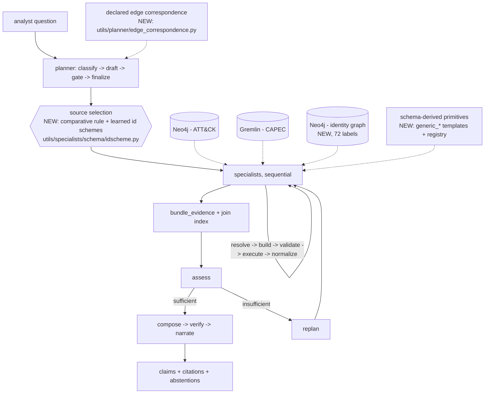

# Ariadne — Research Audit, 31 August 2026

> **Successor to [`audit-2026-08-03.md`](audit-2026-08-03.md).** That document is
> an archived snapshot and must not be edited. This one re-audits the same
> repository four weeks later and states, for every finding it made, whether the
> finding still holds.

**Prepared:** 31 August 2026
**Repository:** `/home/bdgr/Agents/Ariadne` @ `main`, commit `b8c3b99` (636 commits, of which **182** postdate the previous audit's baseline `769dee7`)
**Method:** every statement about the system was checked against a file in the tree during this session. **No literature search was performed** — the user excluded it, so §5 reports the repository's *own* adversarial novelty audit of 26 August and labels it as second-hand. See §12.

---

## 0. Executive Summary

**The previous audit's work plan has largely been executed, and it changed the answers.**

On 3 August the binding problems were: no baseline of any kind, no holdout, no related-work engagement, no LICENSE, and a headline number (0.9972) that had never been tested against a question the author did not write. Four weeks later:

- **Both missing baselines exist and are measured.** An LLM given the real schema, the resolved seed ids and a repair loop writes its own Cypher and Gremlin and scores **0.5000** where the template cascade scores **0.9467** on the same unseen questions (`EXP-2026-08-008`). Both catalogues loaded into one Neo4j store and queried by the same code scores **−0.0334 and +0.0000** against the two-store configuration (`EXP-2026-08-009`).
- **The holdout was run, and it did what a holdout is for.** Blind correctness came back at **0.689 / 0.708** against a development figure of 0.9972 (`EXP-2026-08-002`). Four experiments of repair later, the same arm reaches **0.9350** blind and **0.9467** on a bank drawn after the repairs.
- **Positioning went from absent to the strongest single asset in the record.** An external adversarial novelty audit on 26 August read 41 papers in full, **refuted C-011 outright**, withdrew the load-bearing Sikos citation, and produced a ranked 20-entry scoop watch.
- **LICENSE (Apache-2.0) and NOTICE shipped on 18 August.**

**And the record's own claims did not survive contact with the measurements.** Of 25 numbered claims, **four are now `refuted`** — including two that were the paper's headline four weeks ago. C-003 ("the templates are where the accuracy lives") is refuted by a schema-derived arm that matches the templates on judged correctness. C-015 ("federating beats merging") is refuted by the merged counterfactual. C-013 and C-011 are refuted. That is the ledger working, and it is the most credible thing in the repository.

**What it now is, mechanically.** Unchanged in kind, larger in surface: a deterministic federated query mediator over Neo4j (ATT&CK, Cypher) and TinkerPop (CAPEC, Gremlin), plus — new since the last audit — a third live source (a customer identity graph over a 72-label schema), a **declared meaning-level bridge** between that graph and ATT&CK where no shared identifier exists, and a schema-derived generic query path that now beats the hand-written templates on every foreign-schema measurement taken. The if-cascade is still an if-cascade; it now emits **~29 distinct query templates** rather than 25, and every LLM seam is still off by default.

**Novelty verdict.** Changed in shape, not in size. Four weeks ago the strongest asset was an unpublished controlled ablation. It still is — but the ablation's headline (`−0.196`, LLM planning) has been superseded, its *mechanism* has been scooped (Leung et al., EACL 2026), and its *direction* now contradicts the only comparable published distribution. Against that, three genuinely new empirical results arrived: co-authorship bias priced at **0.0483** same-conditions; the template/schema-derived reversal across schemas (**−0.01** on the catalogue, **−0.61** on a foreign schema); and the merge/federate null. **The architecture is not the contribution and the repository now says so in writing** (`D-027`). The contribution is four measurements — three of them nulls — plus a question-set resource that is not yet a benchmark.

**Readiness verdict line.**

> **Readiness: L4 — ready for workshop/demo; near from applied conference; blocked by novelty defensibility; critical path 3–5 weeks; cheapest next action: write the Q24 paragraph explaining why our failure distribution runs opposite to Leung et al., and re-grade the headline arm comparisons with the cross-model panel.**

Distance to the other tiers: **near from applied conference** (one axis short, 3–5 weeks); **far from top-tier archival** (five axes short, 20–30 weeks, still not recommended).

**Scorecard movement, 3 Aug → 31 Aug.** Positioning **0 → 3**. Baseline coverage **1 → 3**. Evaluation rigour **2 → 3**. Reproducibility **2 → 3**. Claim clarity **3 → 4**. Narrative **2 → 3**. Data legitimacy **3 → 3**. **Novelty defensibility 2 → 2**, and it is now the minimum axis and the binding constraint. The floor rose by two points and moved to a different wall.

**Recommended action, in order.**

1. **This week (1 day):** write Q24. The audit calls it the highest-value piece of writing left, and it is writing rather than an experiment. C-016 is either the paper's best finding or its worst liability and nothing else decides which.
2. **This week (1–2 days):** re-grade the August headline comparisons with the cross-model Sonnet panel. Every August judged figure — including C-012's 0.9467-vs-0.5000 — currently rests on a local grader that the record itself says is "fine for comparing arms; not a publication figure," and that the identity experiment measured overstating faithfulness by **0.43**.
3. **Next (1–2 weeks):** decide Q26 and, if yes, emit and independently validate executable gold queries. This is the one move that converts an `unsupported` novelty claim (C-025) into the "cleanest gap the audit found."
4. **Then:** stop measuring and start writing. The marginal return on further experiments has gone negative in exactly the way the last audit warned the marginal return on engineering had.

---

## 1. What Changed Since 3 August — the delta at a glance

### 1.1 The previous audit's work plan, item by item

| # | Item (3 Aug) | Est. | Status now | Evidence |
|---|---|---|---|---|
| **W0** | Blind held-out probe | 0.8 wk | ✅ **Done** | `EXP-2026-08-002`; 30 questions, LLM-authored blind, Sonnet-judged. Result: 0.689 / 0.708 |
| **W1** | LICENSE + MITRE attribution | 0.1 wk | ✅ **Done** | `LICENSE` (Apache-2.0, 18 Aug), `NOTICE` |
| **W2** | Related-work section | 1.5 wk | ✅ **Done, and exceeded** | `RELATED_WORK.md` (461 ln, evidence-tagged) + `reports/2026-08-26-novelty-audit/` (765 ln, 41 papers read in full) |
| **W3** | Rebuild planner corpus without the success filter | 0.5 wk | ⚠️ **Relabelled, not rebuilt** | Q7 "RESOLVED BY RELABELLING (2026-08-24)". The two metrics that were 1.0 by construction are no longer reported as measurements; the filter is still in `build_corpus.py` |
| **W4** | Merged-single-graph baseline | 2.5 wk | ✅ **Done** | `EXP-2026-08-009`, plus `EXP-2026-08-017` on the structural cost |
| **W5** | Free-form text-to-graph-query baseline | 2.0 wk | ✅ **Done, built in good faith** | `EXP-2026-08-008`; `utils/specialists/llm_builder.py` |
| **W6** | Genuine holdout catalogue | 2.5 wk | ✅ **Done, several times over** | holdout-v1 (30) + two fresh banks (30 each) + 10 resampled catalogue banks (300 anchors) + 3 identity banks (27/28/117) + tri-source bank (64) + 579 paraphrase variants |
| **W7** | Variance and significance | 1.0 wk | 🟡 **Partial** | Bootstrap CIs on every judged cell; grader spread 0.0050 over 3 passes; 10-bank resampling intervals; 3-repeat sd on the LLM composer arm. **Still `n_runs: 1` per arm on the judged pipeline** |
| **W8** | Contamination control (relabelled graphs) | 1.0 wk | ❌ **Not run** | No renamed-entity or obfuscated-schema condition exists. The identity-schema transfer is a *different* schema, not a control |
| **W9** | Judge validation against humans | 1.5 wk | ❌ **Closed as WILL NOT DO** | Q6, 2026-08-23. Moved to the known-weakness list |
| **W10** | Name the model | 1.0 wk | ✅ **Done — and it found something worse** | Q11/Q12: `MIRALABS/Ornith-1.5-35B-A3B-W4A16-SYM`, 96k context, 16-way concurrency. **The relay alias `skynet` was repointed mid-study**; the July arms are Gemma 4 31B and the August ones are not |
| **W11** | Verifier ablation | 0.3 wk | ✅ **Done, and it returned a clean zero** | `EXP-2026-08-014`: 888 claims, 5 conditions, **no gate cuts anything** — then `EXP-2026-08-018` reconnected the LLM composer and the gates fired 32–36 times per run |
| **W12** | Third source | 3.5 wk | ✅ **Done** | `EXP-2026-08-013`: three live sources across two query languages retrieve *identically* to one, plus a declared meaning-level bridge |

**Ten of thirteen done, one partial, two declined.** For a four-week window that is an unusual rate of execution, and it is worth saying plainly before the rest of this document starts finding problems.

### 1.2 The experiment record

| | 3 Aug 2026 | 31 Aug 2026 |
|---|---|---|
| Experiments on record | 11 | **31** |
| Judged arm comparisons | 1 (July, 7 arms) | 4 further judged rounds + 3 cross-model panels |
| Question populations | 1 (120, co-authored) | **9 populations**, roughly 1,650 question instances — though the 579 paraphrase variants derive from the catalogue and the 10 resample banks draw from a shared anchor pool, so these are not 1,650 independent questions |
| Baselines | 0 | 2 internal-but-external-in-kind + 2 published benchmarks with an oracle ceiling |
| Claims ledger | *did not exist* (created 6 Aug) | 25 claims: **7 supported · 10 partial · 4 refuted · 1 unsupported · 3 cut** |
| Decisions ledger | *did not exist* (created 6 Aug) | **27 decisions (D-001 … D-027)** |
| Tests | 142 files / 1,176 functions | **172 files / 2,030 collected** (collected counts parametrised instances, so the two figures are not the same unit) |
| Committed evaluation artifacts | ~2,656 | **4,762 tracked files** |
| LICENSE | ❌ | ✅ Apache-2.0 |
| Research-record validator | — | `make validate-research` → *"research record OK — 31 experiment(s) validated"* (run this session) |

### 1.3 The headline numbers, then and now

| Quantity | 3 Aug | 31 Aug | Which experiment |
|---|---|---|---|
| Deterministic correctness, development catalogue | **0.9972** (Sonnet, Gemma-era) | 0.9833 / 0.9839 (local grader, post-fix) | 07-001, 08-007/008 |
| Deterministic correctness, **blind** | *unknown* | **0.689** → **0.8367** → **0.9350** → **0.9467** (fresh bank) | 08-002, 08-007, 08-008 |
| Co-authorship bias | *unmeasured* | 0.1472 → **0.0483** (corrected the same day) | 08-007, 08-008 |
| LLM planning penalty | −0.196 ⚠️ irreproducible | **−0.1185** within one judge run; superseded as a headline | audit footnote; 07-002/003 |
| Templates vs no templates | −0.3568 (Arm G) → C-003 | **−0.01** catalogue, **+0.0100→0.0000** after a template fix; **−0.61** on a foreign schema | 08-007, 08-015, 08-011 |
| Templates vs LLM-written queries | *never run* | **0.9467 vs 0.5000** (0.5739 adjusted) | 08-008 |
| Federated vs merged | *never run* | **−0.0334 / +0.0000** — no difference | 08-009 |
| External benchmark recall (deterministic) | *never run* | **0.7633** against an oracle ceiling of 0.9863 | 08-010, 08-012 |
| Foreign-schema retrieval | *never run* | generic **0.7877**, templates **0.3177** (n=117) | 08-011 |
| Safety gate | 17/17 probes | **240/240 after fixing 15 live bypasses** | 08-016 |
| Cross-tenant leakage | *unmeasured* | **568 → 5 records** under the comparative routing rule | 08-016 |
| Robustness to paraphrase | *unmeasured* | record identity **1.0000 → 0.4667 → 0.0990 → 0.0000** across five tiers | 08-020 |

### 1.4 The three findings that did not exist four weeks ago and matter most

1. **The templates do not hold the accuracy; they hold the abstention — and only on the schema they were written for.** Arm H (every hand-written template disabled, schema-derived primitives only) judged **0.8483** against the cascade's 0.8367 blind and 0.9700 against 0.9467 on a fresh bank. On a schema nobody wrote templates for, the ordering *inverts hard*: schema-derived 0.7877 against 0.3177 retrieval, and the template arm asserts something its evidence does not support in **82%** of blind answers there. `C-003` is refuted and replaced by `C-023`, which states the conditional. This is the single largest revision to the project's self-understanding in the period.

2. **The system's correctness is substantially a property of question phrasing, and it fabricates by selection rather than by invention.** `EXP-2026-08-020` ran 699 paraphrase variants over the 120 catalogue questions. Control passes at 1.0000. Change only the verb and **more than half break**. Drop the identifier and keep the exact name: 0.0990. Paraphrase the name: **exactly 0.0000, on 104 questions.** Worse, 4 of 30 questions about entities that *do not exist* ("Obsidian Larch", "Chimeric Handshake Exploit") were answered with up to **558 records** framed as *"All 558 result(s) for this question"* — every record genuinely retrieved, every claim genuinely grounded, every citation resolving. **The verifier cannot catch this and it is not a verifier bug.** It is the ceiling-by-construction property seen from the other side: a property that cannot be violated also cannot protect you.

3. **Federation's case is structural, not accuracy-based — and the structural case is now counted.** Merging is not worse on correctness. But building the merged store required editing **1,083 of 9,138 nodes** (22.7% of CAPEC) to carry properties MITRE does not publish, while the federated configuration edited none, and a customer identity graph was loaded alongside both catalogues **unmodified**. `C-015` died; `C-022` replaced it and is a claim about *cost and constraint*, not capability. That is a weaker claim, honestly obtained.

---

## 2. Project Characterization — what is different in the system

### 2.1 Identity

Unchanged. Ariadne, ReliaQuest Innovation Challenge Fund Challenge Three, PI Olmo S. Zavala Romero (FSU Scientific Computing), graduate RA and technical lead Brendon DGR. Award period ends 23 October 2026; the deliverable is a pitch, not a paper, and the operator has explicitly protected that date (no publication work before 23 Oct).

**One identity fact changed and it is not cosmetic.** `skynet` is a relay *alias*, not a model, and it was repointed mid-study. Every July figure is Gemma 4 31B; everything from roughly August onward is `MIRALABS/Ornith-1.5-35B-A3B-W4A16-SYM` — a different architecture (MoE, ~3B active of 35B), a different parameter count, and a substantially more lossy quantisation (4-bit weights). **The two are not comparable and the record says so** (Q12). Which model served the runs *between* the July arms and 24 August is still unknown.

### 2.2 The problem — one difficulty has been engaged that was not

The 3 August audit tabulated five research difficulties and found Ariadne engaging one and a half. Re-scored:

| Difficulty | 3 Aug | 31 Aug |
|---|---|---|
| Source selection | Partially — token matching over two sources | **Engaged and measured.** The comparative selection rule, the identifier-shape evidence learned from each dataset's canonical snapshot (`utils/specialists/schema/idscheme.py`), and 240 generated isolation probes. Leakage 568 → 5 records. Residual failure mode named and unfixed (`attack_tactic`) |
| Cost estimation and join planning | No | **Still no.** Execution order is still a fixed producer-then-consumer hoist |
| Cross-source entity reconciliation | Sidestepped by one declared key | **Materially advanced.** `utils/planner/edge_correspondence.py` declares a *meaning-level* bridge for a graph that shares no identifier with ATT&CK — 13 of 21 edge types carry a technique, 8 explicitly do not, each with the customer's own wording cited, and a test fails if the schema grows an edge nobody classified. Measured at 0.8333 on 24 bridge questions with **0 of 12 false positives** on negatives |
| Query correctness from natural language | Sidestepped by templates | **Now measured against the alternative.** 0.9467 vs 0.5000. The sidestep is now a result rather than an evasion |
| Whether the mappings are fit for automated use | Not engaged | **Still not engaged.** The mapping is still treated as ground truth. `C-BRAZ`/`C-BONH` remain uncited limitations |

**Is the problem well-posed?** The 3 August answer — "mostly, with a caveat" — has been *sharpened by the project's own null result*. Merging is not worse on accuracy, so the federation argument is now explicitly the provenance/licensing/staleness one, and `EXP-2026-08-017` supplies the first quantitative evidence for it. The strongest version of the case is no longer about the two catalogues at all; it is the third source, which *cannot* be copied into a shared store for contractual reasons. That is a better argument and it is one the funder's own challenge is about.

**The thin-join-surface caveat stands unchanged.** 177 of 558 CAPEC patterns carry any ATT&CK mapping; 271 mapping edges total. Nothing in four weeks widened that.

### 2.3 The solution — what was added

Architecturally the pipeline is the same graph. What is new sits inside three of its nodes.

**Six substantive additions, each traceable:**

1. **A schema-derived generic query path** (`generic_neighbors`, `generic_chain`, `generic_intersect`, `generic_walk`, `generic_bridge`) driven by the source card, the derived schema registry and the declared join-key registry, with **no MITRE literal in either builder**. It is the arm that beats the templates everywhere except precision on ATT&CK/CAPEC.
2. **Outer-join bridges.** `.out(edge)` dropped any anchor with no far side, so *"this pattern has no ATT&CK mapping"* — a real analyst answer — could not be grounded. Both the generic bridge and the template bridges now project one row per anchor with a possibly-empty fold. `capec_hierarchy_chain`'s two ancestor hops became `optional()` for the same reason after `EXP-2026-08-015` found a whole class of anchor returning nothing.
3. **Binding consistency and schema-resolved direction.** `group_techniques` used to bind `$ids` to `Group.attack_id` whatever the seed identified, so "which groups use T1550.002" emitted a structurally unsatisfiable filter and returned a silent empty indistinguishable from an honest one. A template now resolves which end was seeded from the learned id schemes, and the normalizer pivots on which column carries a seed. **Half the defect was in the normalizer, not the query** — an audit of emitted queries alone would have declared the job done.
4. **A per-source endpoint override** (`ARIADNE_ENDPOINT_<DATASET>`). `endpoint_for(backend)` returned one address per *backend*, so two Neo4j-backed sources in one process shared it and the identity source silently probed ATT&CK's store. Invisible for the life of the project because the stack had exactly one source per backend.
5. **A lexicon and an exact-name resolver, both behind flags, both default-off** (`ARIADNE_LEXICON`, `ARIADNE_EXACTNAME`, `ARIADNE_NAMESEARCH`). See §9 ⚠️-8 — the record says exact-name matching "ships" and the shipped default does not include it.
6. **An LLM query builder** (`utils/specialists/llm_builder.py`) and a reconnected **LLM claims composer** (`select_composer`, `SYNTHESIS_LLM_CLAIMS`, default false), both built as *instruments* rather than as shipping paths. The composer is the only configuration in which the verifier's central property is testable at all.

### 2.4 Maturity table (updated)

Changes from 3 August are marked **→**.

| Component | File(s) | Status | Evidence |
|---|---|---|---|
| Canonical graph build | `utils/kg_builder/` | Implemented and exercised | Unchanged; plus `merge.py` for the merged counterfactual |
| Runtime loader, preflight, verify | `utils/graph_loader/` | Implemented and exercised | ⚠️ `--graph health` reports a socket, not content; `--graph verify` is the real check (`EXP-2026-08-020` I-1) |
| Source cards + overlays | `data*/source_cards/`, `utils/planner/cards.py` | Implemented and exercised | **→ Cards are gitignored build artifacts.** `EXP-2026-08-016` moved the authoritative disallow-lists *into the validators* for exactly this reason |
| Deterministic planner | `utils/planner/` | Implemented and exercised | **→ Comparative source selection + learned id-scheme evidence.** Still the default path |
| Lexicon (stem / gloss / edit distance) | `utils/planner/lexicon.py` | **→ Implemented, off by default** | Arm 1 of `EXP-2026-08-020`. Shipping it alone made dumps *worse*; it ships only with the unanchored-abstention fix |
| LLM planner drafter | `utils/planner/llm_drafter.py` | Implemented, not default | Unchanged |
| LLM intent classifier | `utils/planner/intent_llm.py` | Implemented, unexercised | Unchanged — no arm tests it |
| Cypher specialist | `utils/specialists/cypher/` | Implemented and exercised | **→ ~21 static template ids + 2 generated (`group_software`, `campaign_software`); `node_lookup` deleted (Q13)** |
| Gremlin specialist | `utils/specialists/gremlin/` | Implemented and exercised | **→ 14 template ids; `capec_lookup` deleted (Q13)** |
| Schema-derived generic path | both builders + `utils/specialists/schema/registry.py` | **→ Implemented and exercised as a first-class arm** | `EXP-2026-08-001/003/004/011/015`. Not the default |
| Learned identifier schemes | `utils/specialists/schema/idscheme.py` | **→ New, implemented and exercised** | Routing tiebreak (Q21), binding direction (`EXP-2026-08-005`) |
| BM25 name index | `utils/specialists/schema/namesearch.py` | **→ Implemented, measured, deliberately OFF** | 68% precision on a frozen half; `EXP-2026-08-020` Step 6 |
| `expand` primitive | `utils/specialists/primitives/expand.py` | **→ Implemented and exercised** | Now constructed by both builders (`cypher/builder.py:1109`) |
| Declared edge correspondence (meaning bridge) | `utils/planner/edge_correspondence.py` | **→ New, implemented and exercised** | `EXP-2026-08-013` phase 2 |
| Deterministic composer | `utils/synthesis/composer.py` | Implemented and exercised | **→ Two answer-writing defects fixed (+0.098 paired); D-024 label fix** |
| LLM claims composer | `utils/synthesis/llm_composer.py` | **→ Implemented and reachable; default off** | `select_composer` is now called (`factory.py:117`). Kept as an instrument: 67× slower, −0.1367 grounding |
| Claim verifier + abstention | `utils/synthesis/verifier.py` | Implemented and exercised | **→ Ablated. Four gates cut 0 of 888 claims on the shipped path; 32–36 per run when a model proposes claims** |
| Conflict detection | `utils/synthesis/reconcile.py` | Implemented, still effectively unexercised | 0 cross-source conflicts in every experiment that reports the field |
| LLM narrator | `utils/synthesis/narrator.py` | Implemented and exercised | Unchanged; still the only live LLM role by default |
| Assess / sufficiency policy | `utils/orchestration/agents/assess/` | **→ Implemented and exercised in experiments** | Arms run at `ORCH_MAX_HOPS=5`. ⚠️ `.env` still pins `1`, so the loop is inert on the local default |
| LLM sufficiency critic | `assess/policy.py:40` | **Aspirational, unchanged** | `LLMCritic` is still a type alias with no concrete production implementation; `build_assess_node` is called without a critic |
| LLM query builder (baseline arm) | `utils/specialists/llm_builder.py` | **→ New, implemented and exercised** | `EXP-2026-08-008`. `SPECIALIST_LLM_*` now has real read sites — the 3 Aug "zero read sites" finding is closed |
| Judge runner | `utils/evaluation/judge_answers.py` | **→ New, in-tree, with `--calibrate`** | Closes half of the 3 Aug "out-of-tree grading" finding |
| Bank generator | `utils/specialists/evalset/make_bank.py`, `author.py` | **→ New, implemented and exercised** | Fairly-drawn banks on demand (Q16) |
| Variant harness | `scripts/variant_harness.py`, `author_variants.py`, `split_variants.py` | **→ New** | 579 variants, six tiers, frozen tune/report split |
| Research-record tooling | `utils/research_record/`, `scripts/validate_research.py` | **→ New, enforced** | `make validate-research` passes on 31 experiments; pre-commit hook regenerates `INDEX.md`; `make figures --check` fails on a stale figure |
| Baselines | `llm_builder.py`, `utils/kg_builder/merge.py`, `utils/evaluation/external/` | **→ Present** | Was *Absent* |
| Related-work engagement | `RELATED_WORK.md`, `reports/2026-08-26-novelty-audit/` | **→ Present** | Was *Absent* |
| LICENSE / attribution | `LICENSE`, `NOTICE` | **→ Present** | Was *Absent* |
| Contamination control | — | **Absent** | W8 never run |
| Human-validated judging | — | **Absent by decision** | Q6 closed as will-not-do |
| Managed cloud backends | — | Aspirational | Unchanged |

### 2.5 Data and evaluation infrastructure

**Question populations now on record.** This is the largest single change and the least visible from the README.

| Population | n | Blind? | Authored by | Used for |
|---|---|---|---|---|
| Golden catalogue | 120 | No — co-authored with the templates | Human (the author) | Every arm figure since July; still ships `expected_template` (35 occurrences in `questions.py`) |
| holdout-v1 | 30 | Was blind; **now burned** — it diagnosed two defects that were then fixed | Claude Fable | C-013, C-021 |
| bank-2026-08-19 / -08-20 | 30 + 30 | Yes at draw time | `skynet` relay | `EXP-2026-08-008/009` |
| Catalogue resample | 10 banks × 30 anchors | Yes; **measured** anchor-disjoint (0/45 overlapping pairs) | relay | `EXP-2026-08-015` intervals |
| Identity banks 1 / 2 / 3 | 27 / 28 / 117 | 1 is a dev set; 2 and 3 blind, zero anchor overlap, verified | Fable + relay | `EXP-2026-08-011` |
| Tri-source bridge bank | 64 (half negative by design) | Yes; audited before any run — 0/64 contain a gold identifier | Fable | `EXP-2026-08-013` phase 2 |
| Paraphrase variants | 579 + 120 control + 30 negative control | Derived from the catalogue, six tiers | Sonnet, with the pipeline's LLM seams off | `EXP-2026-08-020` |
| External benchmarks | 182 (45 `cti-ate`, 137 AttackQA) | Published, fetched not committed (D-020) | Third parties | `EXP-2026-08-010/012` |

**Two disciplines are worth naming because they are unusual and load-bearing.**

- **The oracle ceiling.** External benchmarks are scored against a *direct graph read*, not against 1.0 (`D-018`). `cti-ate` precision at the ceiling is **0.607** — pure benchmark staleness. The record's own sentence: *"any published `cti-ate` result that does not say this is overstating its own headroom."* That is a publishable methodological observation on its own.
- **The frozen split, honoured once.** `EXP-2026-08-020` Step 6 split the variant bank by gold question via `sha256(case_id)` parity **before any threshold was touched**, with the harness physically filtering the frozen half out of a sweep. Fitted thresholds gave 12-right/0-wrong on the tuning half and **17-right/8-wrong** on the frozen half. Had the whole bank been used, the reported figure would have been perfect precision and it would have been an artifact. This is the cleanest demonstration in the repository that the discipline pays, and it should be in the paper.

**The circularity findings from 3 August, re-checked.**

1. *Gold is a deliberate reimplementation of the ingest's own policy by the same author* — **unchanged and still true.** It measures ingest fidelity, not ground truth.
2. *Gold was in one place bent to match builder behaviour* (`_top_level`) — **unchanged, and now a recorded decision rather than a silent one** (`D-023`, `EXP-2026-08-012` I1). A tested patch that would raise external recall from 0.7633 to **0.9825** is kept on disk and deliberately not applied, because the two external benchmarks disagree with each other about which reading is right. That is the correct call and it costs 0.22 recall.
3. *The question set is defined by what the system can do* — **now measured rather than argued.** `EXP-2026-08-010` located it precisely: all eight `group_techniques`/`campaign_techniques`/`software_techniques` questions across both internal banks are technique-anchored, the reverse direction is never asked, and Group↔Software is never asked at all. *"That is co-authorship bias, located precisely and for the first time. It did not show up as a wrong answer on an internal question. It showed up as a question the internal bank does not contain."*
4. *The planner corpus is circular in the strict sense* — **still true.** `build_corpus.py` still discards cases the planner under test gets wrong. Q7 resolved it by relabelling: the two affected metrics are no longer reported as measurements. The filter remains.

**Statistical treatment.** Bootstrap CIs on every judged cell, Wilson intervals on verdict rates, paired per-question regression checks on every code change, and — new — a measured grader spread (**0.0050** over three passes on a fixed answer set) and a grader calibration (**r = 0.9275**, mean delta **+0.031** against the committed Sonnet judgments, verdict agreement **0.70**). The 3 Aug complaint that "determinism is treated as a substitute for replication" is now half-answered: `EXP-2026-08-015` correctly reframes it — for LLM-free arms *pipeline* variance is zero by construction, and the variance that exists is over which anchors you drew, which had never been measured and now is.

**What is still missing statistically:** `n_runs: 1` per arm for the judged pipeline; no significance test on any inter-arm delta (`D-010` is explicit about this); no multiple-comparison correction across a study that now reports several dozen comparisons.

### 2.6 Scale and reproducibility

**Scale** is unchanged in kind and slightly larger: 9,138 catalogue nodes plus a 1,339-node / 3,814-relationship synthetic identity tenant over the customer's real 72-label schema. The four 100× breakpoints identified on 3 August (row cap first, LLM context second, serial federation third, gold-bank build fourth) all still hold; nothing tested them.

**Reproducibility has genuinely split into two halves, and that is the right way to read it.**

- **The LLM-free half is strong and got stronger.** Most of the 20 new experiments take no model in the primary metric: retrieval-set comparisons, isolation counts, leakage counts, node-edit counts. Those are byte-reproducible given the public MITRE snapshots, and the record now carries `PROTOCOL.md` + `manifest.yaml` + `data/POINTERS.md` hashes per experiment, a validator, and figure regeneration with `--check`.
- **The LLM half is weaker than it was.** It still points at a private relay — and now the weights behind that relay have changed, so *no July figure can be reproduced at all, by anyone, including the author*. The cross-model Sonnet panels still run through out-of-tree agent scripts in `scratchpad/`. There is still no DOI.

---

## 3. The Experiment Record — 20 new experiments, what each established

Grouped by what they were for. Every figure here is quoted from the experiment's own `RESULTS.md`, which is generated from a committed `metrics.json`.

### 3.1 Establishing the blind baseline (08-002)

30 questions authored by a model with no sight of the templates, uniform anchor sampling, Sonnet-judged one agent per question.

- Arm A **0.689** (CI 0.550–0.817), Arm F **0.708**, against development 0.9972/0.9957 — a drop of **−0.308 / −0.287**.
- **The drop is concentrated, not uniform.** Seven of sixteen categories score 1.00 on both arms. Four diagnosable modes carry the loss, and the dominant one is *reverse direction*: the system answers A→B and was asked B→A.
- **Abstention held completely:** 4/4 abstained on the no-mapping anchors, 4/4 carried the executed query, **0/4 fabricated a mapping**.
- Arm F − Arm A = **+0.019 for 554× the wall clock**.

### 3.2 Closing the blind gap (08-003 → 08-006), and what closing it revealed

A four-experiment sequence in which retrieval on the blind bank goes 0.7688 → 0.8952 → 1.0000, with the 120-question development catalogue reporting **0 improved, 0 regressed** at every step.

- The gap was **two independent defects**: direction/binding (08-005) and inner-join bridges (08-004/006). Each was closable from declarations the repository already had.
- **The development catalogue did not move by a single record** — 1,061 evidence records on both sides — while the blind set recovered 187 identifiers. *"The two banks ask the same graph the same kinds of question; the only difference is that one of them was written by someone who could see the templates."* That is co-authorship bias measured directly, and it is a cleaner demonstration than the score gap.
- **The recall fix silently deleted the project's headline property, and a negative test caught it.** Once the producer returned an anchor with an empty mapping list, `_empty_ok_results` stopped recognising it as an honest empty, and *"which techniques does CAPEC-16 map to?"* returned two supported claims about CAPEC-16 and **no statement about mappings at all**. Nothing was fabricated; the answer quietly stopped answering. Seven committed adversarial negatives asserted the old contract and failed. **This is the strongest argument in the repository for keeping adversarial negatives in a golden bank**, and the retrieval metric rose at every step while the honesty defect was invisible to it.

### 3.3 Judged comparisons (08-007, 08-008)

| Arm | Blind (30) | Catalogue (120) | Fresh bank (30) | Hallucinating answers, blind / catalogue |
|---|---|---|---|---|
| Template cascade | 0.8367 → **0.9350** | 0.9839 → 0.9833 | **0.9467** | **0 / 3** |
| Arm H (no templates) | 0.8483 | 0.9692 | 0.9700 | 1 / 9 |
| Arm F (loop + LLM writer) | 0.9157 | 0.9852 | 0.9773 | 4 / **19** |
| **LLM writes the query** | — | — | **0.5000** (0.5739 adjusted) | 5 |

- **C-012 is supported for the first time** and it is the paper's intended headline. The baseline was built fairly — real schema, resolved seeds, the gate's constraints, the column convention, and a repair loop that feeds rejections back. It is denied only the templates. It loses by half, and *not mainly on syntax*: most of its queries pass the gate and execute.
- **Arm F's advantage is a coverage effect, not a general one.** Blind it leads by +0.079; on the catalogue by 0.0013 — i.e. nothing — while hallucinating in 19 of 120 answers against the cascade's 3. *"A catalogue-only evaluation would have called it a regression; a blind-only evaluation would have called it a clear win."*
- **C-021 was corrected by two-thirds within eleven hours.** A 0.1472 gap written into the ledger at 09:00 was 0.0483 by 20:00, because the measurement had been taken over a pipeline with two answer-writing defects in it. *"A bias measurement taken over a defective pipeline measures the defect too."* Quote 0.0483.

### 3.4 The two baselines (08-009, 08-010/012)

**Merged vs federated.** One store against two, everything else identical, no language model in either arm, all eight cells graded by one grader in one session:

| | set 1 | set 2 |
|---|---|---|
| merged | 0.9233 | 0.9367 |
| federated | 0.9567 | 0.9367 |
| difference | **−0.0334** | **+0.0000** |

**C-015 is refuted.** The first pass of this experiment was *confounded* — it compared a deterministic-composer merged arm against an LLM-narrator federated arm — and the protocol caught it. The superseded figures are on disk and quoted nowhere. Merging's one measured advantage is reported rather than hidden: in one store the next hop is reachable without leaving the engine, so consumer sub-questions skipped for want of a join value fall from 7/30 to 3/30.

**External validation.** Two published benchmarks, no language model in the metric, scored against an oracle ceiling:

| arm | n | recall | ceiling |
|---|---|---|---|
| deterministic (templates) | 182 | 0.6836 → **0.7633** after 08-012 | 0.9863 |
| generic (no templates) | 60 | **0.9953** | 0.9953 — *held exactly* |

**H1 was refuted for the arm the paper leads with and held exactly for the arm it does not.** Four question families scored **0.000** — every one traversing Group↔Software or Campaign↔Software — because `group_software` did not exist and `group_techniques` answered as though a different question had been asked. Those four now match the ceiling. Two partial families remain open **by decision**, with a tested patch worth +0.22 recall kept unapplied because `_top_level` filters gold on purpose and the two benchmarks disagree about which reading is right.

### 3.5 Foreign-schema transfer (08-011) — the largest single finding

The first non-MITRE schema this codebase has ever been pointed at: ReliaQuest's real production identity schema, 72 labels, 779 attribute names, synthetic instances.

**Pre-fix: both arms retrieved nothing. 0.0000 on 27 of 27.** And the failure was upstream of where the arms differ — on 26 of 27 questions the anchor label was never queried at all. `Technique` was queried **twelve times against a graph that has no such label**. The mechanism: entity extraction matches question words against schema vocabulary, which works at 11 labels of distinctive jargon and collapses at 72 labels of ordinary IT English.

**Five structural fixes later** — none of which names a label, a group or a question — the arms separate decisively and the result replicates across three banks and 172 questions:

| | bank 1 (dev, 27) | bank 2 (blind, 28) | bank 3 (blind, 117) |
|---|---|---|---|
| generic | 0.8519 | 0.7857 | **0.7877** |
| deterministic | 0.2778 | 0.1964 | 0.3177 |
| gap | +0.5741 | +0.5893 | +0.4700 |

Four further amendments matter as much as the headline:

- **The local judge overstates faithfulness by 0.43–0.54 on this source** against ten independent Sonnet judges — four to five times the 0.1054 gap C-009 recorded on the MITRE pipeline. Arm *ordering* survives; the *level* does not.
- **Independent judges found a defect the local one scored straight past**: identity records rendered as *"Found N ATT&CK record(s)"* regardless of what they were. Fixing it raised both arms and **collapsed the faithfulness arm gap to −0.0085** — so A-7's +0.20 gap was substantially an artifact of a defect hitting the arms unequally.
- **The primary retrieval metric was shown to overstate quality where precision is poor.** An anchor name extracted as `App Access` matched 54 nodes instead of 1; gold was "present" among 53 irrelevant siblings. After the fix, recall fell 0.7635 → 0.6571 while precision rose 73% and answers shrank to a sixth — *the correct direction*. The template arm lost recall with **no** precision gain, confirming its earlier score was dumping, not retrieving.
- **Faithfulness rewards silence.** After both fixes the template arm scores *higher* faithfulness (0.9282 vs 0.8175) while retrieving 0.1140 recall against 0.6923. The record says the right thing about this: an answer that asserts almost nothing cannot be unfaithful, so faithfulness is a necessary property and a useless headline alone.

### 3.6 Hardening the record (08-014 → 08-019)

- **Verifier ablation (08-014).** 888 claims, 5 conditions: **no gate cuts anything, because nothing reaching the verifier can fail one.** The deterministic composer builds each claim *from* a retrieved record, so a violating claim is unconstructible. C-017's first half is *true and vacuous on the shipped path*, and the honest sources are a unit proof (13 assertions) and a structural argument — not a measured rate.
- **LLM claims composer (08-018).** Reconnecting it made the property testable for the first time: **32–36 cuts per run**, overwhelmingly by the `correlated` gate (92 across three runs) — *the model's characteristic error is asserting a cross-source correlation the join index does not back*. It essentially never emits an uncited claim. It is also **67× slower** and **−0.1367** on grounding, so the pre-registered decision rule selected "keep, never default".
- **Determinism levers (08-019).** Both hypotheses refuted. Seeding does not reduce spread (0.0212 vs 0.0207) because the variance is not sampling variance — it is timeout and fallback. And the metric is contaminated by its own failure mode: **r(fallbacks, gold) = +0.62**, because a timeout falls back to the *stronger* deterministic composer. *"Any harness with a fallback to a stronger path will report improvement when the primary path degrades."* That generalises well beyond this project.
- **Bank variance (08-015).** Ten anchor-disjoint banks per population. Catalogue gap −0.0100 with CI upper bound **exactly +0.0000**; identity gap **−0.6121** [−0.672, −0.553], independently confirming 08-011's point estimate from a fresh draw. And the catalogue variance turned out not to be noise at all: it was three questions in two banks, one template failing on a whole class of anchor. **Resampling found in ten draws what two fixed banks had hidden through six experiments.**
- **Tenant isolation (08-016).** 17 hand-written probes became 240 generated ones; **20 were not blocked; 15 were genuine gate defects** — including eight `mergeV`/`mergeE` placements that mutate and that no card named. All closed; block rate 1.0000 after. Cross-tenant leakage fell **568 → 5 records**, and the cost was reported rather than hidden: the comparative rule initially dropped ATT&CK from an ATT&CK question, scoring a *perfect zero* on the leak metric while answering nothing. That cost was then fixed by learned identifier evidence, with **0 of 300 catalogue answers changed**.
- **Federation isolation (08-017).** Merging rewrote **1,083 nodes**; federation rewrote none. *"Merging does not eliminate the reconciliation; it relocates it from a function into the stored records."*

### 3.7 Tri-source federation (08-013)

- Two defects had to be fixed before the question could be asked, and **the first run was invalid and its numbers discarded** — a missing canonical tree made every schema-driven primitive silently revert to a MITRE fallback, and it read exactly like a routing defect.
- **Three live sources across two query languages retrieve identically to one.** Zero questions differ, either arm, either direction; evidence volume per question returns from 180 to 8.24.
- **Phase 2 built a bridge on meaning, not on identifiers.** 13 of 21 edge types carry a technique; 8 explicitly do not, each with the customer's own description cited; a test fails if the schema grows an edge nobody classified. `GET_CHANGES` is marked partial because the customer's catalog says it is insufficient alone, so a lone half-right produces nothing.
- Measured on a 64-question blind bank, half negative by design: schema-derived **0.7724** overall, **1.0000** on refusals with **0 of 12** false technique claims; templates **0.3176**, falsely naming a technique on **7 of 12** negatives.
- **Two gold defects were caught before they were reported**, both of which would have read as the system inventing techniques. One control was *removed rather than reported* because the tenant cannot produce a clean instance of it, and its first-draw score of 0.8889 was discarded.

### 3.8 Variant robustness (08-020) — the newest and the most uncomfortable

Covered in §1.4. Three additional points:

- **The control passes at 1.0000 on every metric**, so the instrument measures the system rather than itself. That is the check most robustness studies omit.
- **Arm 1 was actively harmful and that is the finding.** A better word matcher made more questions route, and with no anchor resolved they fell through to a label scan and returned everything: wrong-entity +0.115 at T5, dumps +0.135. *"The lexicon was not the defect; it exposed the defect."*
- **Arm 2 does not retrieve more. It stops pretending.** T3 pooled recall *falls* because high-recall dumps become honest abstentions. The right fix at this stage, and explicitly not a retrieval improvement.

---

## 4. Claims Ledger — then and now

> The ledger itself was created on 6 August, three days after the previous audit. The "3 Aug" column below is the status each claim carried at its first commit, which is the closest comparable snapshot.

| ID | Claim (abbreviated) | 3 Aug | 31 Aug | What moved it |
|---|---|---|---|---|
| C-001 | Deterministic pipeline near-ceiling with zero hallucinations, in-distribution | `partial` (0.9972) | `partial` — 0.689 blind → 0.9467 on a fresh bank; 0 fabrications blind | 08-002 → 08-008 |
| C-002 | LLM planning is the dominant single loss | `partial` (−0.196 ⚠️) | `partial` — −0.1185 within one judge run | audit footnote |
| C-003 | **The templates hold the accuracy** | `supported` | **`refuted`** — superseded by C-023 | 08-007, 08-008, 08-011 |
| C-004 | Deterministic path orders of magnitude cheaper | `supported` | `supported` (637×) | — |
| C-005 | Narrator bound to verified claims removes the accuracy/readability trade | `supported` | `supported` | — |
| C-006 | The loop's value is a function of plan quality | `supported` | `supported` — and bounded: +0.019 for 554× on blind questions | 08-002 |
| C-007 | Query validity/safety at a ceiling by construction | `supported` | `supported` | — |
| C-008 | Safety gate blocks adversarial probes | `partial` (17/17) | `partial` — 240/240 **after fixing 15 live bypasses**; and *scooped* by Szlobodnyik | 08-016, novelty audit |
| C-009 | Self-judging overstates quality | `supported` | `supported`, and far more strongly: +0.43–0.54 on a foreign schema | 08-011 A-7 |
| C-010 | The dataset-specific surface is bounded and countable | `supported` | **`partial`** — the July portability audit "measured the wrong unit" and classified the planner as portable when it is not schema-*scale*-independent | 08-011 |
| C-011 | **Cross-engine security-KG federation is an unmade contribution** | `unsupported` | **`refuted`** — the Sikos citation does not say what it was cited for | novelty audit |
| C-012 | **Templates beat an LLM writing the queries** | `unsupported` — *"no experiment supports it"* | **`supported`** — 0.9467 vs 0.5000 | 08-008 |
| C-013 | Near-ceiling is a genuine capability, not an artifact | `unsupported` | **`refuted`** — the artifact hypothesis won | 08-002 |
| C-014 | The coverage cliff is measurable | `unsupported` | `partial` — priced in retrieval and in correctness | 08-002 → 08-007 |
| C-015 | **Federating beats merging** | `unsupported` | **`refuted`** | 08-009 |
| C-016 | Failure localisation contradicts the hallucination assumption | `partial` | `partial` — *mechanism* scooped (EACL 2026); *finding* contradicts the only comparable distribution | novelty audit |
| C-017 | Claim verification eliminates unsupported claims | `unsupported` | `partial` — true-and-vacuous on the shipped path; testable only via the LLM composer, where the gates do fire | 08-014, 08-018 |
| C-021 | **Co-authorship bias is measurable** (new) | — | `supported` — **0.0483** | 08-007/008/010/020 |
| C-022 | **Federation is accuracy-neutral; its advantage is structural** (new) | — | `partial` — 1,083 nodes rewritten vs 0 | 08-009, 08-017 |
| C-023 | **Templates hold precision on the schema they were written for, and lose elsewhere** (new) | — | `partial` | 08-007/011/015 |
| C-024 | **First implemented and benchmarked cross-language federation** (new) | — | `partial` | novelty audit |
| C-025 | **No benchmark pairs NL questions with executable gold graph queries** (new) | — | `unsupported` — *we do not have gold queries* | Q26 |
| C-018/019/020 | "−0.196"; "it is an agentic pipeline"; "accuracy/readability trade is real" | — | **cut** | — |

Counted from the ledger this session: **7 `supported`, 10 `partial`, 4 `refuted`, 1 `unsupported`, 3 cut.**

**Four refutations, three of them of the project's own prior headlines.** A ledger that only accumulates support is not a ledger. This one is doing its job, and it is the single most persuasive artifact in the repository for a reviewer assessing methodological seriousness.

---

## 5. Research Landscape — the delta, and a caveat about its provenance

> ⚠️ **This section is second-hand.** No literature search was performed during this audit, at the user's instruction. Everything below is read from the repository's own adversarial novelty audit of 26 August (`reports/2026-08-26-novelty-audit/`, 95 queries, 41 papers read in full, 15 at abstract level) and from `RELATED_WORK.md`. **I did not independently verify a single citation this session.** Treat the verdicts as the repository's, not as mine, and re-verify before submission — the audit's own §8 lists five coverage gaps it could not close.

### 5.1 What the novelty audit did to the 3 August picture

The 3 August audit's landscape work has been superseded in one specific and damaging way, and confirmed in most others.

**Superseded, badly: the Sikos citation.** The 3 August audit built the novelty argument on Sikos (2023) §7 *naming* cross-KG federation for security and citing nothing for it. The 26 August audit retrieved the paper in full: the word "federat" appears **once**, the worked example is a `FROM NAMED` query inside one triplestore, and the paper has **no future-work section**. It is an offhand remark about a capability the author treats as available. **The citation was withdrawn (`D-026`).** A reviewer disproves it in ninety seconds by downloading an open-access paper. This is the correct kind of finding to get from an audit, and it is a finding *about the previous audit*, not only about the project.

**Superseded, usefully: four of eight prior-art rows.** AgCyRAG generates its Cypher (only SPARQL is predefined) and is **not** a federation in the query-engine sense — integration happens in the agent prompt. LinkQ offers no faithfulness *guarantee*; verification is delegated to the user, and its evaluation is five people and six scripted questions. Both corrections cut *against* the previous audit's deterrence: two of the closest competitors are weaker artifacts than they appeared.

**Newly foreclosed.** Ozsoy (arXiv:2605.10373, 2026) states the cross-language multi-database query problem explicitly as a roadmap and builds nothing — so priority on *identifying* the problem is gone and priority on *implementing and measuring* it remains. EICopilot (arXiv:2501.13746) forecloses "first natural-language-to-Gremlin". UniQGen renders both SPARQL and openCypher but against one endpoint — dual rendering, not federation.

**Newly killed.** Q8 (security of natural-language interfaces to graph databases) is **fully scooped** by Szlobodnyik, *Analytics* 5(3):25, published 28 July 2026 — peer-reviewed, and it has the injection dataset, the unsafe-operation metric, the read-only validator and the schema-boundary access control. C-008's 240/240 is still *true*; it is no longer *new*.

**Newly scooped in mechanism.** C-016's earliest-failing-stage attribution exists in Leung et al. (EACL 2026) and in a 2026 preprint stating the rule almost verbatim. The *finding* survives, and it now **contradicts** the only comparable published distribution — see §6, G8.

### 5.2 The surviving novelty statement, as the repository drafted it

> *the first implemented and empirically evaluated system that answers natural-language questions by dispatching native queries in two different graph query languages to live, independently administered graph stores that are never merged*, together with four measurements a generation-based architecture cannot isolate — stage-wise failure localisation, templates versus schema-derived construction across two schemas, federated versus materialised, and co-authorship bias — plus the first question set over ATT&CK and CAPEC pairing questions with executable gold queries.

Three of those four measurements are **nulls**, and the last clause is **not yet true** (see Q26). The audit's own strategic sentence is the one to carry forward:

> **"Your architecture is your method section, not your contribution."**

This is now a recorded decision (`D-027`), which is a meaningful difference from four weeks ago, when it was an outside opinion.

---

## 6. Gap Inventory — G1–G10 revisited

| # | Gap (3 Aug) | Status 31 Aug |
|---|---|---|
| **G1** | No head-to-head of a template library against free-form LLM query generation for graph languages | **Ariadne now occupies it, on one dataset pair.** 0.9467 vs 0.5000, with the baseline built in good faith and its 7 harness-attributable failures reported separately. Still one domain, one model, n=1 run |
| **G2** | No federated QA across security KGs in separate engines | **Occupied and now *measured against the counterfactual*.** And the measurement says the architecture buys no accuracy. The gap is closed in a way that removes the reason to want it closed — which is a real result and a weaker paper |
| **G3** | No multi-KG cybersecurity QA benchmark | **Substantially advanced and still not a benchmark.** Nine question populations, computed gold, documented draw protocols, dataset cards. Blocked from being a *resource* by Q26 (no executable gold queries) and by the identity half being non-redistributable |
| **G4** | No text-to-Gremlin literature | **Partially foreclosed** by EICopilot. Ariadne's Gremlin path is now also *adversarially audited at scale* (240 probes, 15 defects found) — that half is stronger than four weeks ago |
| **G5** | Attribution/provenance over graph data is nearly unstudied | **Occupied, and the honest reading got sharper.** The verifier is a ceiling by construction, not a filter — and `EXP-2026-08-020` showed that a property which cannot be violated also cannot protect you against fabrication-by-selection |
| **G6** | No KGQA abstention benchmark | **Materially advanced.** 30 negative controls in the variant bank, 12 in the tri-source bank, 7 `expect_no_join` catalogue negatives, and abstention rates reported per tier. Still not a benchmark |
| **G7** | No measurement of analyst disagreement on CTI→ATT&CK mapping | **Unchanged. Not addressed.** Still the right limitation to cite |
| **G8** | Failure localisation in multi-stage KG-QA pipelines | **⚠️ Downgraded from "novel" to "scooped in mechanism".** Leung et al. (EACL 2026) walk stages in order and stop at the earliest error, over 832 and 1,222 responses, *and validate by intervening*. Their distribution runs the **opposite way** — generation is 32.7% and 76.4% of errors. The 3 August audit called `failure_terminus.py` "the most methodologically interesting artifact in the repository". It still is *as an instrument*; it is no longer a contribution, and its finding is now a contradiction requiring explanation (Q24) |
| **G9** | Whether LLM routing can be trusted for source selection | **Corroborated further** — and Ariadne now has its own routing failure modes measured (alphabetical tiebreak, generic-vocabulary leakage, comparative-rule cost) |
| **G10** | Cost accounting for agentic pipelines | **Extended.** 637× on planning, 554× on the loop for +0.019 blind, 67× on the LLM composer for −0.1367 grounding, and the concurrency/engagement trade in 08-019 |

### 6.1 Gaps this audit adds

| # | Gap | Evidence | Addressed? |
|---|---|---|---|
| **G11** | **Fabrication by selection is unmeasured anywhere.** A system that retrieves genuinely, cites genuinely and grounds genuinely can still assert *"all results for this question"* about an entity that does not exist. No metric in the field — faithfulness, groundedness, unsupported-claim rate — sees it | `EXP-2026-08-020` H3: 4 of 30 non-existent entities answered with up to 558 records; unsupported-claim rate 0.0 throughout | **Discovered, not addressed.** Arm 2 reduces it (28/30 silent) and does not eliminate it |
| **G12** | **Fallback-contaminated benchmarking.** Any harness whose primary path falls back to a stronger path reports *improvement when the primary path fails* | `EXP-2026-08-019`: r(fallbacks, gold) = +0.62; at 32 workers a fifth of "the LLM arm" is not the LLM arm | **Discovered and stated as a general rule.** Publishable as a short methodological note |
| **G13** | **Recall metrics reward dumping.** `gold_in_evidence` is satisfied by a bulk label scan | Reproduced independently on two axes: `EXP-2026-08-011` I-11 (54 nodes for 1) and `EXP-2026-08-020` (T3 recall 0.5093 pooled vs 0.3166 with dumps removed) | **Discovered; partially addressed** by reporting precision alongside |
| **G14** | **Benchmark staleness caps external precision and nobody says so** | `cti-ate` ceiling precision **0.607** on a direct graph read | **Addressed by decision** (`D-018`). A one-paragraph methodological contribution sitting unused |

---

## 7. Novelty Verdict

### 7.1 Assessment, then and now

| Dimension | 3 Aug | 31 Aug | Justification |
|---|---|---|---|
| **Problem novelty** | Moderate | **Moderate** | Unchanged in substance and better grounded. Ozsoy (2026) states the cross-language problem explicitly, so priority on *posing* it is gone; the domain instantiation and the non-copyable-third-source motivation are stronger than they were, and the merge/federate null forces the honest version of the argument (provenance and constraint, not accuracy) |
| **Methodological novelty** | Marginal | **Marginal** | Unchanged, and now better evidenced *against*. Mediator-wrapper federation, template-over-generation and earliest-stage attribution all have prior art; the claim verifier's unique property turned out to be vacuous on the shipped path. The one genuinely uncommon mechanism added since — a *declared meaning-level bridge* between graphs sharing no identifier, with a partial/whole discipline enforced from the data owner's own descriptions — is interesting and completely unevaluated against anything |
| **Domain-transfer novelty** | Moderate | **Moderate–Strong** | Raised. The transfer is no longer asserted, it is *measured across a genuinely foreign schema* — and the measurement found the transfer failing at 0.0000 before five structural defects were removed, then replicating at 0.7877 on 117 unseen questions. "What breaks when a card-driven system meets a 72-label schema of ordinary IT English" is a real, transferable finding |
| **Empirical novelty** | Strong — conditionally | **Strong, and the conditions are largely discharged** | The conditions were: no external baseline, no holdout, n=1, and a delta needing recomputation. Baselines exist; holdouts exist and were burned honestly; the delta was recomputed and superseded. What remains is n=1 on the judged pipeline and a grader that is neither cross-model nor human-validated for the August figures. **But the headline moved:** the strongest empirical asset is no longer the seven-arm matrix, it is the *conditional reversal* of the template advantage across schemas plus the co-authorship price tag |
| **Systems novelty** | Moderate | **Moderate–Strong** | 636 commits, 172 test files collecting 2,030 tests, three live sources across two query languages, a validated research record with CI, and an evaluation harness that produces nine question populations on demand. Still not scale novelty (9,138 + 1,339 nodes). Now releasable (Apache-2.0), still without a DOI |
| **Resource novelty** | Moderate | **Moderate** | Unchanged on the ledger and *further* from release than it looks. More banks, better draw protocols, dataset cards — but no executable gold queries (C-025 `unsupported`), and the most interesting half (identity, tri-source) is contractually non-redistributable |

### 7.2 Honest overall position

**Publishable after a reframing — and the reframing has been chosen, written down, and is not yet written up.**

Four weeks ago the recommendation was to abandon the system-description paper for the empirical one. That happened: `D-027` records it, `OUTLINE.md` was written against it (and is now stale — §9), and the experiments the reframing needed were run. The project is no longer at risk of submitting the wrong paper.

It is now at risk of something narrower: **submitting a paper whose three headline results are nulls, one of whose mechanisms is scooped, and one of whose findings contradicts the only published comparison — without the paragraph that explains why.** A paper built on nulls needs unusually clean design and unusually careful claims. This project now has the first. The second is a writing problem, and it is one day of work that has been open since 26 August.

The system is still not the contribution. The measurements are — and the measurements are now real.

### 7.3 The hard questions, re-answered

**"What did you learn that we did not already know?"**

The 3 August answer was the −0.196 planning penalty. That answer is retired. The current best three, in order:

1. *The advantage of hand-written query templates over schema-derived construction is **conditional on the schema they were written for**, and it reverses. On the schema they serve, they are worth −0.01 in retrieval and nothing in judged correctness; on a schema nobody wrote them for they are worth −0.61, and they assert unsupported content in 82% of answers rather than declining. What templates buy is not accuracy — it is which of several schema-valid readings the analyst meant, and provable abstention, on one schema.*
2. *Evaluating a graph-QA system on questions co-authored with the code that answers them overstates correctness by **0.0483** measured same-system, same-grader, same night — and, more usefully, the bias's dominant form is not a wrong answer but **a question the bank does not contain**. All eight actor-anchored questions in two internal banks ask one direction; the reverse direction and one entire relation pair are simply absent.*
3. *A claim-level verifier that cannot be violated also cannot protect you. Ask about an entity that does not exist and the system returns 558 genuinely-retrieved, genuinely-cited, genuinely-grounded records framed as "all results for this question". Faithfulness, groundedness and unsupported-claim rate all read clean.*

The weakest answer is still *"you can federate live across two graph engines"* — and the merge counterfactual has now made that weaker rather than stronger.

**What is the strongest reason to stop working on this?**

Unchanged in kind, changed in emphasis. Four weeks ago it was the thin join surface. It still is — 271 mapping edges is not a research programme — but a better reason has arrived: **the project's three strongest new results are all null or negative**, and the one positive result that is unambiguously the project's own (C-012, templates beat LLM-written queries) is a finding the field will read as unfashionable and will scrutinise hard. Meanwhile the deadline structure is adverse: the funder's pitch is 19–23 October, no publication work is permitted before then, and by the time writing starts the closest competing group's workshop (RAGE-KG 2026) may have published the evaluation they have twice declared as future work.

**What is the fastest experiment that would falsify the central claim?**

The old answer (the blind holdout) has been run. The new one is not an experiment: it is **Q24**. If the structural argument for why our failure distribution runs opposite to Leung et al. does not hold up, C-016 is not a finding but an artifact of a different pipeline partition, and the "measurement" contribution loses one of its four legs. It costs a day and it can only be done by reading their appendix.

A close second, and a real experiment: **re-grade the August judged comparisons cross-model.** If the local grader's MITRE calibration (r = 0.9275, +0.031) does not hold at the scale the identity experiment found (+0.43), then C-012's margin, C-015's null and C-021's 0.0483 are all measured with an uncalibrated instrument.

**Is the effort-to-contribution ratio defensible?**

For the last four weeks: **yes, emphatically.** Twenty experiments, thirteen work-plan items, four self-refutations, and a repository that validates its own record. That is a rate most groups do not achieve.

Going forward: **no, not for more experiments.** The last audit said the marginal return on engineering had gone negative. The same is now true of measurement. Every remaining open question of consequence — Q24, Q26, the cross-model re-grade, the write-up — is writing, deciding, or re-running an existing harness. **The single most expensive mistake available right now is to run experiment number 32.**

---

## 8. Publication Readiness

### 8.1 Readiness ladder

**Level: L4 — Comparison.** (Was **L3 — Measurement**.)

L4 requires measurement "against at least one credible baseline on a recognized dataset or a justified custom one." Both conjuncts are now satisfied and each in two ways:

- **Baselines.** (a) An LLM that writes its own Cypher and Gremlin, given the schema, the resolved seeds, the gate's constraints and a repair loop — a good-faith construction, not the strawman the 3 August audit correctly identified Arm B as. (b) A merged-single-graph configuration of the same code, isolated to one variable with no language model on either side.
- **Datasets.** (a) Two published external benchmarks (`cti-ate`, AttackQA) scored against an oracle ceiling rather than against 1.0. (b) Custom banks with documented draw protocols, verified anchor-disjointness, and dataset cards.

**It does not reach L5, and the blocking criterion is "multiple seeds or folds" on the judged metrics.** L5 asks for a complete empirical package: baselines ✅, ablations isolating the claimed mechanism ✅ (verifier gates, composer, templates, lexicon, name index, store count, source count), error analysis ✅ (`failure_terminus.py` + `answer_gap.py`), limitations ✅ (unusually complete). But `D-010` is still in force — **every arm is `n_runs: 1` and no delta carries a significance test** — and the one experiment that does resample (`EXP-2026-08-015`) resamples *anchors* for a *retrieval* metric, not runs for the judged one. The judged comparisons that carry C-012, C-015 and C-021 are each a single run of each arm, graded once, by an instrument calibrated on 30 answers of one arm.

### 8.2 Readiness scorecard

| Axis | 3 Aug | **31 Aug** | Justification |
|---|---|---|---|
| **Claim clarity** | 3 | **4** | 25 numbered claims, each with conditions, evidence pointers and an artifact; four of them refuted *by their own experiments*, which is the strongest possible demonstration that they were falsifiable as constructed. Pre-registered hypotheses with recorded outcomes in every August `PROTOCOL.md`, including three that were "not evaluable as written" and said so. The residual risk is not clarity but *selection* — which claim is the paper's is decided (`D-027`) and one of its legs (C-025) is `unsupported` |
| **Novelty defensibility** | 2 | **2** | **The minimum axis, and the binding constraint.** The architecture is not novel in kind and the repository now says so. The failure-localisation mechanism is scooped (EACL 2026); the graph-interface-security territory is fully scooped (Szlobodnyik, July 2026); the problem statement is Ozsoy's; the abstention output tuple is Sawhney et al.'s. What remains is an implementation-and-measurement priority claim plus four measurements, three of which are nulls. That is defensible and it is not a 3 — a reviewer can still name the closest work in one sentence, and the audit wrote that sentence down verbatim |
| **Evaluation rigor** | 2 | **3** | Bootstrap CIs on every judged cell; paired per-question regression on every code change; grader spread measured at 0.0050 and calibration at r = 0.9275; ten-bank resampling with intervals; three-repeat sd on the LLM composer arm; a frozen tune/report split honoured exactly once and reported when it failed; multiple experiments where a *harness* defect was found and the affected numbers discarded rather than reported. Not 4: `n_runs: 1` on the judged pipeline, no significance tests, no multiple-comparison correction across dozens of reported comparisons, no human validation of any judge, and the primary August grader is not cross-model |
| **Baseline coverage** | 1 | **3** | Two good-faith baselines plus two published benchmarks with an oracle, plus ablations isolating each claimed mechanism. Not 4: **no comparison against any published external *system*.** AgCyRAG, LinkQ, a tuned text-to-Cypher system (PICARD, GCR) — none is run, and at least one of them is now cheap to approximate |
| **Data legitimacy** | 3 | **3** | The MITRE half is a 4: pinned SHA-256 snapshots, documented URLs, scripted rebuild, cards, LICENSE and NOTICE. The identity and tri-source halves are a 1: funder-supplied, **explicitly not redistributable**, synthetic instances over a real schema — and they carry the strongest transfer results in the record. Weakest-link scoring gives 3, and the split must be stated wherever those results are quoted |
| **Reproducibility / artifact** | 2 | **3** | The LLM-free majority of experiments is byte-reproducible with committed protocols, pointer hashes, a record validator and figure regeneration under `--check`. Apache-2.0 shipped. Not 4: the LLM path points at a private relay **whose weights changed mid-study**, so the July arms cannot be reproduced by anyone; cross-model judging still runs through out-of-tree scripts; no DOI |
| **Positioning** | **0** | **3** | From absent to a 461-line evidence-tagged bibliography plus a 765-line adversarial audit that read 41 papers in full, ranked 20 scoop threats, corrected four of its own prior-art rows and **withdrew the citation the whole novelty argument rested on**. Not 4: no related-work *section* has been written; the audit lists five coverage gaps it could not close (CEUR workshop volumes unswept, QUINT/TeBaQA/QAnswer unopened, SG-KBQA abstract-only, arXiv full-text search unavailable) |
| **Narrative** | 2 | **3** | The story is now stated as a decision — *"the architecture is the method section; the contribution is the measurements and the resource"* (`D-027`) — and every experiment carries a "what surprised us" section that does real work. Not 4: it exists as ledger entries, not as prose; the public-facing README still tells the July story; and one of the three legs of the narrative (C-016) is currently a contradiction with no explanation written |

**Minimum axis: 2 (Novelty defensibility).** Was 0 (Positioning). **Mean 1.875 → 3.0**, and the mean is still the wrong number — but it is worth noting that the *distribution* changed shape: four weeks ago one axis was at zero and dragged everything; now seven of eight axes clear the applied-conference bar and one does not.

### 8.3 Tier thresholds

| Axis | Ariadne | Workshop / demo | Applied conference | Top-tier archival |
|---|---|---|---|---|
| Claim clarity | 4 | 2 ✅ | 3 ✅ | 4 ✅ |
| Novelty defensibility | **2** | 1 ✅ | 3 ❌ | 4 ❌ |
| Evaluation rigor | 3 | 1 ✅ | 3 ✅ | 4 ❌ |
| Baseline coverage | 3 | 1 ✅ | 3 ✅ | 4 ❌ |
| Data legitimacy | 3 | 2 ✅ | 3 ✅ | 3 ✅ |
| Reproducibility | 3 | 1 ✅ | 2 ✅ | 3 ✅ |
| Positioning | 3 | 2 ✅ | 3 ✅ | 4 ❌ |
| Narrative | 3 | 2 ✅ | 3 ✅ | 4 ❌ |

- **Workshop / demo: READY.** Every axis clears, several by a wide margin. This was "near, blocked by positioning" four weeks ago; positioning is done. There is no methodological reason not to submit to a demo or workshop track today, and the only reason not to is the operator's protection of the 23 October pitch.
- **Applied or domain conference: NEAR.** Exactly one axis short — novelty defensibility (2 against 3). It is raised by *writing*, not by measuring: the Q24 structural argument, the explicit positioning against Ozsoy / AgCyRAG / Leung / Szlobodnyik, and a decision on Q26 that either makes the resource claim real or cuts it.
- **Top-tier archival: FAR.** Five axes short. Novelty defensibility at 2/4 is not closable by any amount of work on this codebase; it would need a genuinely new mechanism or a second domain with a second result. Still not recommended.

### 8.4 Hard disqualifiers

| # | Disqualifier | 3 Aug | 31 Aug |
|---|---|---|---|
| 1 | Central claim not falsifiable as constructed | ⚠️ Present for the project as framed | ✅ **ABSENT.** The reframing is a recorded decision; four claims have been falsified by experiment, which settles the question empirically |
| 2 | No baseline, or only a strawman | ❌ **Present — the binding one** | ✅ **ABSENT.** `llm_builder.py` is a deliberately fair construction and its 7 harness-attributable failures are reported separately, with the conclusion stated against both the raw 0.5000 and the adjusted 0.5739 |
| 3 | Closest prior work already demonstrates the result | ✅ Absent, but close | ⚠️ **PARTIALLY PRESENT.** Szlobodnyik (July 2026) demonstrates the graph-interface-security result; Leung et al. (EACL 2026) demonstrate the failure-localisation *method*. Neither touches the template/schema-derived reversal, the co-authorship price, or the merge/federate null — so the *core* is not scooped, but two of the perimeter claims are and must be cut or narrowed |
| 4 | Evaluation data cannot be shared | ✅ Absent (with a LICENSE caveat) | ⚠️ **PARTIALLY PRESENT.** MITRE half: clean, and now licensed. **Identity and tri-source halves: funder-supplied under a challenge agreement, explicitly not redistributable.** The strongest transfer results in the record sit on data a reviewer cannot obtain. There is a route — a synthetic tenant generator already exists, and publishing *it* plus the schema shape rather than the catalog would be defensible — but nobody has taken it |
| 5 | Test data contamination | ⚠️ Present, structurally mitigated for the deterministic arm | ⚠️ **STILL PRESENT, and still unaddressed.** W8 was never run. No renamed-entity or obfuscated-schema condition exists. The structural defence for the deterministic path is unchanged and genuine. **What is new and cuts both ways:** the identity schema is a genuinely unseen, non-public schema, and both arms scored 0.0000 on it before repair — which is weak evidence that memorised MITRE structure was doing real work somewhere. And the paraphrase experiment shows the deterministic path's correctness collapsing off the schema's own vocabulary, which is the *opposite* of what memorisation-driven success would look like. Neither is a substitute for the control |
| 6 | Improvement not attributable — no ablation | ✅ Absent | ✅ **ABSENT, and stronger.** Every mechanism now has its own ablation: verifier gates individually, composer, templates, lexicon and name-index separately flagged, store count, source count, plan-given vs plan-free |
| 7 | Single unblinded rater, no agreement statistics | ⚠️ Present in modified form | ⚠️ **PRESENT, and now measured rather than suspected.** Grader self-agreement is 0.70 on verdicts against r = 0.93 on scores, and two passes over *byte-identical* answers disagreed on a hallucination count and an abstention count. The local grader overstates faithfulness by 0.43–0.54 on a foreign schema. Q6 (human validation) is **closed as will-not-do**, which converts a fixable gap into a permanent limitation — a defensible call for a solo project and a costly one at review |
| 8 | Licensing / IRB absent with no route | ⚠️ Present, trivially fixable | ✅ **ABSENT for code and MITRE data** (Apache-2.0 + NOTICE, 18 Aug). ⚠️ Partially present for the funder data — see #4. No DOI yet, which blocks the "Available" artifact badge |

**Two disqualifiers cleared outright (#2, #8), one cleared by reframing (#1). Three remain in partial form (#3, #4, #7) and one remains outright (#5).** The binding one is no longer #2. Nothing on this list now blocks a workshop or demo submission.

### 8.5 Distance estimate

| Work item | Closes | Raises | Prereq | Effort | Risk |
|---|---|---|---|---|---|
| **X1. Write Q24** — the structural argument for why the failure distribution inverts | G8 / C-016 | Novelty defensibility, Narrative | read Leung et al.'s appendix | **0.2 wk** | Low, but the outcome is not guaranteed — the argument may not hold, and that is the point |
| **X2. Cross-model re-grade** of the August headline comparisons (C-012, C-015, C-021) | — | Evaluation rigor, removes half of #7 | answers already saved; panel machinery exists | **0.3 wk** | Medium: the margins may move. C-012's 0.9467-vs-0.5000 is wide enough to survive; C-015's null and C-021's 0.0483 are not obviously so |
| **X3. Decide Q26**, and if yes emit + independently validate executable gold queries | G3 / C-025 | Novelty defensibility, Resource | — | **1.0–1.5 wk** | **Medium-high.** The circularity trap is real: gold queries emitted by the system under test, in the templates' own shape, favour one of our own arms. The defence — the query is gold only if executing it reproduces gold derived from the raw files — is mechanical and must be built |
| **X4. Positioning prose** — a related-work section stating the delta against the 20 ranked works | — | Positioning 3 → 4 | X1 | **1.0 wk** | Low |
| **X5. Close Q25** — sweep CEUR/ESWC/ISWC 2026 workshop volumes; open QUINT, TeBaQA, QAnswer, SG-KBQA | — | Positioning, removes scoop risk | — | **0.5 wk** | Medium: RAGE-KG 2026 is where the closest group would publish the evaluation they have twice deferred |
| **X6. Contamination control** (W8, still open) — relabel entities and relations, re-run the LLM arms | — | Evaluation rigor, removes #5 | — | **1.0 wk** | Medium. May show LLM planning was riding on memorisation, which *strengthens* C-012 |
| **X7. Releasable proxy for the identity results** — publish the tenant generator and schema shape rather than the catalog | — | Data legitimacy 3 → 4, removes #4 | funder assent | **0.5 wk** + approval | Medium, gated on other people |
| **X8. Seeds / repeats on the judged pipeline** — 3 runs per judged arm | — | **Evaluation rigor 3 → 4**, unblocks L5 | X2 | **1.0 wk** + compute | Low. Some deltas may narrow |
| **X9. External *system* baseline** — reimplement or run one published comparator | — | **Baseline coverage 3 → 4** | — | **2.5–3.5 wk** | High. Only worth it for an archival target |
| **X10. DOI deposit** (Zenodo) | — | Reproducibility, artifact badge | LICENSE ✅ | **0.1 wk** | None |

**Critical path.** X1 has no prerequisites and gates X4. X2 has no prerequisites and gates X8. X3 is independent and is the only item that can move the binding axis on its own. X10 is free.

- To **workshop / demo**: **0 weeks.** It is ready. Add X1 + X10 (≈2 days) to make it a substantially better submission.
- To **applied conference**: X1 → X2 → X3 → X4, with X5 in parallel. **3–5 weeks of focused work**, which — given the 23 October pitch protection — means a realistic November start and a submission window opening around early December.
- To **top-tier archival**: add X6, X8, X9, and a second domain result. **20–30 weeks.** Still not recommended, and the reason is now novelty rather than evidence.

**Cheapest decisive next action: X1, the Q24 paragraph.** One day, no infrastructure, no compute, and it decides whether C-016 is the paper's best finding or a liability. The runner-up is X2, which is the only item that protects three headline numbers at once against a single instrument.

**Confidence: high** on the repository facts (every one traces to a file checked this session, and `make validate-research` passes). **Moderate** on the effort figures. **Low-to-moderate** on the literature verdicts, which are the repository's own and were not re-verified here — that is the largest uncertainty in this document and §12 says so again.

### 8.6 Readiness verdict line

> **Readiness: L4 — ready for workshop/demo; near from applied conference; blocked by novelty defensibility; critical path 3–5 weeks; cheapest next action: write the Q24 paragraph explaining why our failure distribution runs opposite to Leung et al., and re-grade the headline arm comparisons with the cross-model panel.**

Supplementary: **far from top-tier archival** — blocked by novelty defensibility, evaluation rigour, baseline coverage, positioning and narrative; 20–30 weeks; not recommended.

---

## 9. ⚠️ Documentation vs Code — discrepancies found this session

The 3 August audit found the documentation *overstating* the system (an "agentic federated pipeline" that was a deterministic router). That defect was fixed and has not returned. **The defect now runs the other way: the public-facing documentation understates the project by four weeks.** Every item below was verified against the file this session.

| # | Where | What it says | What is true | Severity |
|---|---|---|---|---|
| **1** | `README.md:189` | *"**No alternative system was implemented**, so the federation approach has not been contrasted against a text-to-query baseline or a merged-single-graph baseline."* | Both exist and are measured — `EXP-2026-08-008` (0.9467 vs 0.5000) and `EXP-2026-08-009` (−0.0334 / +0.0000) | **High.** This is the exact sentence a reviewer or a hiring manager would use to dismiss the project, and it is now false in the project's favour |
| **2** | `README.md` §Results | Leads with the July arm table and **0.9972**, with no blind figure anywhere | `CLAIMS.md` C-001 instructs: *"Never quote 0.9972 without 0.689 beside it."* The README does exactly that | **High** |
| **3** | `README.md:46`, `:193` vs `docs/evaluation/2026-07-26/portability.md:72` | *"27 distinct query templates"* / *"25 distinct identifiers"* | The two documents disagree with each other, and both disagree with the code: the builders emit **29 distinct static `template=` identifiers plus two generated by an f-string** (`group_software`, `campaign_software`), of which two (`ambiguous-name`, `unanchored`) are non-query outcomes. Two templates were deleted (Q13) and several added since either count was written | Medium |
| **4** | `docs/evaluation/README.md` §"The model behind `skynet`" | *"Model: **Gemma 4 31B**; Quantisation: **Unknown**; Context window: **Unknown**"* | Q11/Q12 (24 Aug): `MIRALABS/Ornith-1.5-35B-A3B-W4A16-SYM`, 96,000 tokens, 16-way concurrency — **and the alias was repointed mid-study**, so this table is right for the July arms and wrong for everything after | **High.** The most consequential provenance fact in the record is contradicted by the index that points readers at it |
| **5** | `docs/evaluation/README.md` §Current | Calls `2026-07-26/` *"the standing record"* | Twenty experiments have superseded parts of it; the arm ordering it reports has been overturned (C-003) | Medium |
| **6** | `docs/research/datasets/DATASETS.md` §"⚠️ Release blocker" | *"There is **no LICENSE file** for Ariadne's own source code… The artifact cannot legally be released"* | `LICENSE` (Apache-2.0) has existed since 18 August; `venue-targets.md` records the same item as closed | Medium |
| **7** | `docs/research/paper/OUTLINE.md` | Lists C-003's −0.3568 as *"**The strongest result available**"*; C-012 as *"the baseline does not exist"*; §7 coverage cliff as *"❌ **Not run**"* | C-003 is `refuted`; C-012 is `supported`; the coverage cliff is measured in retrieval and in correctness | **High.** This is the paper plan, and it plans a paper built on a refuted claim |
| **8** | `EXP-2026-08-020/RESULTS.md:379` | *"**`ARIADNE_EXACTNAME` ships.**"* | The flag is **default-off** (`utils/specialists/cypher/builder.py:235`) and appears in neither `.env` nor `.env.example`. "Ships" here means "is a shippable win", but nothing in the deployed configuration turns it on | Medium — the gap between a recommendation and a default is exactly where a result stops being real |
| **9** | `.env:193` | `ORCH_MAX_HOPS=1` | The retrieval loop is therefore **inert on the local default path**, while every arm that measures it sets `5`. Unchanged since the last audit, and still a way for a reader of `.env` to form a false model of the running system | Low-medium |
| **10** | `docs/research/paper/venue-targets.md` | Deadlines *"read on 3 August 2026"*, with the file's own ⚠️ saying re-verify | ARTMAN (31 Aug) is today; IEEE Big Data demo (21 Aug) has passed; EACL demo (22 Sept) was explicitly dropped. A separate venue report dated 31 August exists **outside the repository** (`~/Downloads/ariadne-venue-report.md`) and is not linked from it | Medium — and the fix is to link or import that report, not to redo it |

**A pattern worth naming.** Every one of these is a *derived* or *summary* document — README, evaluation index, dataset card, paper outline, venue table. The *primary* record — `CLAIMS.md`, `DECISIONS.md`, `OPEN_QUESTIONS.md`, the 31 experiment folders — is current, cross-linked and machine-validated. The project has excellent discipline on the artifacts it treats as the record and no discipline on the artifacts that summarise it. `D-012` says documentation accuracy is a maintained property with a test behind it; that test evidently does not reach these files. **Extending `validate_research.py` to assert a handful of cross-document facts — the template count, the model identity, the LICENSE existence, the claim statuses quoted in `OUTLINE.md` — is a half-day and would have caught seven of ten.**

---

## 10. Reshaping Paths — revisited

The 3 August audit proposed four. Their status:

| Path | 3 Aug framing | Status |
|---|---|---|
| **1. Deterministic routing vs LLM planning** — *recommended* | Needed one external baseline, one holdout, seeds | **Chosen and substantially built.** Baselines ✅, holdouts ✅, seeds ⚠️. But its headline moved underneath it: the interesting comparison is no longer deterministic-vs-LLM *planning*, it is **templates-vs-schema-derived construction, across schemas** |
| **2. A federated cybersecurity QA benchmark** (resource paper) | Needed a holdout, agreement, a release path | **Advanced and blocked in a new place.** Nine populations, computed gold, cards, draw protocols — and no executable gold queries (Q26), plus a non-redistributable half. The novelty audit calls this *"the cleanest gap"* and *"may be the stronger paper"* |
| **3. Provenance-verified abstention** | Needed the verifier ablation | **Damaged by its own ablation.** The gates cut nothing on the shipped path because violations are unconstructible; and `EXP-2026-08-020` showed the property cannot protect against fabrication-by-selection. What survives is narrower and more interesting: *provable abstention is what the templates hold, and it degrades to 0.55 on the portable path* |
| **4. Failure localisation** (method paper) | Needed a second system | **Scooped in mechanism** (Leung et al., EACL 2026) and contradicted in distribution. Dead as a method paper; alive as one section of Path 1, conditional on Q24 |

### 10.1 The paths that now exist and did not

**Path 5 — "What breaks when a schema-driven QA system meets a schema it was not written for."** This is the strongest genuinely new framing in the record and it is not in `OUTLINE.md`. The materials: a real production schema of 72 labels and 779 attributes; a measured collapse to 0.0000 before repair; five structural defects, four of which were invisible to a code reading; a replication at 0.7877 across 117 blind questions and an independent confirmation of the arm gap from a fresh ten-bank draw; cross-model judging showing the template arm asserting unsupported content in 82% of answers on a foreign schema; and a precision/recall trade where the "fix" correctly *lowered* recall. **Evaluation needed:** a second foreign schema, which is the only thing that would turn "this schema" into "schemas". **Effort:** 3–4 weeks if a second schema is obtainable; the blocker is data access, not code. **Risk:** the identity results are non-redistributable, so a reviewer cannot check them — X7 is a prerequisite, not a nicety.

**Path 6 — "How graph-QA evaluations lie to you", a short methodological paper.** Four independent findings, all already measured, none requiring another run: recall metrics satisfied by dumping (G13); benchmark staleness capping external precision at 0.607 and nobody reporting it (G14); fallback-to-a-stronger-path inverting the sign of a quality measurement (G12); and a frozen split turning 12-right/0-wrong into 17-right/8-wrong (`EXP-2026-08-020` Step 6). **Effort:** 2 weeks, essentially all writing. **Risk:** short methodological papers are hard to place and easy to dismiss as a collection. **But it is the only path whose evidence is complete today.**

**Ranking, and what I would choose.** Path 1 remains the primary, because it is the one the experiments were built for and the one D-027 commits to. **But I would carve Path 6 out and submit it first** to a workshop or a findings track, ahead of the pitch if the operator's protection allows and immediately after if not. It is complete, it is cheap, it is unusually honest, and — crucially — its four findings are *methodological*, so they do not compete with Path 1 for the same claims and cannot trigger a dual-submission overlap problem. It also has the property this project needs most: it converts four negative results into a contribution instead of a liability.

### 10.2 Minimum viable contribution

The smallest complete package that would constitute a credible applied-conference submission, as a checklist:

- [x] **Claim.** C-023 as primary: *hand-written query templates hold precision and provable abstention on the schema they were written for, and their advantage reverses on a schema they were not.*
- [x] **Primary experiment.** Template cascade vs schema-derived path, on ATT&CK/CAPEC and on a foreign schema, retrieval and judged.
- [x] **Baseline 1.** LLM writes the queries (0.5000).
- [x] **Baseline 2.** Merged single store (null).
- [x] **External validation.** `cti-ate` + AttackQA against an oracle ceiling.
- [x] **Ablations.** Verifier gates, composer, lexicon, name index, store count, source count.
- [x] **Error analysis.** `failure_terminus` + `answer_gap`.
- [x] **Bias control.** Co-authorship priced at 0.0483; blind banks with verified anchor disjointness.
- [x] **Intervals.** Bootstrap on every judged cell; ten-bank resampling.
- [ ] **Cross-model grading of the headline cells.** ← X2
- [ ] **≥3 runs per judged arm.** ← X8
- [ ] **The Q24 paragraph.** ← X1
- [ ] **Related-work section as prose.** ← X4
- [ ] **A releasable proxy for the identity data.** ← X7
- [ ] **DOI.** ← X10

**Eight of fourteen done, and the six outstanding are collectively about five weeks — four of which are writing.**

---

## 11. Venue Strategy — deferred, with one note

Venue targeting requires current deadline information, which requires search, which was out of scope for this audit. Two things should be recorded:

1. **`docs/research/paper/venue-targets.md` is stale by four weeks** and says so itself. Its recommended first move (EACL 2027 System Demonstrations, 22 Sept) was **dropped by operator decision on 23 August**, for reasons the file states honestly: four open backlog items that a submission would have to be written around. **Three of those four are now closed** — C-003 was resolved by refutation, the verifier was ablated, and confidence intervals now appear on every judged figure. The fourth (the 17-probe safety claim) is closed too, at 240 probes. **The stated reason for dropping the deadline no longer applies**, which is worth knowing even though the deadline itself has passed.
2. **A separate venue report dated 31 August 2026 exists outside the repository** at `~/Downloads/ariadne-venue-report.md`. It independently assigns **L3** where this audit assigns **L4**, and on inspection the disagreement is definitional rather than factual: it scores the ladder on *external-system* baselines ("every result in the repo compares Ariadne arms to other Ariadne arms"), while this audit scores it on the §7.1 wording, which asks for "at least one credible baseline on a recognized dataset or a justified custom one" and does not require the baseline to be somebody else's system. **Both readings are defensible and they point at the same gap** — see X9. That report should be imported into `docs/research/paper/` so the two live in one place.

---

## 12. Methodology and Confidence

### 12.1 What was done

- Read all 31 `RESULTS.md` files in `docs/research/experiments/`, plus every `ISSUES.md` and `manifest.yaml` referenced in this document.
- Read `CLAIMS.md`, `DECISIONS.md`, `OPEN_QUESTIONS.md`, `RELATED_WORK.md`, `INDEX.md`, and the 26 August novelty audit in full.
- Re-read the 3 August audit's §1.5, §3–§7 for the comparison.
- Verified in the source tree, this session: template identifiers in both builders; feature-flag defaults and their absence from `.env`/`.env.example`; `select_composer`'s call site; `SPECIALIST_LLM_*` read sites; `ExpandRequest` construction; `SpecialistRouter` duplication; `LLMCritic`'s status; `ORCH_MAX_HOPS`; `LICENSE`/`NOTICE`; tracked vs gitignored data; the pre-commit hook.
- Ran `uv run pytest --collect-only -q` → **2,030 tests collected**.
- Ran `uv run python scripts/validate_research.py` → **"research record OK — 31 experiment(s) validated"**.
- Spot-checked two `metrics.json` files against the prose that quotes them (`EXP-2026-08-008`, `EXP-2026-08-009`); both reproduce.
- Read `git log`, commit cadence by week, and the diff statistics between the previous audit's baseline commit (`769dee7`) and `HEAD`.

### 12.2 What was NOT done, and it matters

- **No literature search of any kind**, at the user's instruction. §5, §6's G8, §7's novelty scores and §8.4's disqualifier #3 all rest on the repository's own 26 August audit. **I did not open a single cited paper.** If that audit is wrong about Szlobodnyik, Leung, Ozsoy or Sikos, this document inherits the error entirely.
- **No experiment was re-run.** Every number is quoted from a committed `metrics.json` or the `RESULTS.md` generated from it. I verified two of roughly thirty such files.
- **No live services were started.** Neo4j, the Gremlin server and the LLM relay were not exercised, so nothing here confirms the system currently runs end to end — only that the tests collect and the record validates.
- **The web workbench and API were not exercised.** Their status is carried forward from the 3 August audit.
- **No independent check of the gold-derivation logic**, which is the deepest circularity in the project and would need a line-by-line reading of `gold_bank.py` against the raw STIX/XML.

### 12.3 Where this audit is uncertain

- **The scorecard deltas are judgement calls at the boundaries.** Evaluation rigour at 3 rather than 4 turns on whether one accepts a calibrated same-family grader for headline figures; baseline coverage at 3 rather than 4 turns on whether "baseline" requires somebody else's system. A reviewer could reasonably score either axis one point lower. Novelty defensibility at 2 is the score I am most confident of and the one that binds.
- **L4 vs L3** is the disagreement described in §11. If a reviewer insists on external-system baselines for L4, this project is L3 with a very unusual amount of L5 machinery attached.
- **The identity results carry the most weight and the least verifiability.** They supply C-010's downgrade, C-023's conditional, and half of the novelty case for the schema-derived path — and they run on a non-redistributable schema with synthetic instances, judged by panels whose two instruments disagreed by 0.43.
- **The model change is a larger threat than the record treats it as.** Q12 concludes the July and August figures "are not comparable" and that the study's limitation is now "two models". That is right, and its consequence is under-stated: the *grader* also changed, so the calibration measured on 24 August (r = 0.9275) was measured on a different instrument from the one that produced the July Sonnet judgments it was calibrated against. Which model graded which August run between 19 and 24 August is not determinable from the record.

### 12.4 Confidence summary

| Statement class | Confidence |
|---|---|
| Repository facts (files, counts, flags, defaults) | **High** — each traces to a check run this session |
| Experiment figures as recorded | **High** — machine-generated, validated, and the record's own discipline about provenance is better than most published work |
| That the experiments *measure what they claim* | **Moderate-high** — the threats sections are unusually complete and repeatedly caught their own harness defects |
| Readiness ladder and scorecard | **Moderate-high**, with the boundary caveats above |
| Literature verdicts and scoop assessment | **Low-moderate** — entirely second-hand this session |
| Effort estimates | **Moderate** — solo, focused, no infrastructure surprises, and they exclude the 23 October pitch protection |

---

## 13. One-paragraph answer, for the reader who reads only this

Four weeks ago Ariadne was a well-engineered deterministic system with a striking uncontrolled number, no baseline, no holdout, no related work and no licence. Today it has two good-faith baselines, nine question populations including several genuine holdouts, two published external benchmarks scored against an oracle, a 41-paper adversarial positioning audit, a licence, a machine-validated research record, and — most tellingly — **four of its own claims refuted by its own experiments**, including two that were its headline. The blocking axis moved from Positioning (0) to Novelty defensibility (2), which is a much better problem to have and a much harder one to fix by working. The remaining distance to an applied-conference submission is three to five weeks and roughly four-fifths of it is writing: one paragraph explaining why this project's failure distribution runs opposite to the only published comparison, one cross-model re-grade to stop three headline numbers resting on a single uncalibrated instrument, one decision about whether the question banks become a real benchmark, and one related-work section. **The most expensive thing available right now is another experiment.**
