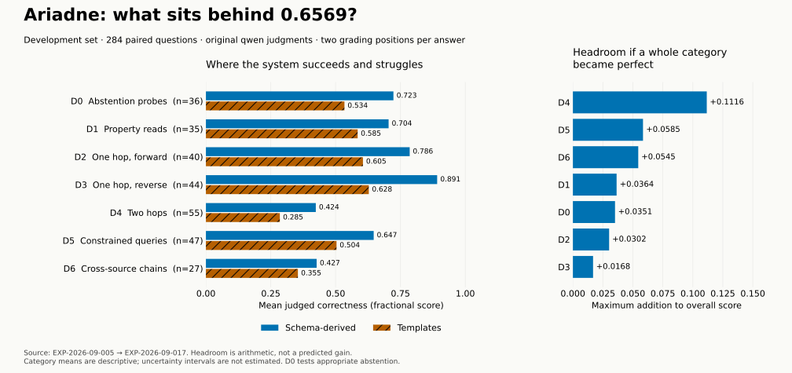

# Correctness improvement diagnostic

## Headline

The original development judgments reproduce **0.6569** for schema-derived queries and **0.4946** for templates. The largest category-level opportunity is **two-hop questions**, whose schema-derived judge mean is **0.4236**; this is a diagnosis of existing results, not evidence of an improvement.

The headline is a mean fractional rubric score, **not** “65.69% of questions answered correctly.” The historical holdout mean is **0.6546**, with a reported interval **[0.6218, 0.6875]** in [EXP-007](../EXP-2026-09-007-holdout-spend/RESULTS.md). That suggests the development headline was not an isolated favorable draw, while leaving substantial room to improve.

## Results table

The complete generated table is [tables/results.md](tables/results.md). It averages the original two qwen grading positions per case before averaging cases; later gemma grades are excluded. There are **284 paired cases**, with no missing original grading positions. No new system runs or new grading calls were made; no seed-level spread or category confidence intervals are estimated here.

## Figures



The left panel compares existing scores. The right shows how much each category could add to the overall mean **if every answer in it became perfect**. This is an upper bound on recoverable score in that category, not an attribution of errors to a pipeline stage. Generated by [make_figures.py](figures/make_figures.py).

[Open the interactive scenario explorer](explorer.html) or [download the PDF](figures/fig-correctness-opportunities.pdf).

## Interpretation: experiments worth trying

**First, repair the CAPEC schema-to-gate mismatch.** Q45 records relationships declared by the source but absent from its edge-pattern allowlist. The affected development slice contains **34 questions**. Its judge mean is **0.4287**, not zero: the zero previously reported for that slice describes retrieval. Filling validated endpoint patterns from the canonical snapshot is a concrete repair to try in `data/source_cards/` and its generator, with `utils/specialists/gremlin/validator.py` enforcing the repaired card. Validate that the edges are policy-permitted rather than treating existence in the graph as permission; preserve fail-closed behavior for unknown patterns. Compare repaired and original configurations in the same session on affected and unaffected questions.

The explorer makes the possible scale concrete. If the affected slice reached **0.75** judged correctness and every other score stayed fixed, the overall mean would become **0.6953**. Even perfect answers on that slice alone would yield **0.7253**. These are conditional arithmetic scenarios, not measured gains. Repairing a gate cannot guarantee that downstream planning or synthesis succeeds.

**Second, make the requested field or relationship explicit in the answer.** A saved development question asks which platforms HTML Smuggling applies to. The evidence includes the platform values, but the answer describes the technique, its parent and its tactic without stating the platforms. A second asks who contributed Data from Cloud Storage; the answer similarly omits the contributors carried in the evidence. These are selected failure examples, not an estimate of how prevalent that mechanism is. Their saved records are in `data/examples.json`.

The intervention is an answer contract: requested property or relation, matching values, citations, and completion status. Compile it from the interpreted question and retrieved records, then render it before optional narrative prose. In `utils/synthesis/composer.py`, make the requested property part of the verified claim instead of relying on a narrator to notice it. In `utils/synthesis/narrator.py`, test rendering those claims without dropping requested values. Existing claim-render rules already attempt this, so audit the path actually used before adding another prompt. A frozen-evidence comparison would isolate composition from retrieval: original answer versus requested-field rendering over identical evidence, with a blinded paired judge and deterministic checks that requested values survive.

**Third, represent multi-hop requests as a chain of typed operations.** Two-hop questions account for **+0.1116** possible overall score, the largest category contribution. Cross-source chains add **+0.0545** of category headroom. Keep intermediate entity identifiers, relation direction, source, filters and explicit join keys; check whether each hop produced the input required by the next. When a hop fails, expose the failed step to bounded replanning rather than returning the first anchor's dossier as the final answer. The rewrite experiment already identified that its single-relation form cannot represent a federated chain; that is evidence about the optional rewrite representation, not a claim that the shipped planner has no dependency support.

Execution-guided refinement is a research-backed direction: [Guo et al., EMNLP 2023](https://aclanthology.org/2023.emnlp-main.720/) feed executed intermediate reasoning steps back into a semantic parser. Applying that idea to Ariadne's typed cross-engine plans is a hypothesis, not an established transfer of their results. Measure it first on development two-hop and cross-source slices, keeping the current gates and enforcing a bounded execution budget.

**Fourth, improve ambiguous entity selection without accepting the first plausible match.** On the separate paraphrase bank, [EXP-014](../EXP-2026-09-014-hybrid-rewrite-stage/RESULTS.md) found that the rewrite stage recovered some answers while also increasing wrong-entity answers; [EXP-015](../EXP-2026-09-015-relation-slot-derivation/RESULTS.md) found that deriving the relation slot did not improve exact records. A better next hypothesis is joint candidate ranking using entity label, aliases, requested relationship and graph-neighborhood compatibility. Let the model select among explicit grounded candidates, and abstain or request clarification when incompatible candidates remain. Evaluate correct-answer gain and wrong-entity rate together. Do not translate gains on that paraphrase bank directly into gains on the expansion-bank judge score here.

**Make the measurement trustworthy alongside the product fixes.** Q44 concerns graph-inconsistent relation-slot gold; Q48 concerns illustrative identifiers in abstention text being flagged as hallucinations. Independently adjudicate the intended gold from the pinned source, version corrections, and score every compared arm under both old and corrected instruments. Distinguish unsupported/no-match outcomes from query failure and source unavailability. Removing misleading example identifiers improves the answer, but a judge-score change caused by a scoring correction is a measurement change, not a system capability gain. Neither artifact's effect on aggregate judged correctness has been established here.

## What surprised us

The records' D6 template advantage is a **retrieval** comparison. The underlying retrieval report gives generic **0.0717** versus templates **0.3548**. Re-aggregating the actual original judge sidecars for the same D6 cases gives generic **0.4269** versus templates **0.3546**. Both can be true because the instruments reward different things. Selecting templates for every cross-source question on the strength of the retrieval reversal alone is therefore not supported by the judged objective. The earlier completed record is preserved; this experiment explicitly disambiguates its figures.

The blocked CAPEC slice has the same lesson: an apparently catastrophic retrieval defect does not imply an equally large pool of zero judge scores available to recover.

## Threats to validity

This is retrospective development-set triage with one historical system execution per arm, not a causal experiment. Categories are question types, not mutually exclusive failure mechanisms. The CAPEC slice overlaps several categories, so its scenario gains must not be added to the category headroom. A single grader family, partial-credit and abstention behavior, imperfect gold, selected qualitative examples and session-dependent execution remain limitations. Matching the overall means checks extraction but does not validate the judge's reasoning. Full source hashes and a portable per-case score CSV preserve traceability.

## Follow-ups

Q49 in OPEN_QUESTIONS.md records this diagnostic. The immediate candidate experiments are the CAPEC card repair and a frozen-evidence answer-contract comparison. Run each independently against a same-session control, then test the combination to detect overlap or regressions. Keep unchanged cases as a control for grader drift, counterbalance grading order, report paired intervals and service failures, and verify shipped latency as well as generous-budget behavior. Select using development data; assess the chosen configuration on a freshly sealed evaluation set. The existing spent holdout can serve as a regression set, not renewed evidence of unseen generalization.

## Reproduction

From the repository root:

```bash
# Optional: reconstruct the CSV when the original ignored sidecars are available.
.venv/bin/python docs/research/experiments/EXP-2026-09-017-correctness-improvement-diagnostic/data/extract.py

# Uses committed CSV only; requires Matplotlib.
UV_CACHE_DIR=/tmp/ariadne-uv-cache uv run --with matplotlib==3.11.1 python docs/research/experiments/EXP-2026-09-017-correctness-improvement-diagnostic/figures/make_figures.py
make index
make validate-research
make check-docs
```

## AMENDMENT A-1 — portable CSV hashing (2026-09-11)

The CSV writer initially emitted CRLF, which Git normalized to LF when staging. The in-workspace hash therefore differed from the committed bytes. The extractor now explicitly writes LF; the data hash and pointer use those portable bytes. No case, score, metric, figure or interpretation changed.

## AMENDMENT A-2 — the same 284 cases, assigned to mechanisms (2026-09-11)

The body of this experiment groups the dev half by **question type** and prices
the headroom per type. A second diagnostic of the same 284 answers, written
independently on the same day, instead joined each case to the bank's anchor
label, predicate chain and filter, and to the answer's own retrieval outcome
and narrator status, then assigned every question to the first *defect
mechanism* that applies. It is recorded here, rather than as its own
experiment, because it regrades nothing: its per-case scores are the committed
`cases.csv` values, and it reproduces the published 0.6569 and 0.4946 exactly.

`data/mechanisms.py` performs the join and writes `data/mechanisms.csv` (one
row per case: mechanism, anchor label, predicate chain, filter, record count,
gold coverage, fallback reason, both arms' scores). It reads only `cases.csv`,
`bank-dev.json` and the saved EXP-2026-09-005 generic answers.

**The assignment is first match, in a fixed order, and the order is a claim.**
A case is attributed to the defect that would have to be repaired *first* for
the next one to become observable: an edge the gate forbids never reaches a
builder (`capec` before everything), a seed that binds to the wrong namespace
retrieves nothing to chain (`ns` before `chain`), a filter can only be
mis-applied to records that came back (`chain` before `filter`), and a narrator
time-out is the whole story only when no retrieval defect is present
(`narrator` last). A different order would move cases between rows; it would
not change the total, and the two largest rows are dominated by cases that
match one predicate only.

| Mechanism | n | generic mean | points lost | share of the 97.45 lost | Where |
|---|---:|---:|---:|---:|---|
| `capec` — five declared CAPEC edges not allowlisted | 34 | 0.4287 | 19.43 | 19.9% | `kg_builder/schema/capec.py`, `gremlin/validator.py` |
| `ns` — Category/View seed mapped to the attack-pattern namespace | 23 | 0.4674 | 12.25 | 12.6% | `gremlin/builder.py` `_gremlin_vertex_id` |
| `chain` — two-hop request collapsed to the shortest schema path | 56 | 0.4625 | 30.10 | 30.9% | `cypher/builder.py` `_generic_chain`, `gremlin/builder.py` |
| `filter` — declared property filter reaches neither query nor composer | 39 | 0.6699 | 12.88 | 13.2% | plan carries no filter; builders and composer ignore the text |
| `empty` — composer never states that the requested set is empty | 16 | 0.6406 | 5.75 | 5.9% | `synthesis/composer.py` |
| `narrator` — narrator fell back, no other defect | 49 | 0.6964 | 14.88 | 15.3% | `SYNTHESIS_LLM_TIMEOUT_S` default |
| `none` — no known defect and the narrator ran | 67 | **0.9675** | 2.18 | 2.2% | — |

The last row is the finding that gives the rest its force. When none of the six
mechanisms fires, the generic arm scores **0.9675** on 67 questions. The gap
between that and the 0.6569 headline is not a capability ceiling; it is six
located defects.

### Retrieval outcome

| Split | n | generic mean |
|---|---:|---:|
| zero records returned | 86 | 0.5038 |
| one or more records | 198 | 0.7234 |

All 34 `capec` cases and 21 of the 23 `ns` cases returned zero records. The two
`ns` exceptions are the D1 `View-Type` property questions, which read a
property off the seed and score 1.0000; they are assigned to `ns` because the
walk's namespace defect applies to their seed too, and excluding them would
raise the row's mean, not lower it.

### Narrator split

122 of the 284 answers carry a `fallback_reason` — see the Q47 correction
below, filed as `EXP-2026-09-016` `A-7`, for why that is 0.43 and not 0.04.

| Split | n | generic mean |
|---|---:|---:|
| narrator fell back | 122 | 0.6268 |
| narrator ran | 162 | 0.6795 |

The 0.0527 difference is small next to the mechanism spread, and within the
`none` bucket no answer fell back at all. A time-out therefore costs about five
points where retrieval succeeded, and the 49 cases where it is the *only*
defect average 0.6964 — real, but a fifth of the chain row.

### Relation to the body of this experiment

The two diagnostics agree on every number they share and disagree on nothing;
they differ in resolution. This amendment's `chain` row is the mechanism behind
the two-hop headroom priced in the Results table. The "answer contract"
proposed in the Interpretation section is the general form of the `filter` and
`empty` rows, and of the D1 property examples exhibited there: those answers'
evidence carried the requested value and their claims dropped it, because the
composer's attribute projection skips list-valued properties and their narrator
had timed out. The measurement protocol prescribed in the body — concurrent
paired control, unchanged answers as a grader-drift control, counterbalanced
grading, paired intervals, latency at the shipped budget, scoring corrections
reported apart from capability gains, and a freshly sealed set for the final
read — is unchanged by this amendment and governs the repair programme that
follows from it.

**Reproduce:** `.venv/bin/python docs/research/experiments/EXP-2026-09-017-correctness-improvement-diagnostic/data/mechanisms.py`
(asserts the 0.6569 / 0.4946 means and prints the table above).

**Follows on to:** `EXP-2026-09-018-correctness-repair`; open questions Q50–Q53.
